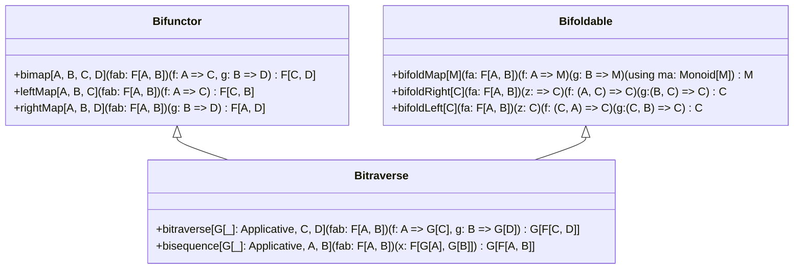

# Bitraverse

## Формальное определение

`Bitraverse` - тип, порождающий два несвязанных [`Traverse`](../monad/traverse.md).
Расширяет [`Bifoldable`](bifoldable.md) и [`Bifunctor`](bifunctor.md).

## Определение в виде кода на Scala

```dotty
trait Bitraverse[F[_, _]] extends Bifunctor[F] with Bifoldable[F]:
  extension [A, B](fab: F[A, B])
    def bitraverse[G[_]: Applicative, C, D](f: A => G[C], g: B => G[D]): G[F[C, D]]

    override def bimap[C, D](f: A => C, g: B => D): F[C, D] =
      bitraverse[Id, C, D](a => Id(f(a)), b => Id(g(b))).value

    override def bifoldMap[M](f: A => M)(g: B => M)(using ma: Monoid[M]): M =
      def toState[X](f: X => M): X => State[M, X] = x => State[M, X](s => (ma.combine(s, f(x)), x))
      val state = bitraverse[[X] =>> State[M, X], A, B](toState[A](f), toState[B](g))
      state.run(ma.empty)._1

  def bisequence[G[_]: Applicative, A, B](x: F[G[A], G[B]]): G[F[A, B]] = x.bitraverse(fa => fa, fb => fb)

  /** Extract the Traverse on the first param. */
  def leftTraverse[R]: Traverse[[X] =>> F[X, R]] =
    new Traverse[[X] =>> F[X, R]]:
      extension [A](fab: F[A, R])
        override def traverse[G[_]: Applicative, B](f: A => G[B]): G[F[B, R]] =
          fab.bitraverse(f, summon[Applicative[G]].unit)

  /** Extract the Traverse on the second param. */
  def rightTraverse[L]: Traverse[[X] =>> F[L, X]] =
    new Traverse[[X] =>> F[L, X]]:
      extension [A](fab: F[L, A])
        override def traverse[G[_]: Applicative, B](f: A => G[B]): G[F[L, B]] =
          fab.bitraverse(summon[Applicative[G]].unit, f)

  /** Unify the traverse over both params. */
  def uTraverse: Traverse[[X] =>> F[X, X]] =
    new Traverse[[X] =>> F[X, X]]:
      extension [A](fab: F[A, A])
        override def traverse[G[_]: Applicative, B](f: A => G[B]): G[F[B, B]] =
          fab.bitraverse(f, f)
```

### Either

```dotty
given Bitraverse[Either] with
  extension [A, B](fab: Either[A, B])
    override def bitraverse[G[_]: Applicative, C, D](f: A => G[C], g: B => G[D]): G[Either[C, D]] =
      fab match
        case Right(value) => g(value).map(d => Right(d))
        case Left(value)  => f(value).map(c => Left(c))
```

## Схема



---

**Ссылки:**

- [Scalaz API](https://javadoc.io/doc/org.scalaz/scalaz-core_3/7.3.6/scalaz/Bitraverse.html)
