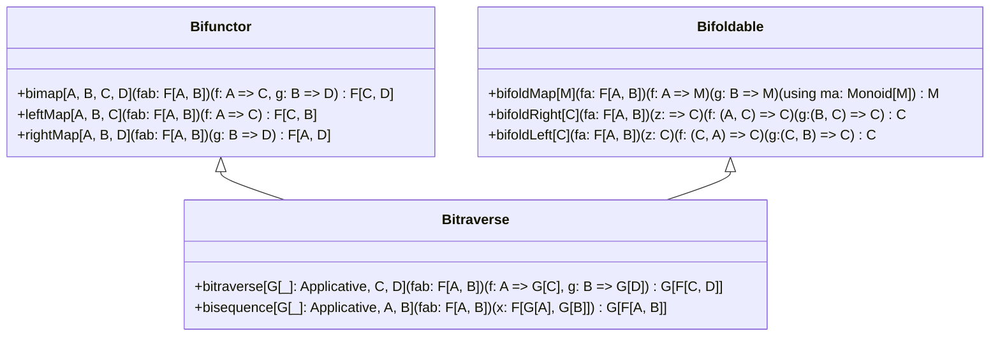



# Bitraverse

**Bitraverse** — это класс типов, который обобщает концепцию [**Traverse**](../monad/traverse.md) для типов, имеющих два параметра. 
Он позволяет одновременно "обходить" (traverse) оба типа в контейнере, 
применяя к ним эффекты (например, вычисления в контексте `Option`, `Future`, `IO` и т.д.). 
В то время как `Traverse` работает с типами, имеющими один параметр (например, `List[A]`), 
`Bitraverse` расширяет эту идею на типы с двумя параметрами (например, `Either[A, B]` или `Tuple2[A, B]`).

Основная операция `Bitraverse` — `bitraverse`, которая позволяет применять эффекты к обоим типам в контейнере и объединять результаты.
`Bitraverse` расширяет [`Bifoldable`](bifoldable.md) и [`Bifunctor`](bifunctor.md).

**Где применяется Bitraverse?**

- **Типы с двумя параметрами**:
    - `Either[A, B]`: Применение эффектов к левому типу (ошибке) и правому типу (успешному значению).
    - `Tuple2[A, B]`: Применение эффектов к обоим элементам кортежа.
    - Пользовательские типы, например, `Result[Error, Value]`.
- **Обработка ошибок**:
    - Применение эффектов к ошибкам и успешным значениям в `Either`.
- **Парсинг и валидация**:
    - Применение эффектов к ошибкам и результатам в процессах парсинга или валидации.
- **Функциональные библиотеки**:
    - Используется в библиотеках Cats и Scalaz для работы с типами, имеющими два параметра.
- **Композиция эффектов**:
    - Применение эффектов к обоим типам в контейнере и объединение результатов.

**Краткие примеры**

- **`Either[A, B]`**:
    - Применение эффекта `Option` к левой части (ошибке) и правой части (успешному значению).
    - Применение асинхронного эффекта `Future` к обеим частям.
- **`Tuple2[A, B]`**:
    - Применение эффекта `IO` к обоим элементам кортежа.
    - Применение эффекта `Option` к обоим элементам и объединение результатов.
- **Пользовательский тип**:
    - Для типа `Result[Error, Value]` можно применить эффекты к ошибкам и значениям, 
      например, преобразовать ошибки в лог-сообщения, а значения — в результаты вычислений.
- **Парсинг JSON**:
    - Применение эффектов к ошибкам парсинга и успешно распарсенным значениям.

## Формальное определение

Класс типов `Bitraverse` представляет собой структуру, которая:

- Работает с типами, имеющими два параметра, например `F[_, _]`.
- Предоставляет операцию `bitraverse`, которая:
    - Принимает эффект (аппликативный функтор) `G[_]`.
    - Применяет две функции: одну к первому типу (`A => G[C]`), другую ко второму типу (`B => G[D]`).
    - Возвращает результат в контексте эффекта: `G[F[C, D]]`.

#### Законы Bitraverse:

`Bitraverse` должен удовлетворять следующим законам (аналогично законам `Traverse`):

- **Закон идентичности**:
    - Применение `bitraverse` с функциями `pure` (из аппликативного функтора) должно возвращать исходный контейнер, обернутый в эффект.
     ```dotty
     bitraverse(fab)(a => Applicative[G].pure(a), b => Applicative[G].pure(b)) == Applicative[G].pure(fab)
     ```
- **Закон композиции**:
    - Последовательное применение `bitraverse` с двумя эффектами должно быть эквивалентно одному применению с композицией эффектов.
    ```dotty
    bitraverse(bitraverse(fab)(f1, g1))(f2, g2) == bitraverse(fab)(a => f2(f1(a)), b => g2(g1(b)))
    ```

## Определение в виде кода на Scala

```dotty
trait Bitraverse[F[_, _]] extends Bifunctor[F] with Bifoldable[F]:
  extension [A, B](fab: F[A, B])
    def bitraverse[G[_]: Applicative, C, D](f: A => G[C], g: B => G[D]): G[F[C, D]]

    override def bimap[C, D](f: A => C, g: B => D): F[C, D] =
      bitraverse[Id, C, D](a => Id(f(a)), b => Id(g(b))).value

    override def bifoldMap[M](f: A => M)(g: B => M)(using ma: Monoid[M]): M =
      def toState[X](f: X => M): X => State[M, X] = x => State[M, X](s => (ma.combine(s, f(x)), x))
      val state = bitraverse[[X] =>> State[M, X], A, B](toState[A](f), toState[B](g))
      state.run(ma.empty)._1

  def bisequence[G[_]: Applicative, A, B](x: F[G[A], G[B]]): G[F[A, B]] = x.bitraverse(fa => fa, fb => fb)
```

### Either

```dotty
given Bitraverse[Either] with
  extension [A, B](fab: Either[A, B])
    override def bitraverse[G[_]: Applicative, C, D](f: A => G[C], g: B => G[D]): G[Either[C, D]] =
      fab match
        case Right(value) => g(value).map(d => Right(d))
        case Left(value)  => f(value).map(c => Left(c))
```

### Связь с другими классами типов

**Bitraverse** — это класс типов, который обобщает концепцию **Traverse** для типов, имеющих два параметра. 
Он позволяет одновременно "обходить" (traverse) оба типа в контейнере, 
применяя к ним эффекты (например, вычисления в контексте `Option`, `Future`, `IO` и т.д.). 
В то время как `Traverse` работает с типами, имеющими один параметр (например, `List[A]`), 
`Bitraverse` расширяет эту идею на типы с двумя параметрами (например, `Either[A, B]` или `Tuple2[A, B]`).

#### **`leftTraverse`**

```dotty
def leftTraverse[R]: Traverse[[X] =>> F[X, R]] =
  new Traverse[[X] =>> F[X, R]]:
    extension [A](fab: F[A, R])
      override def traverse[G[_]: Applicative, B](f: A => G[B]): G[F[B, R]] =
        fab.bitraverse(f, summon[Applicative[G]].unit)
```

- **Цель**: Создать `Traverse` для первого параметра типа `F[A, R]`, где второй параметр (`R`) фиксирован.
- **Как это работает**:
    - `leftTraverse` возвращает `Traverse` для типа `[X] =>> F[X, R]`, где `R` фиксирован.
    - Метод `traverse` применяет функцию `f: A => G[B]` только к первому параметру (`A`), используя метод `bitraverse` из `Bitraverse`.
    - Второй параметр (`R`) остается неизменным, и для него используется нейтральный элемент аппликативного функтора (`unit`).
- **Пример**: Если `F` — это `Either[A, R]`, то `leftTraverse` позволяет применить эффект только к левой части (`A`), оставляя правую часть (`R`) неизменной.

#### **`rightTraverse`**

```dotty
def rightTraverse[L]: Traverse[[X] =>> F[L, X]] =
  new Traverse[[X] =>> F[L, X]]:
    extension [A](fab: F[L, A])
      override def traverse[G[_]: Applicative, B](f: A => G[B]): G[F[L, B]] =
        fab.bitraverse(summon[Applicative[G]].unit, f)
```

- **Цель**: Создать `Traverse` для второго параметра типа `F[L, A]`, где первый параметр (`L`) фиксирован.
- **Как это работает**:
    - `rightTraverse` возвращает `Traverse` для типа `[X] =>> F[L, X]`, где `L` фиксирован.
    - Метод `traverse` применяет функцию `f: A => G[B]` только ко второму параметру (`A`), используя метод `bitraverse` из `Bitraverse`.
    - Первый параметр (`L`) остается неизменным, и для него используется нейтральный элемент аппликативного функтора (`unit`).
- **Пример**: Если `F` — это `Either[L, A]`, то `rightTraverse` позволяет применить эффект только к правой части (`A`), оставляя левую часть (`L`) неизменной.

#### **`uTraverse`**

```dotty
def uTraverse: Traverse[[X] =>> F[X, X]] =
  new Traverse[[X] =>> F[X, X]]:
    extension [A](fab: F[A, A])
      override def traverse[G[_]: Applicative, B](f: A => G[B]): G[F[B, B]] =
        fab.bitraverse(f, f)
```

- **Цель**: Создать унифицированный `Traverse` для типа `F[X, X]`, где оба параметра имеют одинаковый тип.
- **Как это работает**:
    - `uTraverse` возвращает `Traverse` для типа `[X] =>> F[X, X]`.
    - Метод `traverse` применяет функцию `f: A => G[B]` к обоим параметрам одновременно, используя метод `bitraverse` из `Bitraverse`.
- **Пример**: Если `F` — это `Tuple2[A, A]`, то `uTraverse` позволяет применить эффект к обоим элементам кортежа одновременно.

## Схема



---

**Ссылки:**

- [Scalaz API](https://javadoc.io/doc/org.scalaz/scalaz-core_3/7.3.6/scalaz/Bitraverse.html)
