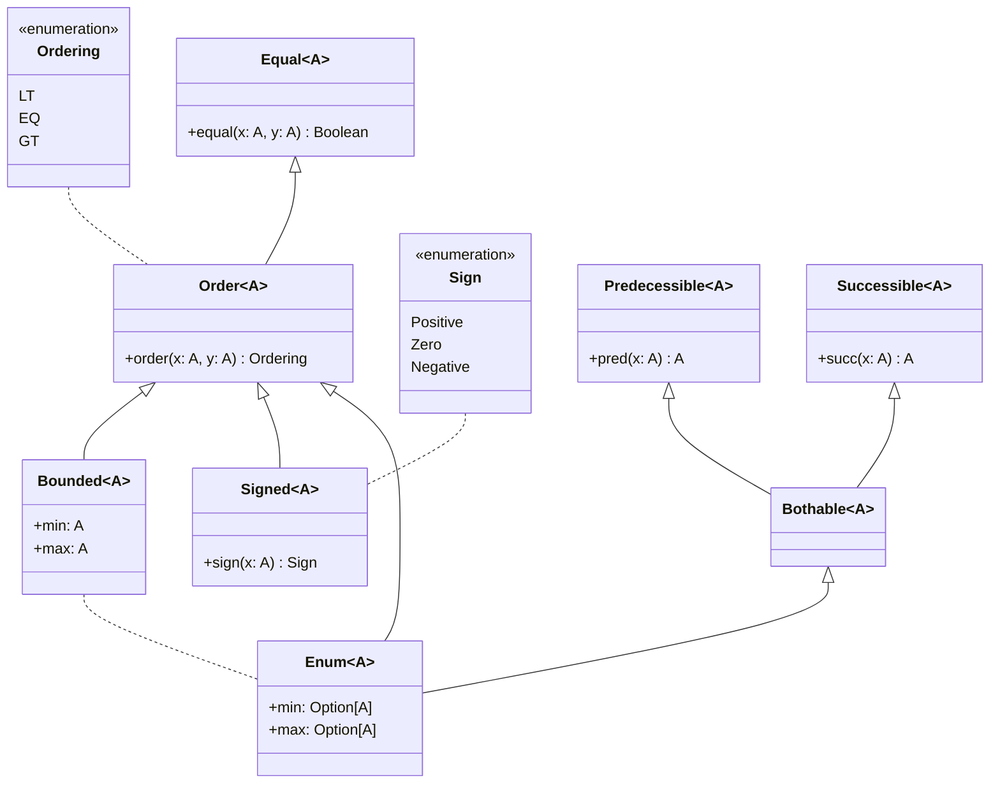

# Группа Equal

Данная группа используется для описания типов, экземпляры которых можно сравнивать между собой.

## Схема

---

**Ссылки:**

- [Learning Scalaz](http://eed3si9n.com/learning-scalaz/Equal.html)
- [Scalaz](https://scalaz.github.io/7/typeclass/Equal.html)
