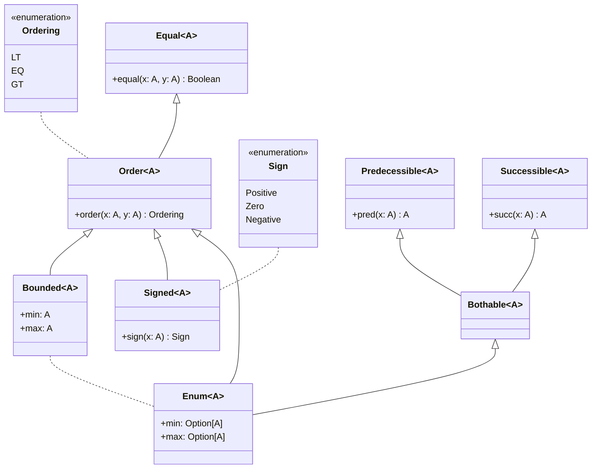



# Группа Equal

## Введение

В функциональном программировании типовые классы играют важную роль в обеспечении абстракций для работы с различными типами данных. 
Одной из таких абстракций является **группа типовых классов "Equal"**, 
используемая для описания типов, экземпляры которых можно сравнивать между собой. 
В Scala эта группа включает типовые классы, такие как `Equal`, `Order`, и другие, 
которые предоставляют механизмы для проверки равенства и упорядочивания значений.

Типовые классы из группы "Equal" позволяют:

- Проверять равенство двух значений (`Equal`).
- Определять порядок значений (`Order`).
- Сравнивать значения на больше/меньше (`Order`).
- Определять минимальное и максимальное значение (`Bounded`).
- Определять предыдущее и следующее по порядку значение (`Bothable`).

Эти типовые классы особенно полезны в функциональных библиотеках, таких как **Cats** и **Scalaz**, 
где они используются для создания универсальных и выразительных абстракций. 
В этом разделе мы рассмотрим, как определяются и используются типовые классы группы "Equal" в Scala, 
а также изучим примеры их применения для различных типов данных.

## Использование

Группа `Equal` в Scala используется в различных контекстах, где необходимо сравнение объектов. 
Вот несколько основных областей применения:

### **Сравнение объектов**

Группа `Equal` предоставляет методы для проверки равенства между экземплярами. 
Это особенно полезно в ситуациях, когда необходимо определить, являются ли два объекта эквивалентными, 
например, при реализации методов `equals` и `hashCode`.

### **Коллекции**

При работе с коллекциями, такими как списки, множества и карты, важно уметь сравнивать элементы. Например, при добавлении элементов в множество или при проверке наличия элемента в коллекции используется метод `equals`. Группа `Equal` позволяет обеспечить корректное сравнение элементов в коллекциях.

### **Фильтрация и поиск**

При выполнении операций фильтрации и поиска в коллекциях, таких как `filter`, `find` и `exists`, 
необходимо сравнивать элементы с заданными условиями. 
Использование `Equal` позволяет легко реализовать такие операции, обеспечивая единый интерфейс для сравнения.

### **Сортировка**

При сортировке коллекций, например, с использованием метода `sortBy`, важно иметь возможность сравнивать элементы. 
Группа `Equal` может быть использована в сочетании с другими типами классов, 
такими как `Ordering`, для определения порядка элементов.

### **Тестирование**

В тестировании важно проверять, что объекты ведут себя ожидаемым образом. 
Использование `Equal` позволяет легко сравнивать ожидаемые и фактические результаты, 
что упрощает написание тестов и повышает их надежность.

### **Обобщенные алгоритмы**

Группа `Equal` позволяет создавать обобщенные алгоритмы, которые могут работать с различными типами данных. 
Это особенно полезно в функциональном программировании, 
где часто требуется обрабатывать данные абстрактно, не привязываясь к конкретным типам.

### **Библиотеки и фреймворки**

Многие библиотеки и фреймворки Scala, такие как Cats и Scalaz, 
используют группу `Equal` для реализации функциональных концепций, таких как монады и аппликативные функторы. 
Это позволяет разработчикам использовать мощные абстракции, сохраняя при этом возможность сравнения объектов.

## Схема

---

**Ссылки:**

- [Learning Scalaz](http://eed3si9n.com/learning-scalaz/Equal.html)
