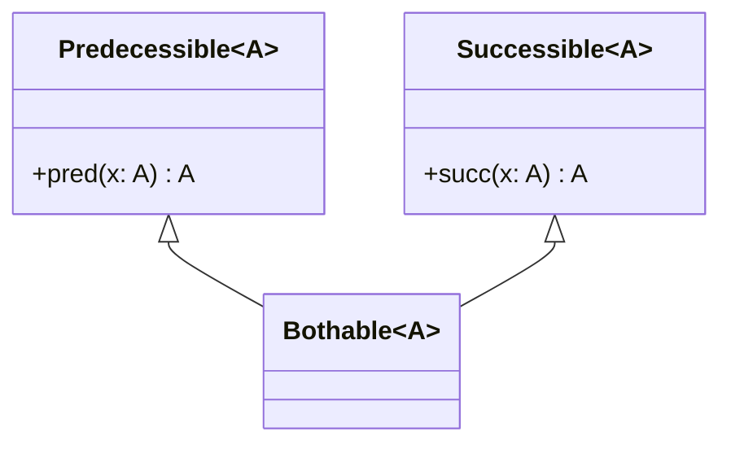

# Predecessible и Successible

## `Predecessible`

**`Predecessible`** — это класс типов, который абстрагирует типы, 
поддерживающие операцию получения **предшествующего элемента** (предшественника). 
Это полезно для типов, которые имеют линейный порядок или последовательность, 
где каждый элемент (кроме первого) имеет определённый предшествующий элемент.

### Формальное определение:

Класс типов `Predecessible` для типа `A` определяет операцию `prev`, 
которая возвращает предшествующий элемент для заданного значения. 
Если элемент не имеет предшественника (например, минимальный элемент в последовательности), 
операция возвращает `None`.

- **`prev`** — функция, которая принимает значение типа `A` и возвращает его предшественника типа `Option[A]`.

### Где применяется?

- **Работа с последовательностями**:
  Для типов, которые представляют последовательности (например, числа, символы, перечисления), 
  `Predecessible` позволяет легко перемещаться по элементам в обратном порядке.
- **Алгоритмы на графах и деревьях**:
  В алгоритмах, где требуется обход в обратном порядке (например, поиск предыдущего узла в дереве или графе).
- **Генерация диапазонов**:
  При работе с диапазонами значений (например, числа, даты) 
  `Predecessible` может использоваться для генерации последовательностей в обратном порядке.
- **Пользовательские типы данных**:
  Для пользовательских типов данных, которые имеют понятие предшественника 
  (например, дни недели, месяцы, элементы перечисления).

## `Successible`

**`Successible`** — это класс типов, который абстрагирует типы, 
поддерживающие операцию получения **следующего элемента** (последователя). 
Это полезно для типов, которые имеют линейный порядок или последовательность, 
где каждый элемент (кроме последнего) имеет определённый следующий элемент.

### Формальное определение:

Класс типов `Successible` для типа `A` определяет операцию `next`, 
которая возвращает следующий элемент для заданного значения. 
Если элемент не имеет последователя (например, максимальный элемент в последовательности), 
операция возвращает `None`.

- **`next`** — функция, которая принимает значение типа `A` и возвращает его последователя типа `Option[A]`.

### Где применяется?

Аналогично классу типов `Predecessible`.

## `Bothable`

`Bothable` - класс типов, расширяющий `Predecessible` и `Successible`, 
где у каждого элемента есть и предыдущий, и следующий элемент.

## Определение в виде кода на Scala

```dotty
trait Predecessible[A]:
  def prev(a: A): Option[A]

trait Successible[A]:
  def next(a: A): Option[A]

trait Bothable[A] extends Predecessible[A], Successible[A]
```

### Числа

```dotty
given Bothable[Int] with
  override def prev(a: Int): Option[Int] =
    if a == Int.MinValue then None
    else Some(a - 1)

  override def next(a: Int): Option[Int] =
    if a == Int.MaxValue then None
    else Some(a + 1)
```

## Схема



---

**Ссылки:**

- [Ссылка на репозиторий с упражнениями][sample]
- [Algebird, Predecessible](https://twitter.github.io/algebird/typeclasses/predecessible.html)
- [Algebird, Successible](https://twitter.github.io/algebird/typeclasses/successible.html)

[sample]: https://gitverse.ru/scalabook/typeclasses
