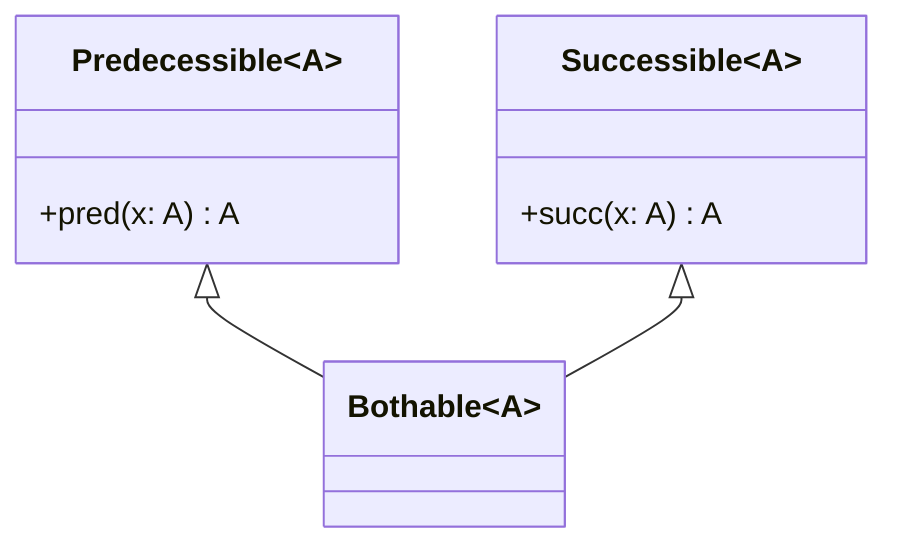



# Predecessible и Successible

## `Predecessible`

**`Predecessible`** — это класс типов (type class), который абстрагирует типы, 
поддерживающие операцию получения **предшествующего элемента** (предшественника). 
Это полезно для типов, которые имеют линейный порядок или последовательность, 
где каждый элемент (кроме первого) имеет определённый предшествующий элемент.

### Формальное определение:

Класс типов `Predecessible` для типа `A` определяет операцию `prev`, 
которая возвращает предшествующий элемент для заданного значения. 
Если элемент не имеет предшественника (например, минимальный элемент в последовательности), 
операция может возвращать `None` или выбрасывать исключение.

- **`prev`** — функция, которая принимает значение типа `A` 
  и возвращает его предшественника типа `Option[A]` (или `A`, если предшественник всегда существует).

### Где применяется?

- **Работа с последовательностями**:
  Для типов, которые представляют последовательности (например, числа, символы, перечисления), 
  `Predecessible` позволяет легко перемещаться по элементам в обратном порядке.
- **Алгоритмы на графах и деревьях**:
  В алгоритмах, где требуется обход в обратном порядке (например, поиск предыдущего узла в дереве или графе).
- **Генерация диапазонов**:
  При работе с диапазонами значений (например, числа, даты) 
  `Predecessible` может использоваться для генерации последовательностей в обратном порядке.
- **Пользовательские типы данных**:
  Для пользовательских типов данных, которые имеют понятие предшественника 
  (например, дни недели, месяцы, элементы перечисления).

### Примеры:

- **Числа**:
  Для типа `Int` предшественником числа `5` будет `4`. 
  Для минимального значения (например, `Int.MinValue`) операция `predecessor` может вернуть `None`.
- **Символы**:
  Для типа `Char` предшественником символа `'b'` будет `'a'`. 
  Для символа `'a'` (если это минимальное значение) операция `predecessor` может вернуть `None`.
- **Перечисления (Enums)**:
  Для перечисления, представляющего дни недели, предшественником `Tuesday` будет `Monday`. 
  Для первого элемента (например, `Monday`) операция `predecessor` может вернуть `None`.
- **Даты**:
  Для типа `LocalDate` предшественником даты `2023-10-02` будет `2023-10-01`. 
  Для минимальной даты операция `predecessor` может вернуть `None`.
- **Пользовательские типы**:
  Если у вас есть тип, представляющий уровни доступа (например, `Guest`, `User`, `Admin`), 
  то предшественником `Admin` может быть `User`, а для `Guest` операция `predecessor` может вернуть `None`.

## `Successible`

**`Successible`** — это класс типов (type class), который абстрагирует типы, 
поддерживающие операцию получения **следующего элемента** (последователя). 
Это полезно для типов, которые имеют линейный порядок или последовательность, 
где каждый элемент (кроме последнего) имеет определённый следующий элемент.

### Формальное определение:

Класс типов `Successible` для типа `A` определяет операцию `next`, 
которая возвращает следующий элемент для заданного значения. 
Если элемент не имеет последователя (например, максимальный элемент в последовательности), 
операция может возвращать `None` или выбрасывать исключение.

- **`next`** — функция, которая принимает значение типа `A` 
  и возвращает его последователя типа `Option[A]` (или `A`, если последователь всегда существует).

### Где применяется?

- **Работа с последовательностями**:
  Для типов, которые представляют последовательности (например, числа, символы, перечисления), 
  `Successible` позволяет легко перемещаться по элементам в прямом порядке.
- **Алгоритмы на графах и деревьях**:
  В алгоритмах, где требуется обход в прямом порядке (например, поиск следующего узла в дереве или графе).
- **Генерация диапазонов**:
  При работе с диапазонами значений (например, числа, даты) 
  `Successible` может использоваться для генерации последовательностей в прямом порядке.
- **Пользовательские типы данных**:
  Для пользовательских типов данных, которые имеют понятие последователя 
  (например, дни недели, месяцы, элементы перечисления).

### Примеры:

- **Числа**:
  Для типа `Int` последователем числа `5` будет `6`. Для максимального значения 
  (например, `Int.MaxValue`) операция `successor` может вернуть `None`.
- **Символы**:
  Для типа `Char` последователем символа `'a'` будет `'b'`. 
  Для символа `'z'` (если это максимальное значение) операция `successor` может вернуть `None`.
- **Перечисления (Enums)**:
  Для перечисления, представляющего дни недели, последователем `Monday` будет `Tuesday`. 
  Для последнего элемента (например, `Sunday`) операция `successor` может вернуть `None`.
- **Даты**:
  Для типа `LocalDate` последователем даты `2023-10-01` будет `2023-10-02`. 
  Для максимальной даты операция `successor` может вернуть `None`.
- **Пользовательские типы**:
  Если у вас есть тип, представляющий уровни доступа (например, `Guest`, `User`, `Admin`), 
  то последователем `User` может быть `Admin`, а для `Admin` операция `successor` может вернуть `None`.

## `Bothable`

`Predecessible` — класс типов для представления множеств, которые можно считать в обратном порядке,
т.е. у каждого элемента есть _предыдущий_ элемент, меньший его. 

`Successible` — класс типов для представления множеств, которые увеличиваются,
т.е. у каждого элемента есть _следующий_ элемент, больший его.

`Bothable` - класс типов, расширяющий `Predecessible` и `Successible`, 
где у каждого элемента есть и предыдущий, и следующий элемент.

## Определение в виде кода на Scala

```dotty
trait Predecessible[A]:
  def prev(a: A): Option[A]

trait Successible[A]:
  def next(a: A): Option[A]

trait Bothable[A] extends Predecessible[A], Successible[A]
```

### Числа

```dotty
given Bothable[Int] with
  override def prev(a: Int): Option[Int] = Some(a - 1)
  override def next(a: Int): Option[Int] = Some(a + 1)
```

## Схема



---

**Ссылки:**

- [Algebird, Predecessible](https://twitter.github.io/algebird/typeclasses/predecessible.html)
- [Algebird, Successible](https://twitter.github.io/algebird/typeclasses/successible.html)
