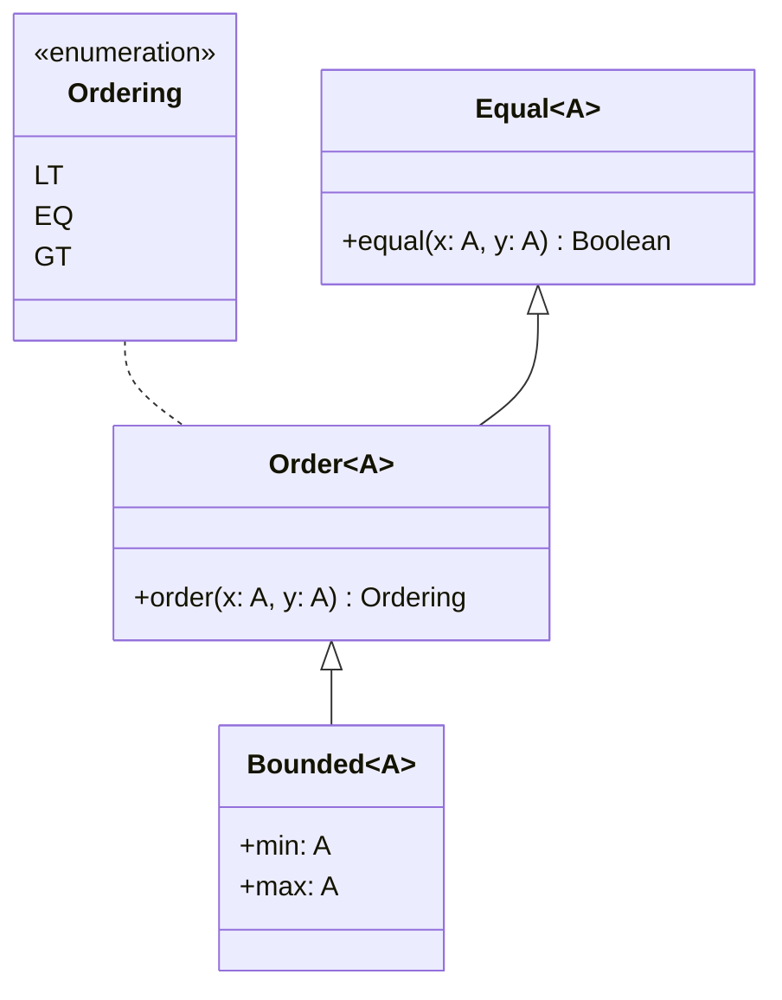



# Bounded 

`Bounded` — это класс типов, который определяет минимальное и максимальное значение для определённого типа. 
Он предоставляет методы для получения этих границ, что позволяет работать с типами, которые имеют ограниченный диапазон значений.

`Bounded` применяется в различных сценариях, где важно знать границы значений типа. Вот несколько примеров:

- **Работа с числами**: `Bounded` может использоваться для определения минимального и максимального значения 
  числовых типов, таких как `Int`, `Long` и других.
- **Символы**: Для типа `Char` можно определить минимальное и максимальное значение, 
  например, минимальный и максимальный символ в таблице Unicode.
- **Пользовательские типы**: Если у вас есть собственный тип данных, 
  вы можете реализовать для него экземпляр `Bounded`, чтобы определить его границы.
- **Алгоритмы**: В алгоритмах, которые работают с ограниченными диапазонами значений, 
  `Bounded` может использоваться для проверки границ.

## Формальное определение

`Bounded` — это класс типов, расширяющий тип [`Order`](order.md) 
и определяющий минимальное и максимальное значение для определённого типа.
`Bounded` предоставляет методы для получения этих границ (`min` и `max`), 
что позволяет работать с типами, имеющими ограниченный диапазон значений. 

### Законы

Для корректной реализации `Bounded` должны выполняться следующие законы:

- **Минимальное значение**: Для любого значения `x` типа `A`, `x` должно быть больше или равно `min` (`x >= min`).
- **Максимальное значение**: Для любого значения `x` типа `A`, `x` должно быть меньше или равно `max` (`x <= max`).

## Определение в виде кода на Scala

```dotty
trait Equal[F]:
  def equal(a1: F, a2: F): Boolean

enum Ordering:
  case LT
  case EQ
  case GT

trait Order[F] extends Equal[F]:
  def order(x: F, y: F): Ordering

trait Bounded[F] extends Order[F]:
  def min: F
  def max: F
```

1. **Типовой параметр `F`**: `Bounded` параметризуется типом `F`, для которого определяются границы.
2. **Метод `min`**: Возвращает минимальное значение типа `F`.
3. **Метод `max`**: Возвращает максимальное значение типа `F`.

## Схема



---

**Ссылки:**

- [Ссылка на репозиторий с упражнениями][sample]
- [Learning Scalaz](http://eed3si9n.com/learning-scalaz/Bounded.html)

[sample]: https://gitverse.ru/scalabook/typeclasses
