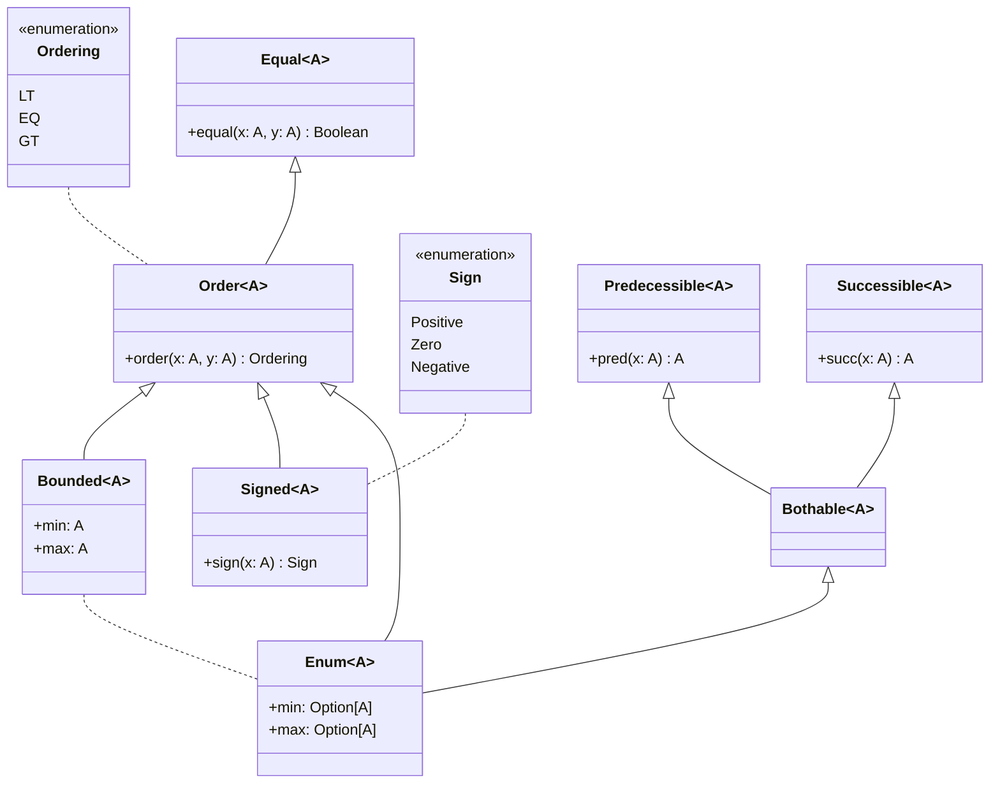



# Enum

**Класс типов `Enum`**, расширяющий [`Order`](order.md) и [`Bothable`](bothable.md), — это абстракция, 
которая представляет типы с конечным набором значений, имеющих определённый порядок. 
Он сочетает в себе свойства перечислений (как в `Enum` из других языков) 
и возможность сравнения значений (благодаря расширению `Order`). 
Это позволяет работать с такими типами как с упорядоченными множествами, 
где каждое значение имеет чётко определённое положение относительно других.

**Где применяется?**

- **Работа с перечислениями**:
    - Для типов, которые представляют фиксированный набор значений (например, дни недели, месяцы, статусы заказов).
- **Сравнение и сортировка**:
    - Благодаря расширению `Order`, значения типа `Enum` можно сравнивать и сортировать.
- **Генерация последовательностей**:
    - `Enum` позволяет легко генерировать последовательности значений (например, все дни недели или все месяцы года).
- **Преобразование между значениями и их порядковыми номерами**:
    - Полезно при сериализации/десериализации, когда значения нужно сохранять в виде чисел.

## Формальное определение

Члены типа `Enum`, расширяющего тип [`Order`](order.md) и [`Bothable`](bothable.md), 
представляют собой последовательно упорядоченные типы — их можно перечислить.

Основное преимущество класса типов `Enum` заключается в том, что мы можем использовать его типы в диапазонах списков. 
У них также есть определенные преемники (_successors_) и предшественники (_predecessors_), 
которые вы можете получить с помощью функций `succ` и `pred`.
И возможно существование минимального и максимального элементов.

`Enum` должен удовлетворять следующим законам (помимо законов `Order` и `Equal`):

- следующий предыдущего элемента `x` является `x`: `succ(pred(x)) == x`
- предыдущий следующего элемента `x` является `x`: `pred(succ(x)) == x`
- для любого x, не равного `max`, его следующий элемент больше или равен `x`: `x == max || succ(x) >= x`
- для любого x, не равного `min`, его предыдущий элемент меньше или равен `x`: `x == min || pred(x) <= x`

## Определение в виде кода на Scala

```dotty
trait Equal[A]:
  def equal(a1: A, a2: A): Boolean

enum Ordering:
  case LT
  case EQ
  case GT

trait Order[A] extends Equal[A]:
  def order(x: A, y: A): Ordering

trait Predecessible[A]:
  def pred(a: A): Option[A]

trait Successible[A]:
  def succ(a: A): Option[A]

trait Bothable[A] extends Predecessible[A], Successible[A]

trait Enum[A] extends Order[A], Bothable[A]:
  def min: Option[A]
  def max: Option[A]
```

### День недели

Пример реализации класса типов `Enum` для дня недели:

```dotty
object Enum:
  enum DayOfWeek(val i: Int):
    case Monday    extends DayOfWeek(1)
    case Tuesday   extends DayOfWeek(2)
    case Wednesday extends DayOfWeek(3)
    case Thursday  extends DayOfWeek(4)
    case Friday    extends DayOfWeek(5)
    case Saturday  extends DayOfWeek(6)
    case Sunday    extends DayOfWeek(7)

  given Enum[DayOfWeek] with
    override def min: Option[DayOfWeek] =
      Some(DayOfWeek.Monday)

    override def max: Option[DayOfWeek] =
      Some(DayOfWeek.Sunday)

    override def order(x: DayOfWeek, y: DayOfWeek): Ordering =
      if x.i < y.i then Ordering.LT
      else if x.i == y.i then Ordering.EQ
      else Ordering.GT

    override def prev(a: DayOfWeek): Option[DayOfWeek] =
      a match
        case DayOfWeek.Monday    => None
        case DayOfWeek.Tuesday   => Some(DayOfWeek.Monday)
        case DayOfWeek.Wednesday => Some(DayOfWeek.Tuesday)
        case DayOfWeek.Thursday  => Some(DayOfWeek.Wednesday)
        case DayOfWeek.Friday    => Some(DayOfWeek.Thursday)
        case DayOfWeek.Saturday  => Some(DayOfWeek.Friday)
        case DayOfWeek.Sunday    => Some(DayOfWeek.Saturday)

    override def next(a: DayOfWeek): Option[DayOfWeek] =
      a match
        case DayOfWeek.Monday    => Some(DayOfWeek.Tuesday)
        case DayOfWeek.Tuesday   => Some(DayOfWeek.Wednesday)
        case DayOfWeek.Wednesday => Some(DayOfWeek.Thursday)
        case DayOfWeek.Thursday  => Some(DayOfWeek.Friday)
        case DayOfWeek.Friday    => Some(DayOfWeek.Saturday)
        case DayOfWeek.Saturday  => Some(DayOfWeek.Sunday)
        case DayOfWeek.Sunday    => None

  end given
end Enum
```

## Схема



## Реализация в библиотеках

### Реализация в ScalaZ

```dotty
import scalaz.*
import Scalaz.*
1 |-> 2        // [1,2]
1 |--> (2, 5)  // [1,3,5]
1.pred         // 0
1.predx        // Some(0)
1.succ         // 2
1.succx        // Some(2)
Enum[Int].min  // Some(-2147483648)
Enum[Int].max  // Some(2147483647)
```

---

**Ссылки:**

- [Ссылка на репозиторий с упражнениями][sample]
- [Learning Scalaz](http://eed3si9n.com/learning-scalaz/Enum.html)
- [Scalaz API](https://javadoc.io/doc/org.scalaz/scalaz-core_3/7.3.6/scalaz/Enum.html)

[sample]: https://gitverse.ru/scalabook/typeclasses
