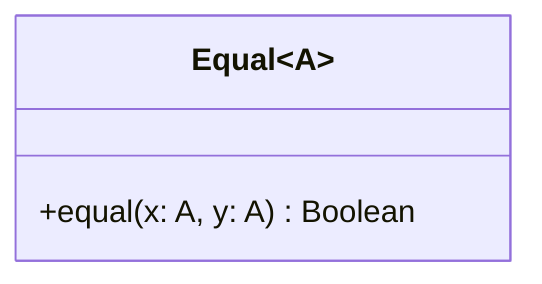



# Equal

`Equal` — это класс типов, который определяет метод для проверки равенства двух объектов. 
В отличие от стандартного метода `==` в Scala, 
`Equal` предоставляет более типобезопасный и функциональный подход к сравнению, 
избегая проблем, связанных с `null` и несовместимыми типами.

**Где применяется?**

`Equal` применяется в функциональном программировании, где важно иметь строгую типизацию и избегать побочных эффектов. 
Он используется в библиотеках, таких как Cats, для работы с типами, которые требуют сравнения, 
например, при реализации алгоритмов, тестировании или работе с коллекциями.

**Примеры использования:**

- **Сравнение пользовательских типов**: Если у вас есть собственный тип данных, 
  вы можете реализовать для него экземпляр `Equal`, чтобы сравнивать объекты этого типа.
- **Тестирование**: В тестах `Equal` может использоваться для проверки, что результат функции соответствует ожидаемому значению.

**Основные преимущества:**

- **Типобезопасность**: `Equal` не позволяет сравнивать объекты разных типов.
- **Функциональный подход**: `Equal` интегрируется с другими функциональными абстракциями, 
  такими как [`Functor`](../monad/functor.md) или [`Monad`](../monad/monad.md).
- **Гибкость**: Вы можете определять собственные правила сравнения для различных типов.

## Формальное определение

`Equal` — это класс типов, который определяет метод `equal(a1: F, a2: F): Boolean`, 
возвращающий `true`, если два значения равны или `false` - в противном случае.

### Законы (laws) для `Equal`:

Для корректной реализации `Equal` должны выполняться [следующие законы](https://ru.wikipedia.org/wiki/%D0%A2%D0%BE%D0%B6%D0%B4%D0%B5%D1%81%D1%82%D0%B2%D0%BE_%D0%BD%D0%B5%D1%80%D0%B0%D0%B7%D0%BB%D0%B8%D1%87%D0%B8%D0%BC%D1%8B%D1%85):

- **Рефлексивность**: Для любого значения `x` типа `A`, `equal(x, x)` должно возвращать `true`.
- **Неразличимость тождеств** (_антисимметрия_): для любых `x` и `y`, если `x == y`, то `x` и `y` неразличимы.
  Неразличимость формализует интуитивное представление о двух объектах, обладающих точно такими же свойствами.
  Два значения `x, y: A` неразличимы, если не существует такой функции `f: A => Boolean`, что `f(x)` - `true`, а `f(y)` - `false`.
- **Личность неразличимых**: для любых `x` и `y`, если `x` и `y` неразличимы, то `x == y`

Эти законы влекут за собой симметрию и транзитивность, которые должно быть легче проверить,
поскольку они не дают универсальной количественной оценки для всех возможных предикатов в языке:

- **Симметричность**: Для любых значений `x` и `y` типа `A`, если `equal(x, y)` возвращает `true`, 
  то `equal(y, x)` также должно возвращать `true`.
- **Транзитивность**: Для любых значений `x`, `y` и `z` типа `A`, 
  если `equal(x, y)` и `equal(y, z)` возвращают `true`, то `equal(x, z)` также должно возвращать `true`.

## Определение в виде кода на Scala

`Equal` определяется следующим образом:

```dotty
trait Equal[F]:
  self =>

  def equal(a1: F, a2: F): Boolean

  def notEqual(a1: F, a2: F): Boolean = !equal(a1, a2)

  def contramap[G](f: G => F): Equal[G] =
    (g1: G, g2: G) => self.equal(f(g1), f(g2))
```

- **Типовой параметр `F`**: `Equal` параметризуется типом `A`, для которого определяется равенство.
- **Метод `equal`**: Метод `equal` принимает два значения типа `A` и возвращает `Boolean`, указывающий, равны ли эти значения.
- **Метод `notEqual`**: Метод `notEqual` принимает два значения типа `A` и возвращает `Boolean`, указывающий, различны ли эти значения.
- **Преобразование**: Если есть преобразование `f: G => F`, то из `Equal[F]` можно получить `Equal[G]`.

## Схема



## Реализация в библиотеках

### Реализация в Cats

```dotty
import cats.*
import cats.implicits.*

1 === 1              // true
"Hello" =!= "World"  // true
123 === "123"        // Не скомпилируется: Type Mismatch Error
1.some =!= none[Int] // true

final case class Cat(name: String, age: Int, color: String)

given Eq[Cat] =
  Eq.instance[Cat] { (cat1, cat2) =>
    (cat1.name  === cat2.name ) &&
      (cat1.age   === cat2.age  ) &&
      (cat1.color === cat2.color)
  }

val cat1 = Cat("Garfield",   38, "orange and black")
val cat2 = Cat("Heathcliff", 32, "orange and black")
cat1 === cat2         // false
```

### Реализация в ScalaZ

```dotty
import scalaz.*
import Scalaz.*
List(1, 2, 3) === List(1, 2, 3) // true
List(1, 2, 3) =/= List(1, 2, 4) // true
```

### Реализация в Spire

```dotty
import spire.math.Rational
import spire.syntax.all.*

Rational(2, 4) === Rational(3, 6) // true
Rational(2, 6) =!= Rational(3, 6) // true
```

---

**Ссылки:**

- [Ссылка на репозиторий с упражнениями][sample]
- [Cats](https://typelevel.org/cats/typeclasses/eq.html)
- [Herding Cats](http://eed3si9n.com/herding-cats/Eq.html)
- [Learning Scalaz](http://eed3si9n.com/learning-scalaz/Equal.html)
- [Scalaz API](https://javadoc.io/doc/org.scalaz/scalaz-core_3/7.3.6/scalaz/Equal.html)
- [Spire home page](https://typelevel.org/spire/)

[sample]: https://gitverse.ru/scalabook/typeclasses
