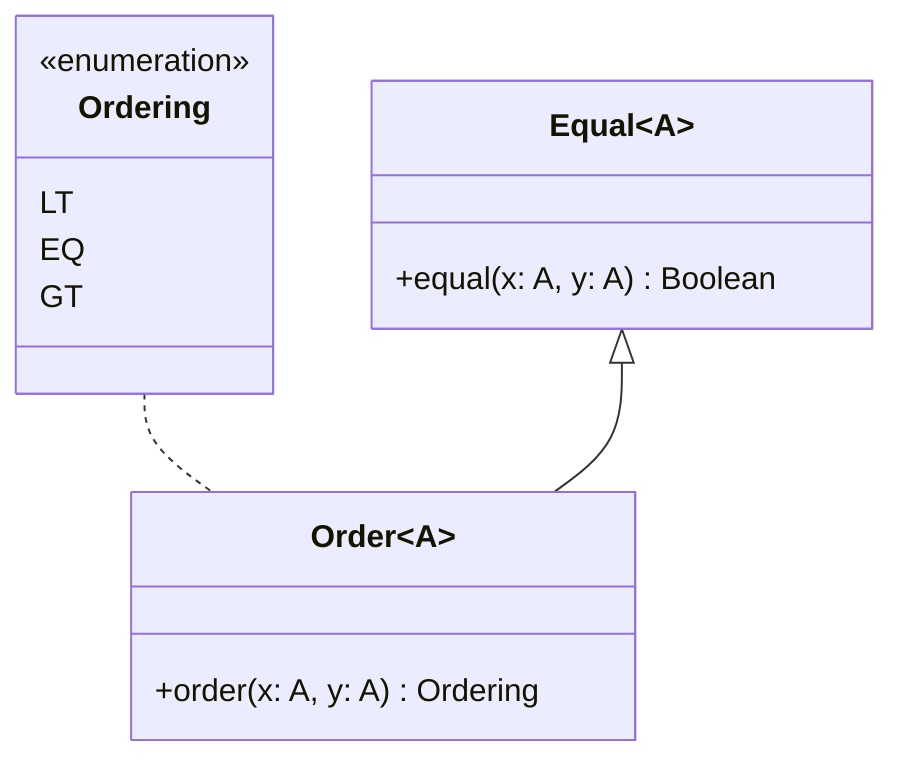

# Order

**Что такое `Order`?**

`Order` — это типовой класс, который определяет методы для сравнения двух объектов одного типа. 
Он позволяет определить, какой из двух объектов "меньше", "больше" или "равен" другому. 
`Order` включает в себя методы для сравнения, такие как `order`, 
возвращающий признак "меньше", "больше" или "равно".

**Где применяется?**

`Order` применяется в различных сценариях, где необходимо упорядочить или сравнить объекты. 
Вот несколько примеров:

- **Сортировка коллекций**: `Order` может использоваться для сортировки списков, массивов или других коллекций объектов.
- **Поиск**: При реализации алгоритмов поиска, таких как бинарный поиск, важно иметь возможность сравнивать элементы.
- **Сравнение пользовательских типов**: Если у вас есть собственный тип данных, 
  вы можете реализовать для него экземпляр `Order`, чтобы определить, как объекты этого типа должны сравниваться.
- **Алгоритмы**: В алгоритмах, таких как сортировка слиянием или быстрая сортировка, `Order` позволяет определить порядок элементов.

**Примеры использования:**

- **Сравнение чисел**: Вы можете использовать `Order` для сравнения двух чисел, чтобы определить, какое из них больше или меньше.
- **Сравнение строк**: `Order` позволяет сравнивать строки по алфавитному порядку.
- **Сравнение пользовательских типов**: Если у вас есть класс `Person` с полем `age`, 
  вы можете реализовать `Order`, чтобы сравнивать объекты `Person` по возрасту.
- **Сортировка объектов**: Вы можете использовать `Order` для сортировки списка объектов по различным критериям, 
  например, по имени или дате создания.

## Формальное определение

`Order` расширяет [Equal](equal.md) и дополнительно определяет методы для проверки порядка между значениями, 
такие как "меньше", "больше" или "равно". 

`Order` должен удовлетворять следующим законам (помимо законов `Equal`):

- **Рефлексивность**: Для любого значения `x` типа `A`, `order(x, x)` - это "равно".
- **Антисимметричность**: 
    - Для любых значений `x` и `y` типа `A`, если `order(x, y)` - это "меньше" или "равно" 
      и `order(y, x)` - это "меньше" или "равно", то `x` и `y` должны быть равны (`equal(x, y) == true`).
    - если `f1 < f2`, то `f2 > f1`,
    - если `f1 <= f2`, то `f2 >= f1`,
    - и т.п.
- **Транзитивность**: 
  Для любых значений `x`, `y` и `z` типа `A`, если `x <= y` и `y <= z`, то `x <= z`.
  Аналогично для `<`, `>=`, `>` и `=`.
- **Полнота**: либо `a <= b`, либо `b <= a`.
- **Согласованность `Order` и `Equal`**: `equal(f1, f2)` равно `true` тогда и только тогда, 
  когда `order(f1, f2)` - это "равно".

## Определение в виде кода на Scala

Определение `Order` выглядит так:

```dotty
trait Equal[F]: 
  def equal(a1: F, a2: F): Boolean

enum Ordering:
  case LT
  case EQ
  case GT

trait Order[F] extends Equal[F]:
  def order(x: F, y: F): Ordering

  def equal(x: F, y: F): Boolean = order(x, y) == Ordering.EQ
```

- **Типовой параметр `F`**: `Order` параметризуется типом `F`, для которого определяется порядок.
- **Метод `order`**: Метод `order` принимает два значения типа `F` и возвращает перечисление `Ordering`:
    - `LT`, если `x < y`.
    - `EQ`, если `x == y`.
    - `GT`, если `x > y`.
- **Наследование от `Equal`**: `Order` расширяет типовой класс `Equal`, 
  что позволяет использовать методы для проверки равенства (`equal`).

### Дополнительные методы

С помощью метода `order` можно реализовать операции "меньше", "меньше или равно", "больше", "больше или равно",
нахождения максимума, минимума, сортировку двух элементов и реверсивный `Order`.

```dotty
trait Order[F] extends Equal[F]:
  self =>

  ...

  def lessThan(x: F, y: F): Boolean = order(x, y) == Ordering.LT

  def lessThanOrEqual(x: F, y: F): Boolean = order(x, y) != Ordering.GT

  def greaterThan(x: F, y: F): Boolean = order(x, y) == Ordering.GT

  def greaterThanOrEqual(x: F, y: F): Boolean = order(x, y) != Ordering.LT

  def max(x: F, y: F): F = if greaterThanOrEqual(x, y) then x else y

  def min(x: F, y: F): F = if lessThan(x, y) then x else y

  def sort(x: F, y: F): (F, F) = if lessThanOrEqual(x, y) then (x, y) else (y, x)

  def reverseOrder: Order[F] = new Order[F]:
    def order(x: F, y: F): Ordering = self.order(y, x)
    override def equal(x: F, y: F) = self.equal(x, y)
    override def reverseOrder = self
```

## Схема



## Реализация в библиотеках

### Реализация в Cats

```dotty
import cats.*
import cats.implicits.*

1.0 compare 2.0
// val res0: Int = -1
1.0 max 2.0
// val res1: Double = 2.0
```

### Реализация в ScalaZ

```dotty
import scalaz.*
import Scalaz.*
1.0 ?|? 2.0 // Ordering.LT
1.0 lt 2.0 // true
2.0 gt 1.0 // true
1.0 lte 2.0 // true
2.0 gte 1.0 // true
1 max 2 // 2
1 min 2 // 1
```

Метод `?|?` в ScalaZ возвращает результат сравнения `Ordering: LT, GT или EQ`. 

### Реализация в Spire

```dotty
import spire.algebra.Order
import spire.math.Rational

Order.comparison(Rational(1, 2), Rational(1, 3)) // GreaterThan
Order.gt(Rational(1, 2), Rational(1, 3))         // true
Order.gteqv(Rational(1, 2), Rational(1, 3))      // true
Order.lt(Rational(1, 2), Rational(1, 3))         // false
Order.lteqv(Rational(1, 2), Rational(1, 3))      // false
Order.min(Rational(1, 2), Rational(1, 3))        // 1/3
Order.max(Rational(1, 2), Rational(1, 3))        // 1/2
```

---

**Ссылки:**

- [Cats API](https://www.javadoc.io/doc/org.typelevel/cats-docs_3/latest/cats/kernel/Order.html)
- [Herding Cats](http://eed3si9n.com/herding-cats/Order.html)
- [Learning Scalaz](http://eed3si9n.com/learning-scalaz/Order.html)
- [Scalaz API](https://javadoc.io/doc/org.scalaz/scalaz-core_3/7.3.6/scalaz/Order.html)
- [Spire home page](https://typelevel.org/spire)
