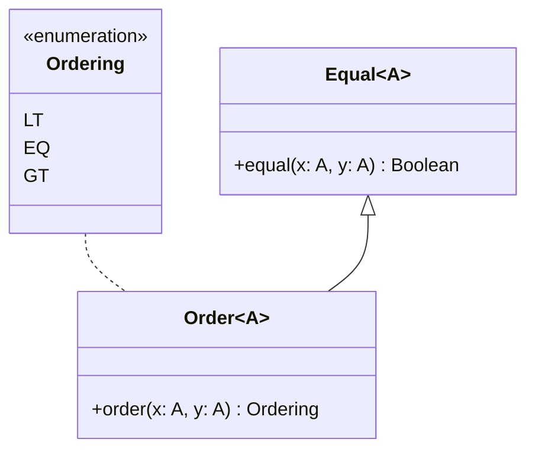



# Order

`Order` — это класс типов, который определяет методы для сравнения двух объектов одного типа. 
Он позволяет определить, какой из двух объектов "меньше", "больше" или "равен" другому. 
`Order` включает в себя методы для сравнения, такие как `order`, 
возвращающий признак "меньше", "больше" или "равно".

`Order` применяется в различных сценариях, где необходимо упорядочить или сравнить объекты. 
Вот несколько примеров:

- **Сортировка коллекций**: `Order` может использоваться для сортировки списков, массивов или других коллекций объектов.
- **Поиск**: При реализации алгоритмов поиска, таких как бинарный поиск, важно иметь возможность сравнивать элементы.
- **Сравнение пользовательских типов**: Если у вас есть собственный тип данных, 
  вы можете реализовать для него экземпляр `Order`, чтобы определить, как объекты этого типа должны сравниваться.
- **Алгоритмы**: В алгоритмах, таких как сортировка слиянием или быстрая сортировка, `Order` позволяет определить порядок элементов.

## Формальное определение

`Order` расширяет [Equal](equal.md) и дополнительно определяет методы для проверки порядка между значениями, 
такие как "меньше", "больше" или "равно". 

`Order` должен удовлетворять следующим законам (помимо законов `Equal`):

- **Рефлексивность**: Для любого значения `x` типа `A`, `order(x, x)` - это "равно".
- **Антисимметричность**: 
    - Для любых значений `x` и `y` типа `A`, если `order(x, y)` - это "меньше" или "равно" 
      и `order(y, x)` - это "меньше" или "равно", то `x` и `y` должны быть равны (`equal(x, y) == true`).
    - если `f1 < f2`, то `f2 > f1`,
    - если `f1 <= f2`, то `f2 >= f1`,
    - и т.п.
- **Транзитивность**: 
  Для любых значений `x`, `y` и `z` типа `A`, если `x <= y` и `y <= z`, то `x <= z`.
  Аналогично для `<`, `>=`, `>` и `=`.
- **Полнота**: либо `a <= b`, либо `b <= a`.
- **Согласованность `Order` и `Equal`**: `equal(f1, f2)` равно `true` тогда и только тогда, 
  когда `order(f1, f2)` - это "равно".

## Определение в виде кода на Scala

Определение `Order` выглядит так:

```dotty
trait Equal[F]: 
  def equal(a1: F, a2: F): Boolean

enum Ordering:
  case LT
  case EQ
  case GT

trait Order[F] extends Equal[F]:
  def order(x: F, y: F): Ordering

  def equal(x: F, y: F): Boolean = order(x, y) == Ordering.EQ
```

- **Типовой параметр `F`**: `Order` параметризуется типом `F`, для которого определяется порядок.
- **Метод `order`**: Метод `order` принимает два значения типа `F` и возвращает перечисление `Ordering`:
    - `LT`, если `x < y`.
    - `EQ`, если `x == y`.
    - `GT`, если `x > y`.
- **Наследование от `Equal`**: `Order` расширяет класс типов `Equal`, 
  что позволяет использовать методы для проверки равенства (`equal`).

### Дополнительные методы

С помощью метода `order` можно реализовать операции "меньше", "меньше или равно", "больше", "больше или равно",
нахождения максимума, минимума, сортировку двух элементов и реверсивный `Order`.

```dotty
trait Order[F] extends Equal[F]:
  self =>

  ...

  def lessThan(x: F, y: F): Boolean = order(x, y) == Ordering.LT

  def lessThanOrEqual(x: F, y: F): Boolean = order(x, y) != Ordering.GT

  def greaterThan(x: F, y: F): Boolean = order(x, y) == Ordering.GT

  def greaterThanOrEqual(x: F, y: F): Boolean = order(x, y) != Ordering.LT

  def max(x: F, y: F): F = if greaterThanOrEqual(x, y) then x else y

  def min(x: F, y: F): F = if lessThan(x, y) then x else y

  def sort(x: F, y: F): (F, F) = if lessThanOrEqual(x, y) then (x, y) else (y, x)

  def reverseOrder: Order[F] = new Order[F]:
    def order(x: F, y: F): Ordering = self.order(y, x)
    
    override def reverseOrder: Order[F] = self
```

## Схема



## Реализация в библиотеках

### Реализация в Cats

```dotty
import cats.*
import cats.implicits.*

1.0 compare 2.0
// val res0: Int = -1
1.0 max 2.0
// val res1: Double = 2.0
```

### [Реализация в Spire](../../libs/spire.md)

Общее сравнение в Spire поддерживается классом типов `Order[A]`.
В отличие от других классов типов упорядочивания (например, `scala.math.Ordering`),
этот специализируется на том, чтобы избежать упаковки `Order[A]`.
Расширение `Eq[A]` можно реализовать с помощью одного метода `compare`,
хотя `Order[A]` обеспечивает все следующее:

- `eqv` (`a === b`)
- `neqv` (`a =!= b`)
- `compare` (`a compare b`): меньше (`-1`), равно (`0`) или больше (`1`)
- `gt` (`a > b`): больше
- `gteqv` (`a >= b`): больше или равно
- `lt` (`a < b`): меньше
- `lteqv` (`a <= b`): меньше или равно
- `min` (`a min b`): наименьший элемент
- `max` (`a max b`): наибольший элемент

Экземпляры `Order[A]` должны соблюдать следующие свойства:

- если `a <= b` и `b <= a`, тогда `a === b` (_антисимметрия_)
- если `a <= b` и `b <= c`, тогда `a <= c` (_транзитивность_)
- либо `a <= b` или `b <= a` (_полнота_)

Кроме того, общее упорядочивание по полям должно подчиняться следующим дополнительным законам:

- если `a <= b`, тогда `(a + c) <= (b + c)` (_O1_)
- если `zero <= a` и `zero <= b`, тогда `zero <= (a * b)` (_O2_)

(Это законы, обязательные для упорядоченных полей.)

В некоторых случаях пользователям может потребоваться использовать (или определять) общее упорядочивание,
которое не соответствуют всем этим законам или может нарушать законы, требуемые другими структурами.
Примером может служить лексикографический порядок комплексных чисел, который нарушает _O2_.
В этих случаях пользователям необходимо будет осознавать риски и ограничивать их использование ситуациями,
когда конкретный закон не требуется.

```dotty
import spire.algebra.Order
import spire.math.Rational

Order.comparison(Rational(1, 2), Rational(1, 3)) // GreaterThan
Order.gt(Rational(1, 2), Rational(1, 3))         // true
Order.gteqv(Rational(1, 2), Rational(1, 3))      // true
Order.lt(Rational(1, 2), Rational(1, 3))         // false
Order.lteqv(Rational(1, 2), Rational(1, 3))      // false
Order.min(Rational(1, 2), Rational(1, 3))        // 1/3
Order.max(Rational(1, 2), Rational(1, 3))        // 1/2
```

#### PartialOrder

Частичное упорядочивание в Spire поддерживается классом типов `PartialOrder[A]`.
Его реализация отличается от `scala.math.PartialOrdering` двумя особенностями:
`PartialOrder` специализирована для предотвращения упаковки, а метод `partialCompare` возвращает `Double`
и избегает выделения экземпляра `Option[Int]`.
`PartialOrder[A]` расширяет `Eq[A]` и может быть реализован с помощью одного метода `partialCompare`, описанного ниже.
`PartialOrder` обеспечивает:

- `partialCompare` (`a partialCompare b`): меньше (`-1.0`), равно (`0.0`), больше (`1.0`) или невозможность сравнения (`NaN`)
- `tryCompare` (`a tryCompare b`): меньше (`Some(-1)`), равно (`Some(0)`), больше (`Some(1)`) или невозможность сравнения (`None`)
- `pmin` (`a pmin b`): нахождение наименьшего элемента, если элементы сравнимы; возвращается `Option`
- `pmax` (`a pmax b`): нахождение наибольшего элемента, если элементы сравнимы; возвращается `Option`
- `gt` (`a > b`), `gteqv` (`a >= b`), `lt` (`a < b`) и `lteqv` (`a <= b`): возвращается `false` если элементы не сравнимы
  или результат сравнения
- `eqv` (`a === b`)
- `neqv` (`a =!= b`)

Частичное упорядочивание определяется бинарным отношением `<=`, которое удовлетворяет отношениям:

- `a <= a` (_рефлексивность_)
- если `a <= b` и `b <= a`, то `a === b` (_антисимметрия_)
- если `a <= b` и `b <= c`, то `a <= c` (_транзитивность_)

Чтобы вычислить оба значения `<=` и `>=` одновременно,
метод `partialCompare` использует число `Double` для кодирования результата обоих сравнений.
Таблица истинности определяется следующим образом:

| `a <= b` |`a >= b` | `partialCompare(a, b)` |    соответствует     |
|:--------:|:-------:|:----------------------:|:--------------------:|
|  `true`  | `true`  |          `0`           |      `a === b`       |
| `false`  | `false` |         `NaN`          | `a` несравнима с `b` |
|  `true`  | `false` |          `-1`          |       `a < b`        |
| `false`  | `true`  |          `1`           |       `a > b`        |

Метод `tryCompare` возвращает вместо `-1.0`, `0.0`, `1.0`, `NaN` соответственно `Some(-1)`, `Some(0)`, `Some(1)` и `None`,
что позволяет использовать метод `getOrElse` и методы более высокого порядка по стоимости выделения `Option[Int]`.

Экземпляры `PartialOrder[A]` необходимы для соблюдения вышеуказанных свойств.

---

**Ссылки:**

- [Ссылка на репозиторий с упражнениями][sample]
- [Cats API](https://www.javadoc.io/doc/org.typelevel/cats-docs_3/latest/cats/kernel/Order.html)
- [Herding Cats](http://eed3si9n.com/herding-cats/Order.html)
- [Learning Scalaz](http://eed3si9n.com/learning-scalaz/Order.html)
- [Scalaz API](https://javadoc.io/doc/org.scalaz/scalaz-core_3/7.3.6/scalaz/Order.html)
- [Spire home page](https://typelevel.org/spire/)

[sample]: https://gitverse.ru/scalabook/typeclasses
