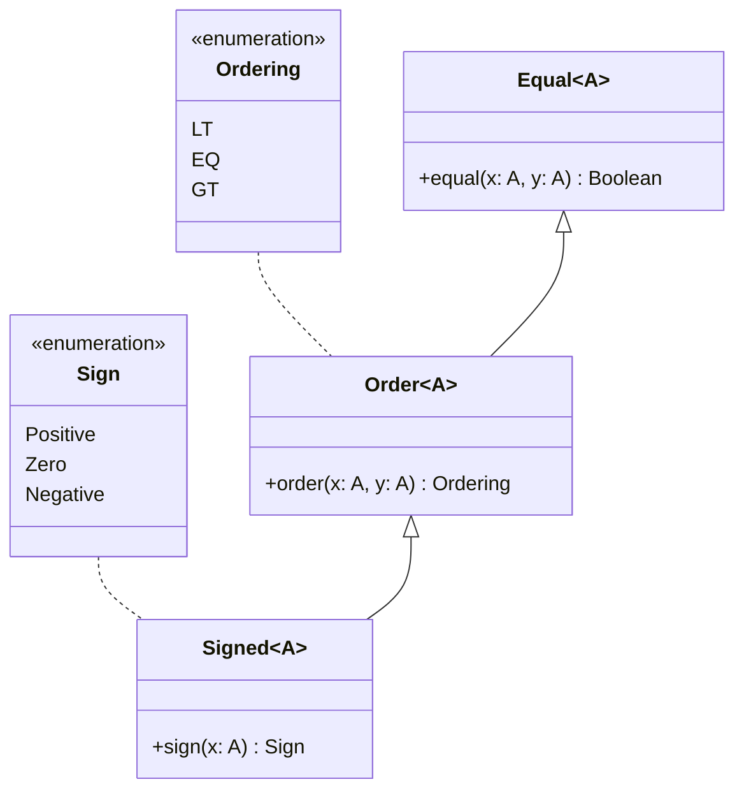



# Signed

`Signed` — это типовой класс, который определяет методы для работы со знаковыми типами. 
Он позволяет определить, является ли значение положительным, отрицательным или нулём, 
а также выполнять операции, такие как взятие абсолютного значения или изменение знака.

**Где применяется?**

`Signed` применяется в различных сценариях, где важно работать со знаковыми значениями. Вот несколько примеров:

- **Числовые типы**: `Signed` может использоваться для работы с числовыми типами, 
  такими как `Int`, `Long`, `Float` и `Double`, которые поддерживают знак.
- **Математические операции**: В математических алгоритмах, таких как вычисление модуля или изменение знака числа, 
  `Signed` предоставляет удобные методы.
- **Пользовательские типы**: Если у вас есть собственный тип данных, который поддерживает знак, 
  вы можете реализовать для него экземпляр `Signed`.
- **Анализ данных**: В задачах анализа данных, где важно учитывать знак значений, 
  `Signed` может использоваться для классификации данных.

**Примеры использования:**

- **Определение знака числа**: Вы можете использовать `Signed`, чтобы определить, 
  является ли число положительным, отрицательным или нулём.
- **Абсолютное значение**: `Signed` позволяет получить абсолютное значение числа, игнорируя его знак.
- **Изменение знака**: Вы можете использовать `Signed`, чтобы изменить знак числа на противоположный.
- **Пользовательские типы**: Если у вас есть класс `Temperature`, вы можете реализовать `Signed`, 
  чтобы определить, является ли температура положительной, отрицательной или нулевой.

## Формальное определение

Общее упорядочивание, инвариантное к сдвигу, фиксируется классом типов `Signed[A]`,
который расширяет [`Order`](order.md), - типы, имеющие знак (отрицательный, ноль, положительный).
В общем случае тип `A` содержит нулевой элемент `0`.

`Signed` должен удовлетворять следующим законам (помимо законов `Order` и `Equal`):

- `sign(x) = Negative` если `x < 0`, `sign(x) = Positive` если `x > 0`, иначе - `sign(x) = Zero`.

Если тип `A` оснащен отрицательными элементами `-x`, то:

- `abs(x) = -x` если `x < 0`, иначе - `x`,

## Определение в виде кода на Scala

```dotty
trait Equal[A]:
  def equal(a1: A, a2: A): Boolean

enum Ordering:
  case LT
  case EQ
  case GT

trait Order[A] extends Equal[A]:
  def order(x: A, y: A): Ordering

enum Sign:
  case Positive
  case Zero
  case Negative

trait Signed[A] extends Order[A]:
  def sign(x: A): Sign
  def abs(x: A): A
  def isSignPositive(x: A): Boolean = sign(x) == Sign.Positive
  def isSignZero(x: A): Boolean = sign(x) == Sign.Zero
  def isSignNegative(x: A): Boolean = sign(x) == Sign.Negative
  def isSignNonPositive(x: A): Boolean = sign(x) != Sign.Positive
  def isSignNonZero(x: A): Boolean = sign(x) != Sign.Zero
  def isSignNonNegative(x: A): Boolean = sign(x) != Sign.Negative
```

- **Типовой параметр `A`**: `Signed` параметризуется типом `A`, для которого определяется работа со знаком.
- **Метод `sign`**: Метод `sign` принимает значение типа `A` и возвращает перечисление `Sign`:
    - `Negative`, если `x` отрицательное.
    - `Zero`, если `x` равно нулю.
    - `Positive`, если `x` положительное.
- **Метод `abs`**: Метод `abs` принимает значение типа `A` и возвращает его абсолютное значение.
- **Метод `isSignPositive`**: Проверяет, является ли значение `x` положительным.
- **Метод `isSignZero`**: Проверяет, является ли значение `x` нулём.
- **Метод `isSignNegative`**: Проверяет, является ли значение `x` отрицательным.
- **Метод `isSignNonPositive`**: Проверяет, является ли значение `x` неположительным (отрицательным или нулём).
- **Метод `isSignNonZero`**: Проверяет, является ли значение `x` ненулевым (положительным или отрицательным).
- **Метод `isSignNonNegative`**: Проверяет, является ли значение `x` неотрицательным (положительным или нулём).

## Схема



## Реализация в библиотеках

### Реализация в Spire

```dotty
import spire.algebra.Signed.*
import spire.std.int.*

sign(10)               // Positive
sign(0)                // Zero
sign(-10)              // Negative
signum(10)             // 1
signum(0)              // 0
signum(-10)            // -1
abs(10)                // 10
abs(0)                 // 0 
abs(-10)               // 10
isSignPositive(10)     // true
isSignZero(0)          // true
isSignNegative(-10)    // true
isSignNonPositive(10)  // false
isSignNonZero(0)       // false
isSignNonNegative(-10) // false
```

---

**Ссылки:**

- [Spire home page](https://typelevel.org/spire)
- [Spire User's Guide](https://typelevel.org/spire/guide.html)
