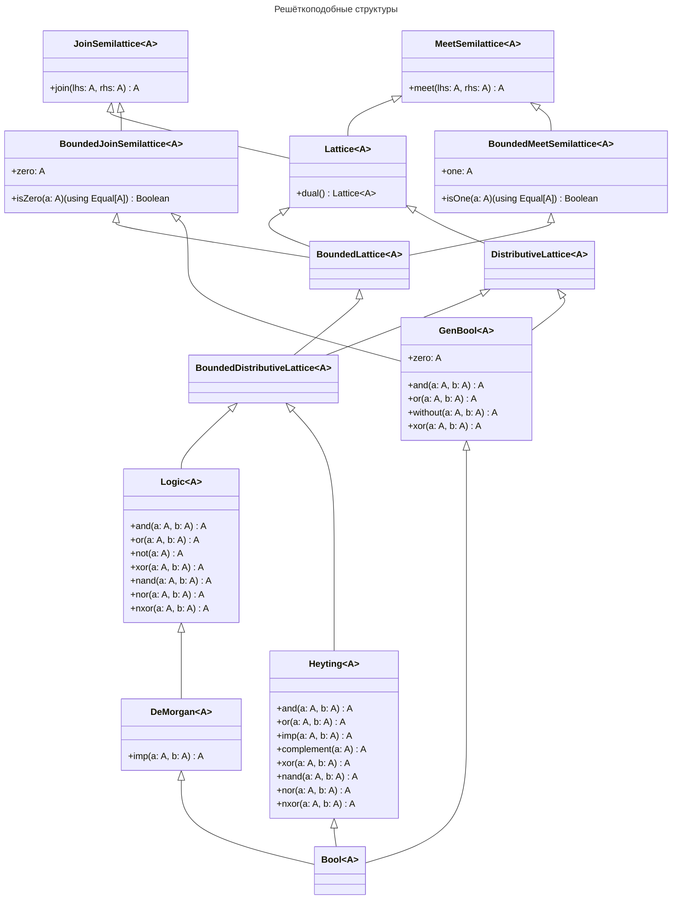

# Решетки

Решёткоподобные структуры представляет структуры, которые могут напоминать кольца, но работают по другим законам.

Вместо `plus` (сложение) и `times` (умножение) здесь используются:

- **`meet`** (встреча/пересечение) — аналог логического **И** (AND) или операции взятия **минимума** («наибольшая нижняя граница»).
- **`join`** (объединение) — аналог логического **ИЛИ** (OR) или операции взятия **максимума** («наименьшая верхняя граница»).

**Свойства `meet` и `join`:**

- Они всегда ассоциативны, коммутативны и идемпотентны (`a ∧ a = a`).
- Каждый по отдельности образует **полурешётку** (Semilattice).

**Дополнительные элементы:**

- **`zero`**: если есть, то `join(a, zero) = a` (ноль — нижняя граница, объединение с ним не меняет элемент).
- **`one`**: если есть, то `meet(a, one) = a` (единица — верхняя граница).
- **Закон поглощения (Absorption)**: если есть оба, то `meet(a, join(a, b)) = join(a, meet(a, b)) = a`.
- **Дистрибутивность**: `meet` дистрибутивен относительно `join` и наоборот.
- **`imp` (импликация)**: специальная операция, означающая «если... то...».

### Таблица решёткоподобных структур

- [**JoinSemilattice**](lattice/join-semilattice.md): Полурешётка объединения (умеет только `join`).
- [**MeetSemilattice**](lattice/meet-semilattice.md): Полурешётка пересечения (умеет только `meet`).
- [**BoundedJoinSemilattice**](lattice/bounded-join-semilattice.md): Полурешётка объединения с нулём (нижней границей).
- [**BoundedMeetSemilattice**](lattice/bounded-meet-semilattice.md): Полурешётка пересечения с единицей (верхней границей).
- [**Lattice**](lattice/lattice.md): Полная решётка (есть и встреча, и объединение).
- [**DistributiveLattice**](lattice/distributive-lattice.md): Дистрибутивная решётка.  
  *Пример: множества с `∩` и `∪`.*
- [**BoundedLattice**](lattice/bounded-lattice.md): Решётка с границами (есть и 0, и 1).
- [**BoundedDistributiveLattice**](lattice/bounded-distributive-lattice.md): Дистрибутивная решётка с границами.
- [**Logic**](lattice/logic.md): **Общая логика**.
- [**DeMorgan**](lattice/de-morgan.md): **Алгебра Де Моргана**.
- [**Heyting**](lattice/heyting.md): **Алгебра Гейтинга**. Решётка с импликацией.  
  *Пример: логика без закона исключённого третьего.*
- [**GenBool**](lattice/gen-bool.md): **Общая Булева алгебра**.
- [**Bool**](lattice/bool.md): **Булева алгебра**. Классическая логика с законом исключённого третьего (`a || !a == true`).  
  *Пример: `true/false`, битовые маски.*

## Схема группы

---

**Ссылки:**

- [Ссылка на репозиторий с упражнениями][sample]
- [Cats](https://typelevel.org/cats/)

[sample]: https://gitverse.ru/scalabook/typeclasses
