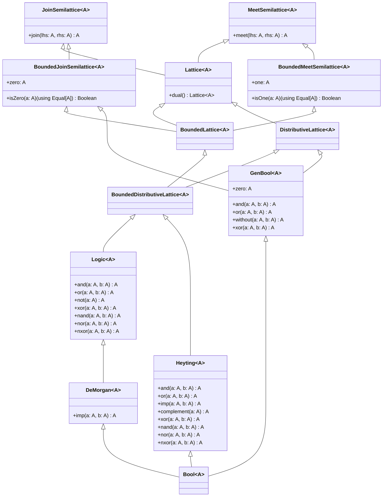



# Булева алгебра

## Формальное определение

**Булева алгебра** (англ. _Boolean algebra_) — это [алгебра Гейтинга](heyting.md), 
которая дополнительно удовлетворяет **закону исключённого третьего** и **закону снятия двойного отрицания**. 
Булевы алгебры моделируют классическую логику и являются фундаментальной структурой в математике, 
информатике и электротехнике.

### Аксиомы булевой алгебры

1. **Аксиомы алгебры Гейтинга**:
    - Все аксиомы `Heyting` (ограниченная дистрибутивная решётка с импликацией и псевдодополнением)

2. **Дополнительные аксиомы**:
    - **Закон исключённого третьего**: `a ∨ ¬a = 1` (для любого `a`)
    - **Закон снятия двойного отрицания**: `¬¬a = a` (для любого `a`)

3. **Эквивалентные формулировки**:
    - `¬¬a = a` ⇔ `a ∨ ¬a = 1` (в контексте алгебры Гейтинга)
    - Закон непротиворечия: `a ∧ ¬a = 0` (уже следует из Heyting)
    - Законы Де Моргана: `¬(a ∨ b) = ¬a ∧ ¬b`, `¬(a ∧ b) = ¬a ∨ ¬b`

### Полный набор законов булевой алгебры

| Категория                   | Закон     | Формула                           |
|-----------------------------|-----------|-----------------------------------|
| Идемпотентность             | join      | `a ∨ a = a`                       |
| Идемпотентность             | meet      | `a ∧ a = a`                       |
| Коммутативность             | join      | `a ∨ b = b ∨ a`                   |
| Коммутативность             | meet      | `a ∧ b = b ∧ a`                   |
| Ассоциативность             | join      | `(a ∨ b) ∨ c = a ∨ (b ∨ c)`       |
| Ассоциативность             | meet      | `(a ∧ b) ∧ c = a ∧ (b ∧ c)`       |
| Дистрибутивность            | join/meet | `a ∨ (b ∧ c) = (a ∨ b) ∧ (a ∨ c)` |
| Дистрибутивность            | meet/join | `a ∧ (b ∨ c) = (a ∧ b) ∨ (a ∧ c)` |
| Поглощение                  | join/meet | `a ∨ (a ∧ b) = a`                 |
| Поглощение                  | meet/join | `a ∧ (a ∨ b) = a`                 |
| Нейтральность zero          | join      | `0 ∨ a = a`                       |
| Нейтральность one           | meet      | `1 ∧ a = a`                       |
| Закон исключённого третьего | -         | `a ∨ ¬a = 1`                      |
| Закон непротиворечия        | -         | `a ∧ ¬a = 0`                      |
| Двойное отрицание           | -         | `¬¬a = a`                         |
| Законы Де Моргана           | -         | `¬(a ∨ b) = ¬a ∧ ¬b`              |
| Законы Де Моргана           | -         | `¬(a ∧ b) = ¬a ∨ ¬b`              |

### Примеры булевых алгебр

| Пример                        | Операции            | zero         | one         | Применение          |
|-------------------------------|---------------------|--------------|-------------|---------------------|
| Булевы значения {true, false} | `!`, `&&`, `\|\|`   | `false`      | `true`      | Классическая логика |
| Булеан множества (P(U))       | `∩`, `∪`, `^c`      | `∅`          | `U`         | Теория множеств     |
| Бинарные строки               | побитовые операции  | 0...0        | 1...1       | Цифровая логика     |
| Решётка делителей числа N     | `НОД`, `НОК`, `N/a` | `1`          | `N`         | Теория чисел        |
| Функции A → Bool              | поточечные операции | const(false) | const(true) | Логика предикатов   |
| Битовые маски                 | битовые операции    | `0x00`       | `0xFF`      | Программирование    |

## Код

```dotty
trait Bool[A] extends Heyting[A] with GenBool[A]:
  self =>

  /** Импликация в булевой алгебре определяется через дополнение и дизъюнкцию: a
    * → b = ¬a ∨ b
    */
  def imp(a: A, b: A): A = or(complement(a), b)

  /** Относительное дополнение в булевой алгебре определяется через пересечение
    * и дополнение: a\b = a ∧ ¬b
    */
  def without(a: A, b: A): A = and(a, complement(b))

  // xor уже определён как в Heyting, так и в GenBool.
  // В Bool эти определения совпадают, поэтому мы просто используем одно из них.
  override def xor(a: A, b: A): A =
    or(without(a, b), without(b, a))
```

## Схема



## Упражнения

### Упражнение 5.3.1: Булева алгебра для Boolean

> [Репозиторий с упражнениями и инструкцией по выполнению][sample]

Реализуйте `Bool` для типа `Boolean`:

```dotty
given Bool[Boolean] with
  override def one: Boolean = ???

  override def and(a: Boolean, b: Boolean): Boolean = ???

  override def or(a: Boolean, b: Boolean): Boolean = ???

  override def zero: Boolean = ???

  override def complement(a: Boolean): Boolean = ???
```

@:note(🔍 Показать решение)

Данная реализация предоставляет классическую булеву алгебру для встроенного типа `Boolean`, 
где `and` соответствует логическому И (`&&`), `or` — логическому ИЛИ (`||`), 
`complement` — логическому НЕ (`!`), а `zero = false` и 
`one = true` являются нейтральными элементами для операций И и ИЛИ соответственно, 
что полностью удовлетворяет законам классической двузначной логики, 
включая закон исключённого третьего и двойное отрицание.

```dotty
given Bool[Boolean] with
  override def one: Boolean = true

  override def and(a: Boolean, b: Boolean): Boolean = a && b

  override def or(a: Boolean, b: Boolean): Boolean = a || b

  override def zero: Boolean = false

  override def complement(a: Boolean): Boolean = !a
```

@:@

## Реализация в библиотеках

### Реализация в Cats

```dotty
import algebra.lattice.Bool
import cats.*
import cats.implicits.*

// Булева алгебра для битовых масок
case class BitMask(value: Int)

given BitMaskBool: Bool[BitMask] with
  def and(a: BitMask, b: BitMask): BitMask =
    BitMask(a.value & b.value)

  def or(a: BitMask, b: BitMask): BitMask =
    BitMask(a.value | b.value)

  def complement(a: BitMask): BitMask =
    BitMask(~a.value)
  
  def zero: BitMask = BitMask(0)
  def one: BitMask  = BitMask(-1) // все биты установлены

// Использование
val mask1 = BitMask(0b1010)
val mask2 = BitMask(0b1100)
val bool  = summon[Bool[BitMask]]

println(bool.and(mask1, mask2)) // BitMask(0b1000)
println(bool.or(mask1, mask2))  // BitMask(0b1110)
println(bool.complement(mask1)) // BitMask(0b...0101)
println(bool.xor(mask1, mask2)) // BitMask(0b0110)
```

## Итоговое резюме

`Bool` — это полная классическая булева алгебра, объединяющая свойства `Heyting` и `GenBool`. Ключевые аспекты:

1. **Закон исключённого третьего**: `a ∨ ¬a = 1` гарантируется
2. **Двойное отрицание**: `¬¬a = a` гарантируется
3. **Полная классическая логика**: все законы классической логики выполняются
4. **Объединение структур**: наследует и объединяет `Heyting` и `GenBool`
5. **Двойственность**: имеет двойственную алгебру с перестановкой операций

Булевы алгебры являются фундаментальными для:

- **Классической логики**: основа математической логики
- **Теории множеств**: операции над подмножествами
- **Цифровой схемотехники**: проектирование логических схем
- **Программирования**: битовые операции, условные выражения
- **Теории баз данных**: реляционная алгебра и запросы
- **Криптографии**: булевы функции и S-боксы

---

**Ссылки:**

- [Ссылка на репозиторий с упражнениями][sample]
- [Cats](https://typelevel.org/cats/)

[sample]: https://gitverse.ru/scalabook/typeclasses
