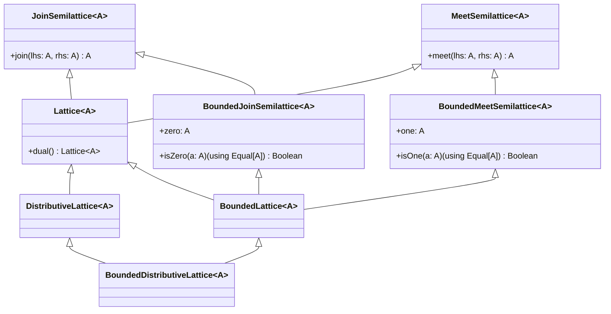

# Дистрибутивная решётка с границами

## Формальное определение

**Ограниченная дистрибутивная решётка** (англ. _bounded distributive lattice_) — это структура, 
объединяющая свойства [ограниченной решётки](bounded-lattice.md) и [дистрибутивной решётки](distributive-lattice.md). 
Она содержит два выделенных элемента (bottom и top) и операции, которые дистрибутивны друг относительно друга.

### Аксиомы

1. **Аксиомы решётки**: идемпотентность, коммутативность, ассоциативность, законы поглощения
2. **Аксиомы ограниченности**:
    - Существование `zero` (⊥): `join(zero, a) = a`
    - Существование `one` (⊤): `meet(one, a) = a`
3. **Аксиомы дистрибутивности**:
    - `join(a, meet(b, c)) = meet(join(a, b), join(a, c))`
    - `meet(a, join(b, c)) = join(meet(a, b), meet(a, c))`

### Полный набор аксиом

| Закон                   | Формула                           | Тип              |
|-------------------------|-----------------------------------|------------------|
| Идемпотентность (join)  | `a ∨ a = a`                       | Решётка          |
| Идемпотентность (meet)  | `a ∧ a = a`                       | Решётка          |
| Коммутативность (join)  | `a ∨ b = b ∨ a`                   | Решётка          |
| Коммутативность (meet)  | `a ∧ b = b ∧ a`                   | Решётка          |
| Ассоциативность (join)  | `(a ∨ b) ∨ c = a ∨ (b ∨ c)`       | Решётка          |
| Ассоциативность (meet)  | `(a ∧ b) ∧ c = a ∧ (b ∧ c)`       | Решётка          |
| Поглощение (1)          | `a ∨ (a ∧ b) = a`                 | Решётка          |
| Поглощение (2)          | `a ∧ (a ∨ b) = a`                 | Решётка          |
| Нейтральность zero      | `⊥ ∨ a = a`                       | Ограниченность   |
| Нейтральность one       | `⊤ ∧ a = a`                       | Ограниченность   |
| Поглощение zero         | `a ∧ ⊥ = ⊥`                       | Ограниченность   |
| Поглощение one          | `a ∨ ⊤ = ⊤`                       | Ограниченность   |
| Дистрибутивность (join) | `a ∨ (b ∧ c) = (a ∨ b) ∧ (a ∨ c)` | Дистрибутивность |
| Дистрибутивность (meet) | `a ∧ (b ∨ c) = (a ∧ b) ∨ (a ∧ c)` | Дистрибутивность |

### Примеры ограниченных дистрибутивных решёток

| Множество                    | join (∨)          | meet (∧)          | zero (⊥)        | one (⊤)             | Примечание              |
|------------------------------|-------------------|-------------------|-----------------|---------------------|-------------------------|
| Булевы значения              | `\|\|` (OR)       | `&&` (AND)        | `false`         | `true`              | Классический пример     |
| Булеан множества             | `∪` (объединение) | `∩` (пересечение) | `∅` (пустое)    | `U` (универсальное) | Требуется универсум     |
| Ограниченные целые от a до b | `max`             | `min`             | `a`             | `b`                 | Любой линейный порядок  |
| Делители числа N             | `НОК`             | `НОД`             | `1`             | `N`                 | Из факторизации         |
| Интервалы на от a до b       | объединение       | пересечение       | пустой интервал | полный интервал     | Интервальная арифметика |
| Типы в Scala                 | LUB               | GLB               | `Nothing`       | `Any`               | Система подтипов        |

## Код

```dotty
trait BoundedDistributiveLattice[A] extends BoundedLattice[A],
      DistributiveLattice[A]:
  self =>

  /** Двойственная решётка (zero ↔ one, join ↔ meet) */
  override def dual: BoundedDistributiveLattice[A] =
    new BoundedDistributiveLattice[A]:
      def meet(a: A, b: A): A = self.join(a, b)
      def join(a: A, b: A): A = self.meet(a, b)
      def one: A = self.zero
      def zero: A = self.one
      override def dual: BoundedDistributiveLattice[A] = self   
```

## Упражнения

### Упражнение 5.1.1: Булевы значения

> [Репозиторий с упражнениями и инструкцией по выполнению][sample]

Реализуйте `BoundedDistributiveLattice` для типа `Boolean`:

```dotty
given BoundedDistributiveLattice[Boolean] with
  def join(a: Boolean, b: Boolean): Boolean = ???

  def meet(a: Boolean, b: Boolean): Boolean = ???

  def zero: Boolean = ???

  def one: Boolean = ???
```

@:note(🔍 Показать решение)

Это решение реализует ограниченную дистрибутивную решётку для булевых значений, 
где операция `join` соответствует логическому ИЛИ (`||`), операция `meet` — логическому И (`&&`), 
а в качестве нижней и верхней границ выступают `false` и `true` соответственно, 
что полностью соответствует законам дистрибутивности и делает эту структуру классической двузначной булевой алгеброй.

```dotty
given BoundedDistributiveLattice[Boolean] with
  // OR
  def join(a: Boolean, b: Boolean): Boolean = a || b

  // AND
  def meet(a: Boolean, b: Boolean): Boolean = a && b

  // false - нейтральный для OR
  def zero: Boolean = false

  // true - нейтральный для AND
  def one: Boolean = true
```

@:@

### Упражнение 5.1.2: Целые числа с min/max (ограниченные)

Создайте ограниченную дистрибутивную решётку для целых чисел в заданном диапазоне `[minBound, maxBound]`:

```dotty
def boundedIntLattice(
    minBound: Int,
    maxBound: Int
): BoundedDistributiveLattice[Int] =
  new BoundedDistributiveLattice[Int]:
    override def zero: Int = ???

    override def one: Int = ???

    override def join(lhs: Int, rhs: Int): Int = ???

    override def meet(lhs: Int, rhs: Int): Int = ???
```

@:note(🔍 Показать решение)

Это решение создаёт ограниченную дистрибутивную решётку для целых чисел в заданном диапазоне `[minBound, maxBound]`, 
где `join` соответствует операции взятия максимума (`math.max`), а `meet` — минимума (`math.min`), 
что делает эту структуру линейно упорядоченной решёткой, при этом `zero = minBound` является наименьшим элементом, 
а `one = maxBound` — наибольшим, 
что позволяет использовать её для моделирования ограниченных числовых диапазонов в задачах статического анализа и оптимизации.

```dotty
def boundedIntLattice(
    minBound: Int,
    maxBound: Int
): BoundedDistributiveLattice[Int] =
  new BoundedDistributiveLattice[Int]:
    override def zero: Int = minBound

    override def one: Int = maxBound

    override def join(lhs: Int, rhs: Int): Int = math.max(lhs, rhs)

    override def meet(lhs: Int, rhs: Int): Int = math.min(lhs, rhs)
```

@:@

### Упражнение 5.1.3: Опциональные значения

Реализуйте `BoundedDistributiveLattice` для типа `Option[A]`, используя базовую ограниченную решётку для `A`:

```dotty
def boundedOptionLattice[A: BoundedLattice as bounded]
    : BoundedDistributiveLattice[Option[A]] =
  new BoundedDistributiveLattice[Option[A]]:
    def join(a: Option[A], b: Option[A]): Option[A] =
      ???

    def meet(a: Option[A], b: Option[A]): Option[A] =
      ???

    def zero: Option[A] = ???

    def one: Option[A] = ???
```

@:note(🔍 Показать решение)

Это решение строит ограниченную дистрибутивную решётку для опциональных значений `Option[A]` 
на основе базовой решётки для типа `A`, где `join` объединяет два значения, 
отдавая предпочтение `Some` (а в случае двух `Some` — применяет `join` к их содержимому), 
а `meet` возвращает общее значение только когда оба аргумента являются `Some` (иначе — `None`), 
при этом `zero = None` выступает в роли отсутствия информации (нейтрального элемента для объединения), 
а `one = Some(bounded.one)` представляет собой максимально возможную информацию.

```dotty
def boundedOptionLattice[A: BoundedLattice as bounded]
    : BoundedDistributiveLattice[Option[A]] =
  new BoundedDistributiveLattice[Option[A]]:
    def join(a: Option[A], b: Option[A]): Option[A] =
      (a, b) match
        case (Some(x), Some(y)) => Some(bounded.join(x, y))
        case (Some(x), None)    => Some(x)
        case (None, Some(y))    => Some(y)
        case (None, None)       => None

    def meet(a: Option[A], b: Option[A]): Option[A] =
      (a, b) match
        case (Some(x), Some(y)) => Some(bounded.meet(x, y))
        case _                  => None

    def zero: Option[A] = None

    def one: Option[A] = Some(bounded.one)
```

@:@

### Упражнение 5.1.4: Система разрешений

Реализуйте `BoundedDistributiveLattice` для уровней доступа `AccessLevel`:

```dotty
enum AccessLevel:
  case Guest, User, Moderator, Admin

given BoundedDistributiveLattice[AccessLevel] with
  import AccessLevel.*

  def join(a: AccessLevel, b: AccessLevel): AccessLevel =
    ???

  def meet(a: AccessLevel, b: AccessLevel): AccessLevel =
    ???

  def zero: AccessLevel = ???

  def one: AccessLevel = ???
```

@:note(🔍 Показать решение)

Это решение реализует ограниченную дистрибутивную решётку для уровней доступа `AccessLevel`, 
где `join` выбирает наивысший уровень (максимальный приоритет), а `meet` — наинизший (минимальный), 
что соответствует политикам объединения и пересечения прав доступа, 
при этом `zero = Guest` является наименьшим элементом, 
а `one = Admin` — наибольшим, образуя иерархию полномочий от гостя до администратора.

```dotty
given BoundedDistributiveLattice[AccessLevel] with
  import AccessLevel.*

  def join(a: AccessLevel, b: AccessLevel): AccessLevel =
    if a.ordinal >= b.ordinal then a else b // max = наивысший уровень

  def meet(a: AccessLevel, b: AccessLevel): AccessLevel =
    if a.ordinal <= b.ordinal then a else b // min = наинизший уровень

  def zero: AccessLevel = Guest

  def one: AccessLevel = Admin
```

@:@

## Схема



## Реализация в библиотеках

### Реализация в Cats

```dotty
import algebra.lattice.BoundedDistributiveLattice
import cats.*
import cats.implicits.*

// Реализация для Boolean
given BoundedDistributiveLattice[Boolean] with
  def join(a: Boolean, b: Boolean): Boolean = a || b
  def meet(a: Boolean, b: Boolean): Boolean = a && b
  def zero: Boolean                         = false
  def one: Boolean                          = true

// Реализация для Int (ограниченного диапазона)
given BoundedDistributiveLattice[Int] with
  def join(a: Int, b: Int): Int = math.max(a, b)
  def meet(a: Int, b: Int): Int = math.min(a, b)
  def zero: Int                 = Int.MinValue
  def one: Int                  = Int.MaxValue

// Реализация для Set (булеан)
def boundedSetLattice[A](universe: Set[A]): BoundedDistributiveLattice[Set[A]] =
  new BoundedDistributiveLattice[Set[A]]:
    def join(a: Set[A], b: Set[A]): Set[A] = a ++ b
    def meet(a: Set[A], b: Set[A]): Set[A] = a diff b
    def zero: Set[A]                       = Set.empty
    def one: Set[A]                        = universe

// Использование
val boolLattice = summon[BoundedDistributiveLattice[Boolean]]
println(boolLattice.join(true, false)) // true
println(boolLattice.meet(true, false)) // false
println(boolLattice.zero)              // false
println(boolLattice.one)               // true
```

## Итоговое резюме

`BoundedDistributiveLattice` — это структура, объединяющая ограниченность и дистрибутивность. Ключевые аспекты:

1. **Полнота**: содержит как границы (zero, one), так и дистрибутивные операции
2. **Нормализация**: позволяет приводить выражения к нормальным формам (ДНФ, КНФ)
3. **Основа для булевых алгебр**: при добавлении дополнения/отрицания становится булевой алгеброй
4. **Практичность**: широко используется в логических системах и анализе данных

Являясь фундаментальной структурой, `BoundedDistributiveLattice` служит основой для:

- **Логических систем**: классическая и неклассическая логика
- **Систем типов**: ограниченные решётки типов с LUB и GLB
- **Абстрактной интерпретации**: полные решётки свойств программ
- **Алгебраических структур**: булевы алгебры, алгебры Гейтинга

---

**Ссылки:**

- [Ссылка на репозиторий с упражнениями][sample]
- [Cats](https://typelevel.org/cats/)

[sample]: https://gitverse.ru/scalabook/typeclasses
