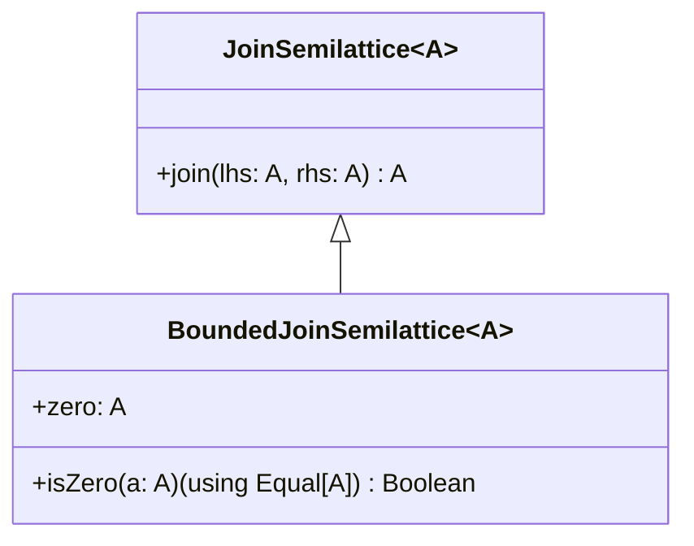



# Полурешётка объединения с нулём

## Формальное определение

**Полурешётка объединения с нулём** (англ. _bounded join-semilattice_), 
также известная как **верхняя полурешётка с нижней границей** — это [`JoinSemilattice`](join-semilattice.md), 
дополненная специальным элементом `zero` (⊥), который является **нейтральным элементом** относительно операции `join`.

### Аксиомы

Помимо стандартных аксиом полурешётки объединения (идемпотентность, коммутативность, ассоциативность), добавляется:

1. **Существование нуля**: существует элемент `zero ∈ A`, такой что:

   ```
   join(zero, a) = a  для любого a ∈ A
   ```

2. **Связь с частичным порядком**: `zero` является **наименьшим элементом**:
   ```
   zero ≤ a  для любого a ∈ A
   ```

### Свойства нулевого элемента

| Свойство               | Формула     | Значение                             |
|------------------------|-------------|--------------------------------------|
| Нейтральность для join | `⊥ ∨ a = a` | Ноль не влияет на объединение        |
| Поглощение для meet    | `a ∧ ⊥ = ⊥` | Пересечение с нулём даёт ноль        |
| Наименьший элемент     | `⊥ ≤ a`     | Ноль меньше или равен всем элементам |
| Идемпотентность        | `⊥ ∨ ⊥ = ⊥` | Объединение нуля с самим собой       |

### Примеры

| Множество               | Операция join                    | zero (⊥)               | Частичный порядок     | Описание                                      |
|-------------------------|----------------------------------|------------------------|-----------------------|-----------------------------------------------|
| Булевы значения         | `\|\|` (OR)                      | `false`                | `false ≤ true`        | Ложь — нейтральна для OR                      |
| Множества               | `∪` (объединение)                | `∅` (пустое множество) | `⊆` (включение)       | Пустое множество — нейтрально для объединения |
| Натуральные числа (с 0) | `max`                            | `0`                    | `≤` (обычный порядок) | 0 — наименьшее число                          |
| Натуральные числа (с 1) | `max`                            | `1`                    | `≤` (обычный порядок) | 1 — наименьшее в множестве {1,2,3,...}        |
| Типы в Scala            | LUB (наименьшая верхняя граница) | `Nothing`              | подтипизация          | `Nothing` — подтип всех типов                 |
| Интервалы               | объединение интервалов           | пустой интервал        | включение             | Пустой интервал — нейтральный для объединения |

## Код

```dotty
trait BoundedJoinSemilattice[A] extends JoinSemilattice[A]:
  /** Нейтральный элемент относительно операции join. Также известен как
    * наименьший элемент (bottom), ноль или ⊥.
    */
  def zero: A

  /** Проверяет, является ли данный элемент нулевым (нейтральным). Использует
    * заданный экземпляр Equal для сравнения с zero.
    */
  def isZero(a: A)(using ev: Equal[A]): Boolean = ev.equal(a, zero)
```

## Схема



## Реализация в библиотеках

### Реализация в Cats

```dotty
import cats.*
import cats.implicits.*
import cats.kernel.BoundedSemilattice

// Реализация для Boolean (OR с zero = false)
given BoundedSemilattice[Boolean] with
  def combine(a: Boolean, b: Boolean): Boolean = a || b
  def empty: Boolean                           = false

// Реализация для Int (max с zero = Int.MinValue)
given BoundedSemilattice[Int] with
  def combine(a: Int, b: Int): Int = math.max(a, b)
  def empty: Int                   = Int.MinValue

// Использование
val boolLattice = summon[BoundedSemilattice[Boolean]]
println(boolLattice.combine(true, false)) // true
println(boolLattice.empty)                // false

val intLattice = summon[BoundedSemilattice[Int]]
println(intLattice.combine(5, 3)) // 5
println(intLattice.empty)         // -2147483648

val setLattice = summon[BoundedSemilattice[Set[String]]]
println(setLattice.combine(Set("a", "b"), Set("b", "c"))) 
// Set("a", "b", "c")
println(setLattice.empty)                                 
// Set()
```

## Итоговое резюме

`BoundedJoinSemilattice` — это `JoinSemilattice` с добавленным **нейтральным элементом** `zero` (⊥), 
который является наименьшим элементом в частичном порядке. Ключевые аспекты:

1. **Нейтральность**: `zero` не влияет на операцию `join`: `join(zero, a) = a`
2. **Наименьший элемент**: `zero ≤ a` для всех `a ∈ A`
3. **Поглощение**: в присутствии `meet`, `meet(a, zero) = zero`

Применяется в:

- **Агрегации данных** (начальное значение для объединения)
- **Системах типов** (Nothing как bottom-тип)
- **Теории множеств** (пустое множество как нейтральный элемент для объединения)
- **Абстрактной интерпретации** (bottom-элемент как отсутствие информации)

---

**Ссылки:**

- [Ссылка на репозиторий с упражнениями][sample]
- [Cats](https://typelevel.org/cats/)

[sample]: https://gitverse.ru/scalabook/typeclasses
