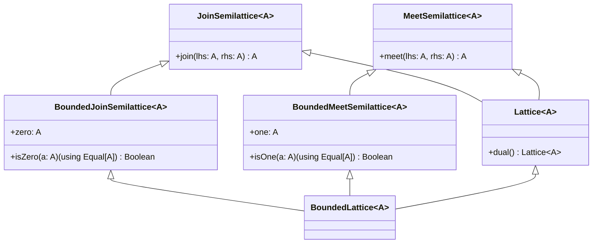

# Решётка с границами

## Формальное определение

**Ограниченная решётка** (англ. _bounded lattice_) — это решётка, которая содержит два выделенных элемента: 
**наименьший** (bottom, ⊥) и **наибольший** (top, ⊤), 
которые являются нейтральными элементами для операций `join` и `meet` соответственно.

### Аксиомы

Помимо стандартных аксиом решётки (идемпотентность, коммутативность, ассоциативность, законы поглощения), добавляются:

1. **Существование нуля (bottom)**: существует элемент `zero ∈ A`, такой что:

   ```
   join(zero, a) = a  для любого a ∈ A
   ```

2. **Существование единицы (top)**: существует элемент `one ∈ A`, такой что:

   ```
   meet(one, a) = a  для любого a ∈ A
   ```

3. **Связь с частичным порядком**:
   ```
   zero ≤ a ≤ one  для любого a ∈ A
   ```

### Свойства ограниченной решётки

| Свойство                    | Формула     | Значение                              |
|-----------------------------|-------------|---------------------------------------|
| Нейтральность zero для join | `⊥ ∨ a = a` | Ноль не влияет на объединение         |
| Нейтральность one для meet  | `⊤ ∧ a = a` | Единица не влияет на пересечение      |
| Поглощение zero для meet    | `a ∧ ⊥ = ⊥` | Пересечение с нулём даёт ноль         |
| Поглощение one для join     | `a ∨ ⊤ = ⊤` | Объединение с единицей даёт единицу   |
| Наименьший элемент          | `⊥ ≤ a`     | Ноль меньше или равен всем элементам  |
| Наибольший элемент          | `a ≤ ⊤`     | Все элементы меньше или равны единице |
| Идемпотентность zero        | `⊥ ∨ ⊥ = ⊥` | Объединение нуля с самим собой        |
| Идемпотентность one         | `⊤ ∧ ⊤ = ⊤` | Пересечение единицы с самой собой     |

### Примеры ограниченных решёток

| Множество                 | join (∨)          | meet (∧)          | zero (⊥)        | one (⊤)             | Частичный порядок     |
|---------------------------|-------------------|-------------------|-----------------|---------------------|-----------------------|
| Булевы значения           | `\|\|` (OR)       | `&&` (AND)        | `false`         | `true`              | `false ≤ true`        |
| Множества (булеан)        | `∪` (объединение) | `∩` (пересечение) | `∅` (пустое)    | `U` (универсальное) | `⊆` (включение)       |
| Целые числа от min до max | `max`             | `min`             | `min`           | `max`               | `≤` (обычный порядок) |
| Делители числа N          | `НОК`             | `НОД`             | `1`             | `N`                 | делимость             |
| Типы в Scala              | LUB               | GLB               | `Nothing`       | `Any`               | подтипизация          |
| Интервалы от min до max   | объединение       | пересечение       | пустой интервал | полный интервал     | включение             |
| Вероятности от 0 до 1     | `max`             | `min`             | `0`             | `1`                 | `≤` (обычный порядок) |

## Код

```dotty
trait BoundedLattice[A] extends Lattice[A], BoundedMeetSemilattice[A],
      BoundedJoinSemilattice[A]
```

## Схема



## Реализация в библиотеках

### Реализация в Cats

```dotty
import algebra.lattice.BoundedLattice
import cats.*
import cats.implicits.*

// Реализация для Boolean
given BoundedLattice[Boolean] with
  def join(a: Boolean, b: Boolean): Boolean = a || b
  def meet(a: Boolean, b: Boolean): Boolean = a && b
  def zero: Boolean                         = false
  def one: Boolean                          = true

// Реализация для Int (ограниченного диапазона)
given BoundedLattice[Int] with
  def join(a: Int, b: Int): Int = math.max(a, b)
  def meet(a: Int, b: Int): Int = math.min(a, b)
  def zero: Int                 = Int.MinValue
  def one: Int                  = Int.MaxValue

// Реализация для Set (булеан)
// Требуется универсальное множество для one
def boundedSetLattice[A](universe: Set[A]): BoundedLattice[Set[A]] =
  new BoundedLattice[Set[A]]:
    def join(a: Set[A], b: Set[A]): Set[A] = a ++ b
    def meet(a: Set[A], b: Set[A]): Set[A] = a diff b
    def zero: Set[A]                       = Set.empty
    def one: Set[A]                        = universe

// Использование
val boolLattice = summon[BoundedLattice[Boolean]]
println(boolLattice.join(true, false)) // true
println(boolLattice.meet(true, false)) // false
println(boolLattice.zero)              // false
println(boolLattice.one)               // true

val intLattice = summon[BoundedLattice[Int]]
println(intLattice.join(5, 3)) // 5
println(intLattice.meet(5, 3)) // 3
println(intLattice.zero)       // -2147483648
println(intLattice.one)        // 2147483647

val setLattice = boundedSetLattice(Set(1, 2, 3, 4, 5))
println(setLattice.join(Set(1, 2), Set(2, 3))) // Set(1,2,3)
println(setLattice.meet(Set(1, 2), Set(2, 3))) // Set(2)
println(setLattice.zero)                       // Set()
println(setLattice.one)                        // Set(1,2,3,4,5)
```

## Итоговое резюме

`BoundedLattice` — это решётка с двумя выделенными элементами: `zero` (⊥) и `one` (⊤), 
которые являются границами в частичном порядке. Ключевые аспекты:

1. **Двойная ограниченность**: есть как наименьший, так и наибольший элемент
2. **Нейтральность**: `zero` нейтрален для `join`, `one` нейтрален для `meet`
3. **Поглощение**: `zero` поглощается `meet`, `one` поглощается `join`
4. **Порядок**: `zero ≤ a ≤ one` для всех `a ∈ A`

Являясь основой для дистрибутивных решёток и булевых алгебр, `BoundedLattice` широко используется в:

- **Статическом анализе программ**: bottom = отсутствие информации, top = избыточная информация
- **Системах типов**: Nothing как bottom, Any как top
- **Теории множеств**: пустое множество как bottom, универсальное множество как top
- **Абстрактной интерпретации**: представление состояний программы
- **Функциональном программировании**: композиция структур с границами

---

**Ссылки:**

- [Ссылка на репозиторий с упражнениями][sample]
- [Cats](https://typelevel.org/cats/)

[sample]: https://gitverse.ru/scalabook/typeclasses
