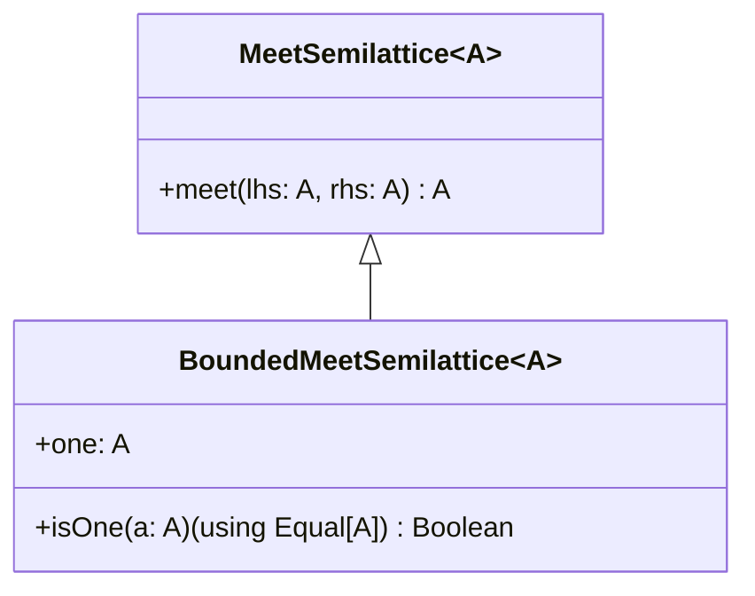



# Полурешётка пересечения с единицей

## Формальное определение

**Полурешётка пересечения с единицей** (англ. _bounded meet-semilattice_), 
также известная как **нижняя полурешётка с верхней границей** — это [`MeetSemilattice`](meet-semilattice.md), 
дополненная специальным элементом `one` (⊤), который является **нейтральным элементом** относительно операции `meet`.

### Аксиомы

Помимо стандартных аксиом полурешётки пересечения (идемпотентность, коммутативность, ассоциативность), добавляется:

1. **Существование единицы**: существует элемент `one ∈ A`, такой что:
   ```
   meet(one, a) = a  для любого a ∈ A
   ```

2. **Связь с частичным порядком**: `one` является **наибольшим элементом**:
   ```
   a ≤ one  для любого a ∈ A
   ```

### Свойства единичного элемента

| Свойство               | Формула     | Значение                              |
|------------------------|-------------|---------------------------------------|
| Нейтральность для meet | `⊤ ∧ a = a` | Единица не влияет на пересечение      |
| Поглощение для join    | `a ∨ ⊤ = ⊤` | Объединение с единицей даёт единицу   |
| Наибольший элемент     | `a ≤ ⊤`     | Все элементы меньше или равны единице |
| Идемпотентность        | `⊤ ∧ ⊤ = ⊤` | Пересечение единицы с самой собой     |

### Примеры

| Множество                        | Операция meet                   | one (⊤)                   | Частичный порядок     | Описание                                             |
|----------------------------------|---------------------------------|---------------------------|-----------------------|------------------------------------------------------|
| Булевы значения                  | `&&` (AND)                      | `true`                    | `false ≤ true`        | Истина — нейтральна для AND                          |
| Множества                        | `∩` (пересечение)               | универсальное множество U | `⊆` (включение)       | Универсальное множество — нейтрально для пересечения |
| Натуральные числа (ограниченные) | `min`                           | максимальное значение     | `≤` (обычный порядок) | Наибольшее число в диапазоне                         |
| Делители числа N                 | `НОД`                           | `N`                       | делимость             | Само число N — наибольший делитель                   |
| Типы в Scala                     | GLB (наибольшая нижняя граница) | `Any`                     | подтипизация          | Any — надтип всех типов                              |
| Интервалы                        | пересечение интервалов          | универсальный интервал    | включение             | Универсальный интервал — нейтральный для пересечения |

## Код

```dotty
trait BoundedMeetSemilattice[A] extends MeetSemilattice[A]:
  /** Нейтральный элемент относительно операции meet. Также известен как
    * наибольший элемент (top), единица или ⊤.
    */
  def one: A

  /** Проверяет, является ли данный элемент единичным (нейтральным). Использует
    * заданный экземпляр Equal для сравнения с one.
    */
  def isOne(a: A)(using ev: Equal[A]): Boolean = ev.equal(a, one)
```

## Схема



## Реализация в библиотеках

### Реализация в Cats

```dotty
import cats.*
import cats.kernel.BoundedSemilattice
import cats.implicits.*

// Реализация для Boolean (AND с one = true)
given BoundedSemilattice[Boolean] with
  def combine(a: Boolean, b: Boolean): Boolean = a && b
  def empty: Boolean                           = true // one для meet

// Реализация для Int (min с one = Int.MaxValue)
given BoundedSemilattice[Int] with
  def combine(a: Int, b: Int): Int = math.min(a, b)
  def empty: Int                   = Int.MaxValue

// Использование
val boolLattice = summon[BoundedSemilattice[Boolean]]
println(boolLattice.combine(true, false)) // false
println(boolLattice.empty)                // true

val intLattice = summon[BoundedSemilattice[Int]]
println(intLattice.combine(5, 3)) // 3
println(intLattice.empty)         // 2147483647
```

## Итоговое резюме

`BoundedMeetSemilattice` — это `MeetSemilattice` с добавленным **нейтральным элементом** `one` (⊤), 
который является наибольшим элементом в частичном порядке. Ключевые аспекты:

1. **Нейтральность**: `one` не влияет на операцию `meet`: `meet(one, a) = a`
2. **Наибольший элемент**: `a ≤ one` для всех `a ∈ A`
3. **Поглощение**: в присутствии `join`, `join(a, one) = one`
4. **Дуальность**: двойственна к `BoundedJoinSemilattice` (с zero)

Применяется в:

- **Агрегации данных** (начальное значение для пересечения)
- **Системах типов** (Any как top-тип)
- **Теории множеств** (универсальное множество как нейтральный элемент для пересечения)
- **Абстрактной интерпретации** (top-элемент как избыточная информация)

---

**Ссылки:**

- [Ссылка на репозиторий с упражнениями][sample]
- [Cats](https://typelevel.org/cats/)

[sample]: https://gitverse.ru/scalabook/typeclasses
