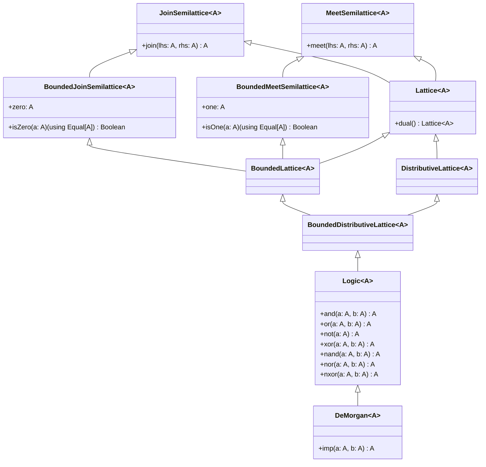



# Алгебра Де Моргана

## Формальное определение

**Алгебра Де Моргана** (англ. _De Morgan algebra_) — это алгебраическая структура, 
представляющая собой [ограниченную дистрибутивную решётку с унарной операцией отрицания (инволюцией)](logic.md), 
которая удовлетворяет **законам Де Моргана** и **закону двойного отрицания**, 
но **не обязательно** удовлетворяет закону исключённого третьего и закону непротиворечия.

### Аксиомы алгебры Де Моргана

1. **Аксиомы ограниченной дистрибутивной решётки**:
    - Все аксиомы `BoundedDistributiveLattice` (идемпотентность, коммутативность, ассоциативность, 
      законы поглощения, дистрибутивность, наличие zero и one)

2. **Законы Де Моргана** (полные):
    - `¬(x ∨ y) = ¬x ∧ ¬y` (первый закон Де Моргана)
    - `¬(x ∧ y) = ¬x ∨ ¬y` (второй закон Де Моргана)

3. **Закон двойного отрицания**:
    - `¬¬a = a` (инволютивность отрицания)

4. **Отсутствие гарантий**:
    - Закон исключённого третьего: `a ∨ ¬a = 1` — **не гарантируется**
    - Закон непротиворечия: `a ∧ ¬a = 0` — **не гарантируется**

### Сравнение с другими логическими структурами

| Свойство                            | Logic       | DeMorgan    | Heyting               | Bool |
|-------------------------------------|-------------|-------------|-----------------------|------|
| Ограниченная дистрибутивная решётка | ✅           | ✅           | ✅                     | ✅    |
| Отрицание (not)                     | ✅           | ✅           | ✅ (псевдодополнение)  | ✅    |
| Законы Де Моргана                   | ❌ (слабые)  | ✅ (полные)  | ✅                     | ✅    |
| Двойное отрицание                   | ❌           | ✅           | ❌                     | ✅    |
| Закон исключённого третьего         | ❌           | ❌           | ❌                     | ✅    |
| Закон непротиворечия                | ❌           | ❌           | ✅                     | ✅    |
| Импликация                          | ❌           | ✅           | ✅                     | ✅    |

### Примеры алгебр Де Моргана

| Пример                             | Описание               | Особенности                           |
|------------------------------------|------------------------|---------------------------------------|
| Булевы значения {true, false}      | Классическая логика    | Является также булевой алгеброй       |
| Нечёткая логика интервал от 0 до 1 | `not(x) = 1-x`         | Не имеет закона исключённого третьего |
| Трёхзначная логика Клини           | {true, false, unknown} | `not(unknown) = unknown`              |
| Решётки множеств с дополнением     | Булеан с complement    | Является булевой алгеброй             |
| Интервальная логика                | Интервалы с отрицанием | `not([a,b]) = [1-b, 1-a]`             |

## Код

```dotty
trait DeMorgan[A] extends Logic[A]:
  self =>

  /** Операция meet (пересечение) реализуется через логическое И */
  def meet(a: A, b: A): A = and(a, b)

  /** Операция join (объединение) реализуется через логическое ИЛИ */
  def join(a: A, b: A): A = or(a, b)

  /** Логическая импликация (a → b) определяется как ¬a ∨ b */
  def imp(a: A, b: A): A = or(not(a), b)
```

## Схема



## Реализация в библиотеках

### Реализация в Cats

В библиотеке Cats алгебра Де Моргана представлена типажом `DeMorgan`:

```dotty
import algebra.lattice.DeMorgan
import cats.*
import cats.implicits.*

// Реализация для Boolean (классическая логика)
given DeMorgan[Boolean] with
  def and(a: Boolean, b: Boolean): Boolean = a && b
  def or(a: Boolean, b: Boolean): Boolean  = a || b
  def not(a: Boolean): Boolean             = !a
  def zero: Boolean                        = false
  def one: Boolean                         = true

// Использование
val boolDeMorgan = summon[DeMorgan[Boolean]]
println(boolDeMorgan.and(true, false)) // false
println(boolDeMorgan.or(true, false))  // true
println(boolDeMorgan.not(true))        // false
println(boolDeMorgan.imp(true, false)) // false
println(boolDeMorgan.xor(true, true))  // false
```

### Реализация для нечёткой логики (пример)

```dotty
// Нечёткая логика на интервале [0, 1]
given FuzzyDeMorgan: DeMorgan[Double] with
  def and(a: Double, b: Double): Double = math.min(a, b)
  def or(a: Double, b: Double): Double  = math.max(a, b)
  def not(a: Double): Double            = 1.0 - a
  def zero: Double                      = 0.0
  def one: Double                       = 1.0

// Проверка законов
val fuzzy = summon[DeMorgan[Double]]
println(fuzzy.and(0.3, 0.7)) // 0.3
println(fuzzy.or(0.3, 0.7))  // 0.7
println(fuzzy.not(0.3))      // 0.7
println(fuzzy.imp(0.3, 0.7)) // 0.7 (¬0.3 ∨ 0.7 = 0.7 ∨ 0.7 = 0.7)
```

### Реализация для трёхзначной логики (пример)

```dotty
enum KleeneLogic:
  case True, False, Unknown

// Трёхзначная логика Клини как алгебра Де Моргана
given KleeneDeMorgan: DeMorgan[KleeneLogic] with
  import KleeneLogic.*

  def and(a: KleeneLogic, b: KleeneLogic): KleeneLogic =
    (a, b) match
      case (False, _)   => False
      case (_, False)   => False
      case (Unknown, _) => Unknown
      case (_, Unknown) => Unknown
      case _            => True

  def or(a: KleeneLogic, b: KleeneLogic): KleeneLogic =
    (a, b) match
      case (True, _)    => True
      case (_, True)    => True
      case (Unknown, _) => Unknown
      case (_, Unknown) => Unknown
      case _            => False

  def not(a: KleeneLogic): KleeneLogic =
    a match
      case True    => False
      case False   => True
      case Unknown => Unknown

  def zero: KleeneLogic = False
  def one: KleeneLogic  = True
end KleeneDeMorgan

```

## Итоговое резюме

`DeMorgan` — это алгебраическая структура, расширяющая `Logic` полными законами Де Моргана и двойным отрицанием. Ключевые аспекты:

1. **Инволютивное отрицание**: `¬¬a = a` гарантируется
2. **Полные законы Де Моргана**: оба закона выполняются в полной форме
3. **Негарантированные законы**: закон исключённого третьего и закон непротиворечия могут нарушаться
4. **Импликация**: определяется как `¬a ∨ b`

Алгебры Де Моргана особенно полезны для моделирования:

- **Нечёткой логики** (fuzzy logic) с непрерывными значениями истинности
- **Многозначных логик** (3-значная, 4-значная логика)
- **Логик с неопределённостью** (unknown, null)

Являясь промежуточным звеном между `Logic` и `Bool`, `DeMorgan` предоставляет баланс между выразительностью и 
гарантиями, позволяя моделировать логические системы, которые не обязаны подчиняться законам классической логики.

---

**Ссылки:**

- [Ссылка на репозиторий с упражнениями][sample]
- [Cats](https://typelevel.org/cats/)

[sample]: https://gitverse.ru/scalabook/typeclasses
