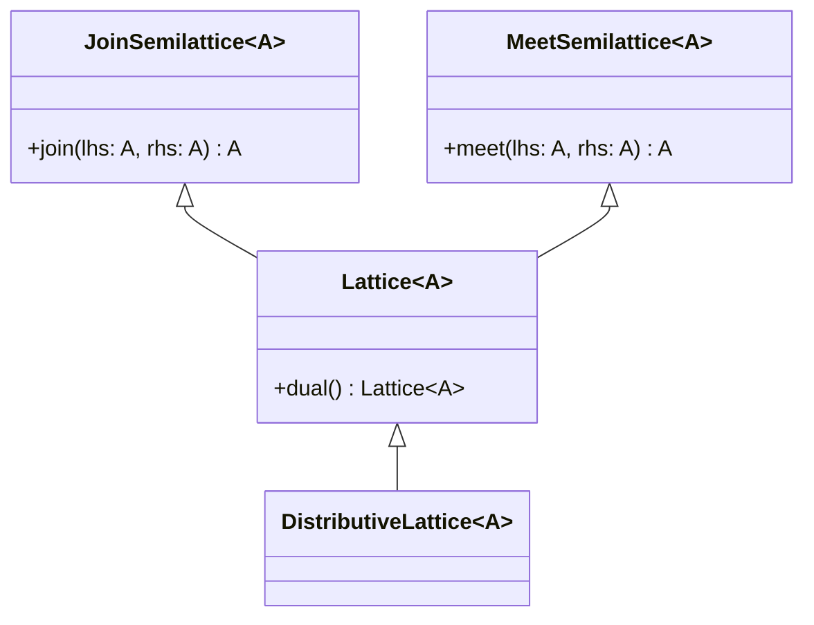

# Дистрибутивная решётка

## Формальное определение

**Дистрибутивная решётка** (англ. _distributive lattice_) — это [решётка](lattice.md), 
в которой операции `join` (∨) и `meet` (∧) **дистрибутивны** друг относительно друга. 
Это означает, что каждая из операций распределяется через другую:

### Законы дистрибутивности

1. **Дистрибутивность join относительно meet**:
   ```
   a ∨ (b ∧ c) = (a ∨ b) ∧ (a ∨ c)
   ```

2. **Дистрибутивность meet относительно join**:
   ```
   a ∧ (b ∨ c) = (a ∧ b) ∨ (a ∧ c)
   ```

В дистрибутивной решётке достаточно проверить **один** из этих законов — второй автоматически следует из первого (и наоборот), 
если решётка уже является решёткой (то есть выполняются законы поглощения).

### Эквивалентные формулировки

Дистрибутивность может быть выражена также через импликацию:

```
a ∨ (b ∧ c) ≤ (a ∨ b) ∧ (a ∨ c)  (всегда верно для любой решётки)
(a ∨ b) ∧ (a ∨ c) ≤ a ∨ (b ∧ c)  (дополнительное условие дистрибутивности)
```

### Характеристические свойства

В дистрибутивных решётках выполняются следующие важные свойства:

| Свойство           | Формула                                                     | Описание                             |
|--------------------|-------------------------------------------------------------|--------------------------------------|
| Дистрибутивность 1 | `a ∨ (b ∧ c) = (a ∨ b) ∧ (a ∨ c)`                           | join дистрибутивен относительно meet |
| Дистрибутивность 2 | `a ∧ (b ∨ c) = (a ∧ b) ∨ (a ∧ c)`                           | meet дистрибутивен относительно join |
| Закон медианности  | `(a ∨ b) ∧ (b ∨ c) ∧ (c ∨ a) = (a ∧ b) ∨ (b ∧ c) ∨ (c ∧ a)` | Характеристическое свойство          |
| Модулярность       | `a ≤ c ⇒ a ∨ (b ∧ c) = (a ∨ b) ∧ c`                         | Следствие дистрибутивности           |

### Примеры дистрибутивных решёток

| Решётка                      | Операции                | Дистрибутивна? | Примечание                           |
|------------------------------|-------------------------|----------------|--------------------------------------|
| Булевы значения              | OR/AND                  | ✅ Да           | Классический пример                  |
| Множества с ∪ и ∩            | объединение/пересечение | ✅ Да           | Решётка подмножеств                  |
| Целые числа с max/min        | max/min                 | ✅ Да           | Любой линейный порядок дистрибутивен |
| Делители числа с НОД/НОК     | НОД/НОК                 | ✅ Да           | Следует из факторизации              |
| Все подмножества множества   | ∪/∩                     | ✅ Да           | Булеан                               |
| Интервалы вещественных чисел | объединение/пересечение | ✅ Да           | Интервальная арифметика              |

## Код

```dotty
trait DistributiveLattice[A] extends Lattice[A]
```

## Схема



## Реализация в библиотеках

### Реализация в Cats

```dotty
import algebra.lattice.Lattice
import cats.*
import cats.implicits.*

// Реализация для Boolean
given Lattice[Boolean] with
  def join(a: Boolean, b: Boolean): Boolean = a || b
  def meet(a: Boolean, b: Boolean): Boolean = a && b

// Реализация для Int (max/min)
given Lattice[Int] with
  def join(a: Int, b: Int): Int = math.max(a, b)
  def meet(a: Int, b: Int): Int = math.min(a, b)

// Реализация для Set (union/intersection)
given [A]: Lattice[Set[A]] with
  def join(a: Set[A], b: Set[A]): Set[A] = a ++ b
  def meet(a: Set[A], b: Set[A]): Set[A] = a diff b

// Использование
val boolLattice = summon[Lattice[Boolean]]
boolLattice.join(true, false) // true
boolLattice.meet(true, false) // false

val intLattice = summon[Lattice[Int]]
intLattice.join(5, 3) // 5
intLattice.meet(5, 3) // 3

val setLattice = summon[Lattice[Set[String]]]
setLattice.join(Set("a", "b"), Set("b", "c")) // Set("a", "b", "c")
setLattice.meet(Set("a", "b"), Set("b", "c")) // Set("b")
```

## Итоговое резюме

`DistributiveLattice` — это важное расширение решётки, добавляющее законы дистрибутивности. Ключевые аспекты:

1. **Дистрибутивность** позволяет преобразовывать выражения, раскрывая скобки
2. **Упрощение** сложных логических выражений к нормальным формам (ДНФ, КНФ)
3. **Оптимизация запросов** в базах данных и системах правил
4. **Модулярность** автоматически следует из дистрибутивности

Применяется в:

- **Логическом программировании** (нормализация формул)
- **Базах данных** (оптимизация условий WHERE)
- **Компиляторах** (вывод типов, упрощение выражений)
- **Системах правил** (объединение и пересечение условий)
- **Абстрактной интерпретации** (упрощение абстрактных состояний)

---

**Ссылки:**

- [Ссылка на репозиторий с упражнениями][sample]
- [Cats](https://typelevel.org/cats/)

[sample]: https://gitverse.ru/scalabook/typeclasses
