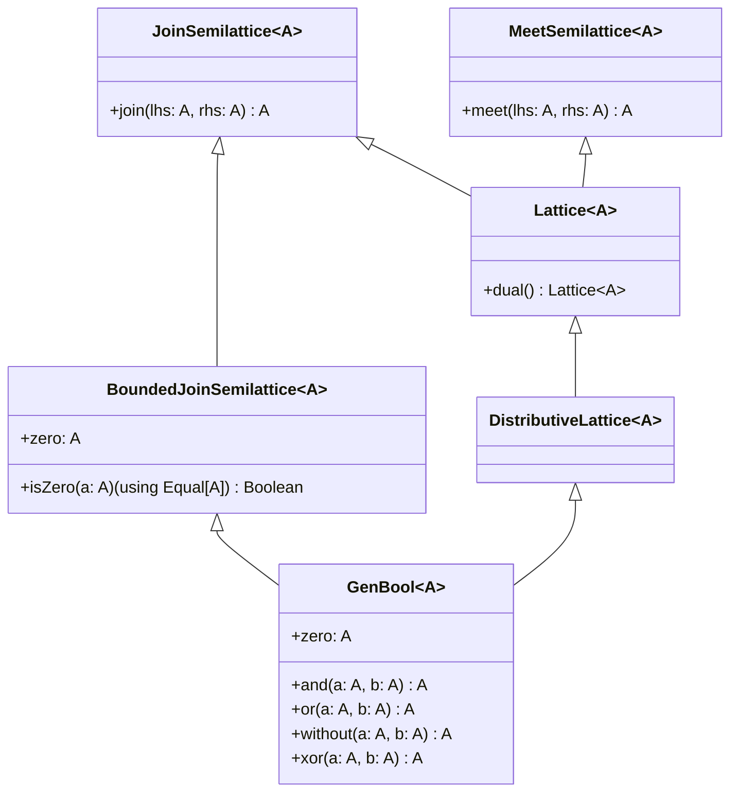



# Общая Булева алгебра

## Формальное определение

**Обобщённая булева алгебра** (англ. _generalized Boolean algebra_, _GenBool_) — 
это [дистрибутивная решётка](distributive-lattice.md) с [нижней границей (zero)](bounded-join-semilattice.md), 
которая имеет операцию **относительного дополнения** (`without`, `\`), 
но не обязательно имеет верхнюю границу (top) или абсолютное дополнение. 
Это делает её пригодной для моделирования структур, где универсальное множество не определено.

### Аксиомы обобщённой булевой алгебры

1. **Аксиомы дистрибутивной решётки**:
    - Идемпотентность, коммутативность, ассоциативность, законы поглощения, дистрибутивность

2. **Аксиомы ограниченной join-полурешётки**:
    - Существование `zero` (⊥): `join(zero, a) = a`

3. **Относительное дополнение** (`without`, `\`):
    - Для любых `a, b ∈ A` существует элемент `a \ b` (относительное дополнение), который является наибольшим элементом `x`, таким что:
        - `meet(b, x) = zero`
        - `join(b, x) = join(a, b)`

4. **Отсутствие top-элемента**:
    - В общем случае нет гарантии существования верхней границы (one)

### Свойства относительного дополнения

| Свойство           | Формула                          | Описание                                          |
|--------------------|----------------------------------|---------------------------------------------------|
| Непротиворечивость | `b ∧ (a \ b) = 0`                | Относительное дополнение не пересекается с b      |
| Поглощение         | `b ∨ (a \ b) = a ∨ b`            | Объединение b и дополнения даёт объединение a и b |
| Идемпотентность    | `a \ a = 0`                      | Разность множества с самим собой пуста            |
| Монотонность       | если `a ≤ c`, то `a \ b ≤ c \ b` | Монотонность по первому аргументу                 |
| Монотонность       | если `b ≤ c`, то `a \ c ≤ a \ b` | Монотонность по второму аргументу                 |

### Примеры обобщённых булевых алгебр

| Пример                                          | Операции                       | zero | Особенности              |
|-------------------------------------------------|--------------------------------|------|--------------------------|
| Множества (без универсума)                      | `∩`, `∪`, `\\`                 | `∅`  | Классический пример      |
| Конечные множества                              | `∩`, `∪`, `\\`                 | `∅`  | Частный случай           |
| Открытые множества топологического пространства | `∩`, `∪`, `\\` (относительное) | `∅`  | Нет гарантии top         |
| Булевы алгебры без top                          | `∩`, `∪`, `\\`                 | `0`  | Обобщение булевых алгебр |
| Решётки с относительным дополнением             | зависит от структуры           | `0`  | Другие структуры         |

## Код

```dotty
trait GenBool[A] extends DistributiveLattice[A], BoundedJoinSemilattice[A]:
  self =>

  /** Логическое И (конъюнкция) */
  def and(a: A, b: A): A

  /** Операция meet (пересечение) реализуется через логическое И */
  override def meet(a: A, b: A): A = and(a, b)

  /** Логическое ИЛИ (дизъюнкция) */
  def or(a: A, b: A): A

  /** Операция join (объединение) реализуется через логическое ИЛИ */
  override def join(a: A, b: A): A = or(a, b)

  /** Операция ''относительного дополнения'', символически часто обозначаемая
    * как `a\b` (символ теоретико-множественной разности, которая является
    * смыслом относительного дополнения в решётке множеств).
    *
    * Относительное дополнение `a\b` — это наибольший элемент x, такой что
    * meet(b, x) = zero и join(b, x) = join(a, b).
    *
    * В терминах множеств: a\b = a ∩ b^c (элементы a, не принадлежащие b)
    */
  def without(a: A, b: A): A

  /** Логическое исключающее ИЛИ (XOR), теоретико-множественная симметрическая
    * разность. Определяется как `a\b ∨ b\a`.
    *
    * В терминах множеств: a XOR b = (a \ b) ∪ (b \ a)
    */
  def xor(a: A, b: A): A = or(without(a, b), without(b, a))
end GenBool
```

## Схема



## Упражнения

### Упражнение 5.2.1: Обобщённая булева алгебра для множеств

> [Репозиторий с упражнениями и инструкцией по выполнению][sample]

Реализуйте `GenBool` для типа `Set[A]`:

```dotty
given genBoolSet[A]: GenBool[Set[A]] with
  override def and(a: Set[A], b: Set[A]): Set[A] =
    ???

  override def zero: Set[A] =
    ???

  override def or(a: Set[A], b: Set[A]): Set[A] =
    ???

  override def without(a: Set[A], b: Set[A]): Set[A] =
    ???
```

@:note(🔍 Показать решение)

Данная реализация предоставляет обобщённую булеву алгебру для множеств, 
где операция `and` соответствует пересечению множеств, 
`or` — объединению, `zero` — пустому множеству, 
а `without` — разности множеств, что позволяет выполнять теоретико-множественные операции без необходимости в универсальном множестве.

```dotty
given genBoolSet[A]: GenBool[Set[A]] with
  override def and(a: Set[A], b: Set[A]): Set[A] =
    a.intersect(b)

  override def zero: Set[A] =
    Set.empty

  override def or(a: Set[A], b: Set[A]): Set[A] =
    a ++ b

  override def without(a: Set[A], b: Set[A]): Set[A] =
    a.diff(b) 
```

@:@

## Реализация в библиотеках

### Реализация в Cats

В библиотеке Cats обобщённая булева алгебра представлена типажом `GenBool`:

```dotty
import algebra.lattice.GenBool
import cats.*
import cats.implicits.*

// Реализация для Set (обобщённая булева алгебра)
given [A]: GenBool[Set[A]] with
  def and(a: Set[A], b: Set[A]): Set[A]     = a intersect b
  def or(a: Set[A], b: Set[A]): Set[A]      = a ++ b
  def zero: Set[A]                          = Set.empty
  def without(a: Set[A], b: Set[A]): Set[A] = a diff b

// Использование
val setBool = summon[GenBool[Set[Int]]]
val a       = Set(1, 2, 3)
val b       = Set(2, 3, 4)

println(setBool.and(a, b))     // Set(2, 3)
println(setBool.or(a, b))      // Set(1, 2, 3, 4)
println(setBool.zero)          // Set()
println(setBool.without(a, b)) // Set(1)
println(setBool.xor(a, b))     // Set(1, 4)
```

## Итоговое резюме

`GenBool` — это обобщение булевой алгебры без верхней границы, использующее относительное дополнение вместо абсолютного. 
Ключевые аспекты:

1. **Отсутствие top**: не требует универсального множества
2. **Относительное дополнение**: `without` вместо `complement`
3. **Zero-элемент**: есть нижняя граница (`zero`)
4. **XOR через without**: симметрическая разность через `without`

Применяется в:

- **Теории множеств**: множества без универсального множества
- **Топологии**: открытые множества топологических пространств
- **Системах разрешений**: относительные права доступа
- **Абстрактной интерпретации**: анализ программ без глобального состояния

---

**Ссылки:**

- [Ссылка на репозиторий с упражнениями][sample]
- [Cats](https://typelevel.org/cats/)

[sample]: https://gitverse.ru/scalabook/typeclasses
