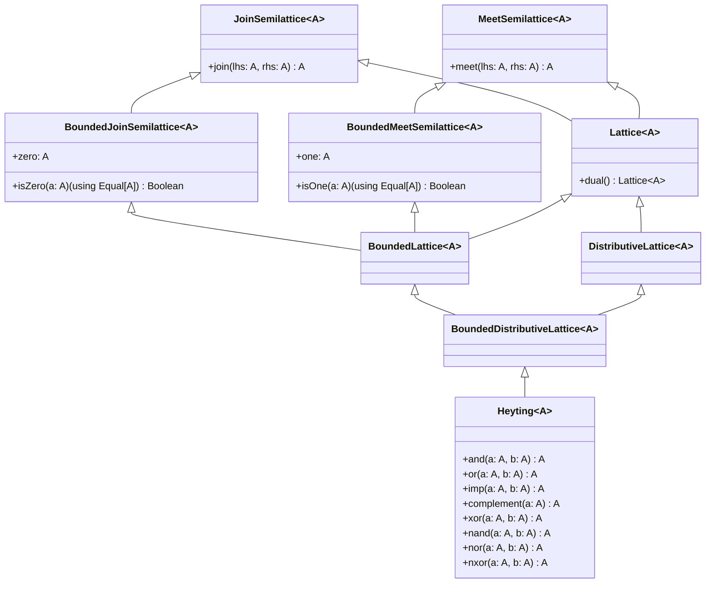



# Алгебра Гейтинга

## Формальное определение

**Алгебра Гейтинга** (англ. _Heyting algebra_) — это алгебраическая структура, 
представляющая собой [ограниченную дистрибутивную решётку](bounded-distributive-lattice.md) 
с бинарной операцией **импликации** (`imp`, →), которая моделирует интуиционистскую логику. 
В отличие от [булевых алгебр](bool.md), алгебры Гейтинга **не гарантируют** закон исключённого третьего (`a ∨ ¬a = 1`), 
но гарантируют закон непротиворечия (`a ∧ ¬a = 0`).

### Аксиомы алгебры Гейтинга

1. **Аксиомы ограниченной дистрибутивной решётки**:
    - Все аксиомы `BoundedDistributiveLattice` (идемпотентность, коммутативность, ассоциативность, 
      законы поглощения, дистрибутивность, наличие zero и one)

2. **Аксиомы импликации** (для любых a, b, c ∈ A):
    - `a → a = 1` (рефлексивность)
    - `a ∧ (a → b) = a ∧ b` (modus ponens)
    - `b ∧ (a → b) = b` (ослабление)
    - `a → (b ∧ c) = (a → b) ∧ (a → c)` (дистрибутивность импликации)

3. **Превдодополнение**:
    - `¬a = a → 0` (дополнение определяется через импликацию и `zero`)
    - `a ∧ ¬a = 0` (закон непротиворечия)

4. **Отсутствие гарантии**:
    - Закон исключённого третьего: `a ∨ ¬a = 1` — **не гарантируется**

### Сравнение с другими логическими структурами

| Свойство                            | Logic       | DeMorgan         | Heyting               | Bool |
|-------------------------------------|-------------|------------------|-----------------------|------|
| Ограниченная дистрибутивная решётка | ✅           | ✅                | ✅                     | ✅    |
| Законы Де Моргана                   | ❌ (слабые)  | ✅ (полные)       | ✅                     | ✅    |
| Двойное отрицание                   | ❌           | ✅                | ❌                     | ✅    |
| Закон исключённого третьего         | ❌           | ❌                | ❌                     | ✅    |
| Закон непротиворечия                | ❌           | ❌                | ✅                     | ✅    |
| Импликация                          | ❌           | ✅ (производная)  | ✅ (базовая)           | ✅    |
| Псевдодополнение                    | ❌           | ❌                | ✅                     | ✅    |

### Примеры алгебр Гейтинга

| Пример                                          | Описание                       | Особенности                        |
|-------------------------------------------------|--------------------------------|------------------------------------|
| Булевы значения {true, false}                   | Классическая логика            | Является также булевой алгеброй    |
| Открытые множества топологического пространства | `imp(U,V) = interior(U^c ∪ V)` | Классический пример                |
| Система типов Scala                             | `imp(A,B) = A => B`            | Функциональные типы как импликация |
| Решётки подмножеств с относительным дополнением | Частный случай булевой алгебры | При наличии универсума             |
| Интуиционистская пропозициональная логика       | Формулы с импликацией          | Моделируется алгебрами Гейтинга    |

## Код

```dotty
trait Heyting[A] extends BoundedDistributiveLattice[A]:
  self =>

  /** Логическое И (конъюнкция) */
  def and(a: A, b: A): A

  /** Операция meet (пересечение) реализуется через логическое И */
  def meet(a: A, b: A): A = and(a, b)

  /** Логическое ИЛИ (дизъюнкция) */
  def or(a: A, b: A): A

  /** Операция join (объединение) реализуется через логическое ИЛИ */
  def join(a: A, b: A): A = or(a, b)

  /** Логическая импликация (a → b) */
  def imp(a: A, b: A): A

  /** Псевдодополнение элемента (¬a), эквивалентно (a → 0) */
  def complement(a: A): A

  /** Исключающее ИЛИ (XOR) — истинно, когда ровно один из операндов истинен */
  def xor(a: A, b: A): A = or(and(a, complement(b)), and(complement(a), b))

  /** Штрих Шеффера (NAND) — отрицание конъюнкции */
  def nand(a: A, b: A): A = complement(and(a, b))

  /** Стрелка Пирса (NOR) — отрицание дизъюнкции */
  def nor(a: A, b: A): A = complement(or(a, b))

  /** Исключающее ИЛИ с отрицанием (XNOR) — эквивалентность */
  def nxor(a: A, b: A): A = complement(xor(a, b))
end Heyting
```

## Схема



## Реализация в библиотеках

### Реализация в Cats

```dotty
import algebra.lattice.Heyting
import cats.*
import cats.implicits.*

// Реализация для Boolean (классическая логика)
given Heyting[Boolean] with
  def and(a: Boolean, b: Boolean): Boolean = a && b
  def or(a: Boolean, b: Boolean): Boolean  = a || b
  def imp(a: Boolean, b: Boolean): Boolean = !a || b
  def complement(a: Boolean): Boolean      = !a
  def zero: Boolean                        = false
  def one: Boolean                         = true

// Использование
val boolHeyting = summon[Heyting[Boolean]]
println(boolHeyting.and(true, false)) // false
println(boolHeyting.or(true, false))  // true
println(boolHeyting.imp(true, false)) // false
println(boolHeyting.complement(true)) // false
println(boolHeyting.xor(true, true))  // false
```

## Итоговое резюме

`Heyting` — это алгебраическая структура, моделирующая интуиционистскую логику через импликацию и псевдодополнение. 
Ключевые аспекты:

1. **Импликация как базовая операция**: `imp` является фундаментальной, а не производной
2. **Псевдодополнение**: определяется через импликацию: `¬a = a → 0`
3. **Закон непротиворечия**: `a ∧ ¬a = 0` гарантируется
4. **Закон исключённого третьего**: `a ∨ ¬a = 1` **не гарантируется**
5. **Интуиционистская логика**: основная модель для конструктивной математики

Алгебры Гейтинга особенно важны в:

- **Теории типов**: функциональные типы как импликация
- **Топологии**: открытые множества как пропозиции
- **Теории категорий**: подобъекты и экспоненциалы
- **Конструктивной математике**: доказательства без закона исключённого третьего

---

**Ссылки:**

- [Ссылка на репозиторий с упражнениями][sample]
- [Cats](https://typelevel.org/cats/)

[sample]: https://gitverse.ru/scalabook/typeclasses
