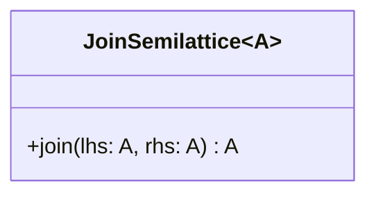

# Полурешётка объединения

## Формальное определение

**Полурешётка объединения** (англ. _join-semilattice_, также известна как **верхняя полурешётка**) — это алгебраическая структура, 
представляющая собой частично упорядоченное множество, в котором для любой пары элементов существует **наименьшая верхняя граница** (supremum).

В терминах абстрактной алгебры, полурешётка объединения — это множество `A` с бинарной операцией `join` (обозначается как `∨`), 
удовлетворяющей трём аксиомам:

1. **Идемпотентность**: `a ∨ a = a` для любого `a ∈ A`
2. **Коммутативность**: `a ∨ b = b ∨ a` для любых `a, b ∈ A`
3. **Ассоциативность**: `(a ∨ b) ∨ c = a ∨ (b ∨ c)` для любых `a, b, c ∈ A`

Связь с частичным порядком: для любых `a, b ∈ A` выполняется:

- `a ≤ b` тогда и только тогда, когда `a ∨ b = b`

То есть `join` выбирает "наибольший" из двух элементов в смысле заданного порядка.

## Код

```dotty
trait JoinSemilattice[A]:
  /** Операция объединения (join) — возвращает наименьшую верхнюю границу
    * для двух элементов.
    */
  def join(lhs: A, rhs: A): A
```

## Примеры

| Множество         | Операция join               | Частичный порядок     | Описание                 |
|-------------------|-----------------------------|-----------------------|--------------------------|
| Булевы значения   | `\|\|` (OR)                 | `false ≤ true`        | Логическое ИЛИ           |
| Множества         | `∪` (объединение)           | `⊆` (включение)       | Объединение множеств     |
| Натуральные числа | `max`                       | `≤` (обычный порядок) | Максимум из двух чисел   |
| Делители числа N  | `НОК`                       | делимость             | Наименьшее общее кратное |
| Типы в Scala      | LUB (Least Upper Bound)     | подтипизация          | Наименьший общий надтип  |
| Строки            | лексикографический максимум | алфавитный порядок    | "более поздняя" строка   |

`JoinSemilattice` — это фундаментальная структура, лежащая в основе многих абстракций в функциональном программировании.
Она позволяет:

- **Объединять информацию** из разных источников
- **Находить обобщения** для различных значений
- **Строить иерархии** на основе частичного порядка
- **Моделировать операции** типа максимум, объединение, ИЛИ

Являясь основой для решёток и булевых алгебр, `JoinSemilattice` широко используется в системах типов,
статическом анализе, базах данных и многих других областях.

## Схема



## Реализация в библиотеках

### Реализация в Cats

```dotty
import algebra.lattice.JoinSemilattice
import cats.*
import cats.implicits.*

// Реализация для Boolean (OR)
given JoinSemilattice[Boolean] with
  def join(a: Boolean, b: Boolean): Boolean = a || b

// Реализация для Int (max)
given JoinSemilattice[Int] with
  def join(a: Int, b: Int): Int = math.max(a, b)

// Реализация для Set (объединение)
given [A]: JoinSemilattice[Set[A]] with
  def join(a: Set[A], b: Set[A]): Set[A] = a ++ b

// Использование
val boolLattice = summon[JoinSemilattice[Boolean]]
boolLattice.join(true, false) 
// true

val intLattice = summon[JoinSemilattice[Int]]
intLattice.join(5, 3)
// 5

val setLattice = summon[JoinSemilattice[Set[String]]]
setLattice.join(Set("a", "b"), Set("b", "c")) 
// Set("a", "b", "c")
```

---

**Ссылки:**

- [Ссылка на репозиторий с упражнениями][sample]
- [Cats](https://typelevel.org/cats/)

[sample]: https://gitverse.ru/scalabook/typeclasses
