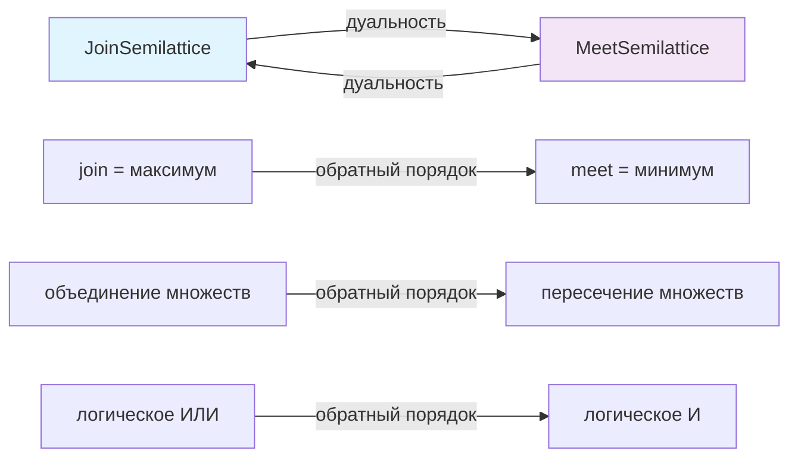
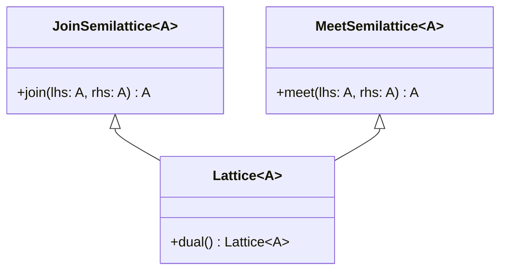



# Полная решётка

## Формальное определение

**Решётка** (англ. _lattice_) — это алгебраическая структура, представляющая собой частично упорядоченное множество, 
в котором для любой пары элементов существует как **наименьшая верхняя граница** (supremum, join, ∨), 
так и **наибольшая нижняя граница** (infimum, meet, ∧).

В терминах абстрактной алгебры, решётка — это множество `A` с двумя бинарными операциями `join` (∨) и `meet` (∧), 
удовлетворяющими следующим аксиомам:

### 1. Аксиомы полурешёток

Для каждой операции по отдельности выполняются законы:

- **Идемпотентность**:
    - `a ∨ a = a`
    - `a ∧ a = a`
- **Коммутативность**:
    - `a ∨ b = b ∨ a`
    - `a ∧ b = b ∧ a`
- **Ассоциативность**:
    - `(a ∨ b) ∨ c = a ∨ (b ∨ c)`
    - `(a ∧ b) ∧ c = a ∧ (b ∧ c)`

### 2. Законы поглощения (absorption laws)

Это ключевые законы, связывающие обе операции:

- `a ∨ (a ∧ b) = a`
- `a ∧ (a ∨ b) = a`

### 3. Связь с частичным порядком

Для любых `a, b ∈ A`:

- `a ≤ b` тогда и только тогда, когда `a ∨ b = b`
- `a ≤ b` тогда и только тогда, когда `a ∧ b = a`

## Код

```dotty
trait Lattice[A] extends JoinSemilattice[A], MeetSemilattice[A]:
  self =>

  /** Это решётка, в которой meet и join поменяны местами
    *
    * Это полезно для использования принципа дуальности:
    * любое утверждение о решётках остаётся верным при замене
    * join ↔ meet и ≤ ↔ ≥
    */
  def dual: Lattice[A] = new Lattice[A]:
    def meet(a: A, b: A): A = self.join(a, b)
    def join(a: A, b: A): A = self.meet(a, b)
    override def dual: Lattice[A] = self
```

## Примеры решёток

| Множество         | Операция join (∨) | Операция meet (∧) | Частичный порядок     | Описание                        |
|-------------------|-------------------|-------------------|-----------------------|---------------------------------|
| Булевы значения   | `\|\|` (OR)       | `&&` (AND)        | `false ≤ true`        | Двухэлементная булева решётка   |
| Множества         | `∪` (объединение) | `∩` (пересечение) | `⊆` (включение)       | Решётка подмножеств             |
| Натуральные числа | `max`             | `min`             | `≤` (обычный порядок) | Линейно упорядоченное множество |
| Делители числа N  | `НОК`             | `НОД`             | делимость             | Решётка делителей               |
| Типы в Scala      | LUB               | GLB               | подтипизация          | Решётка типов                   |
| Подпространства   | сумма             | пересечение       | включение             | Решётка подпространств          |

### Двойственность Join и Meet



### Резюме 

`Lattice` — это фундаментальная структура, объединяющая `JoinSemilattice` и `MeetSemilattice` с помощью законов поглощения. 
Она позволяет:

1. **Объединять и пересекать информацию** из разных источников
2. **Вычислять верхние и нижние границы** в частично упорядоченных множествах
3. **Моделировать иерархии** с операциями обобщения и специализации
4. **Использовать принцип дуальности** через метод `dual`

## Схема



## Реализация в библиотеках

### Реализация в Cats

В Cats решётка представлена типажом `Lattice`:

```dotty
import algebra.lattice.Lattice
import cats.*
import cats.implicits.*

// Реализация для Boolean
given Lattice[Boolean] with
  def join(a: Boolean, b: Boolean): Boolean = a || b
  def meet(a: Boolean, b: Boolean): Boolean = a && b

// Реализация для Int (max/min)
given Lattice[Int] with
  def join(a: Int, b: Int): Int = math.max(a, b)
  def meet(a: Int, b: Int): Int = math.min(a, b)

// Реализация для Set (union/intersection)
given [A]: Lattice[Set[A]] with
  def join(a: Set[A], b: Set[A]): Set[A] = a ++ b
  def meet(a: Set[A], b: Set[A]): Set[A] = a diff b

// Использование
val boolLattice = summon[Lattice[Boolean]]
boolLattice.join(true, false) // true
boolLattice.meet(true, false) // false

val intLattice = summon[Lattice[Int]]
intLattice.join(5, 3) // 5
intLattice.meet(5, 3) // 3

val setLattice = summon[Lattice[Set[String]]]
setLattice.join(Set("a", "b"), Set("b", "c")) // Set("a", "b", "c")
setLattice.meet(Set("a", "b"), Set("b", "c")) // Set("b")
```

---

**Ссылки:**

- [Ссылка на репозиторий с упражнениями][sample]
- [Cats](https://typelevel.org/cats/)

[sample]: https://gitverse.ru/scalabook/typeclasses
