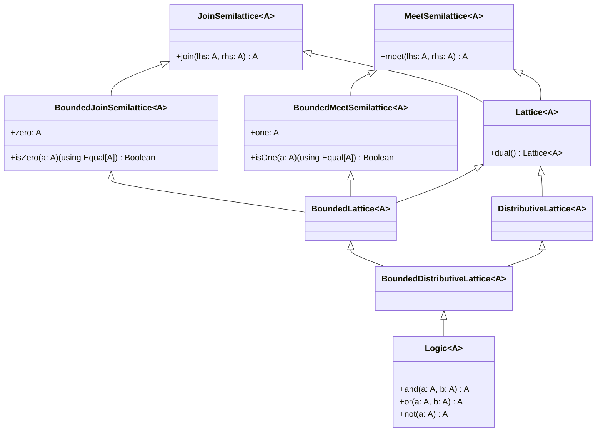



# Общая логика

## Формальное определение

**Общая логика** (англ. _logic_) — это алгебраическая структура, 
расширяющая [ограниченную дистрибутивную решётку](bounded-distributive-lattice.md) операцией отрицания (negation), 
которая подчиняется **слабым законам Де Моргана**. 
Эта структура служит абстрактным фундаментом для различных логических систем, 
включая классическую, интуиционистскую и нечёткую логику.

### Аксиомы Logic

1. **Аксиомы ограниченной дистрибутивной решётки**:
    - Все аксиомы `BoundedDistributiveLattice` (идемпотентность, коммутативность, ассоциативность, 
      законы поглощения, дистрибутивность, наличие `zero` и `one`)

2. **Операция отрицания** (`not`, `¬`):
    - `not: A → A` — унарная операция

3. **Слабые законы Де Моргана**:
    - `¬(x ∨ y) = ¬x ∧ ¬y` (первый закон Де Моргана)
    - `¬(x ∧ y) = ¬¬(¬x ∨ ¬y)` (второй закон в ослабленной форме)

#### Слабые vs Полные законы Де Моргана

| Закон   | Слабая форма (Logic) | Полная форма (DeMorgan/Bool) |
|---------|----------------------|------------------------------|
| Закон 1 | `¬(x∨y) = ¬x∧¬y`     | `¬(x∨y) = ¬x∧¬y`             |
| Закон 2 | `¬(x∧y) = ¬¬(¬x∨¬y)` | `¬(x∧y) = ¬x∨¬y`             |

> В полной форме второй закон Де Моргана не требует двойного отрицания, что делает его более сильным.

### Связь с другими логическими структурами

| Структура                | Отрицание                  | Законы Де Моргана | Закон исключённого третьего | Двойное отрицание |
|--------------------------|----------------------------|-------------------|-----------------------------|-------------------|
| Logic                    | ✅ есть                     | ❌ слабые          | ❌                           | ❌                 |
| [DeMorgan](de-morgan.md) | ✅ есть                     | ✅ полные          | ❌                           | ✅                 |
| [Heyting](heyting.md)    | ✅ есть (псевдодополнение)  | ✅ полные          | ❌                           | ❌                 |
| [Bool](bool.md)          | ✅ есть                     | ✅ полные          | ✅                           | ✅                 |

### Примеры логических систем

| Логика           | Тип элементов            | Операции                    | Применение                              |
|------------------|--------------------------|-----------------------------|-----------------------------------------|
| Классическая     | Boolean                  | `!`, `&&`, `\|\|`           | Программирование, схемотехника          |
| Интуиционистская | Типы, открытые множества | импликация вместо отрицания | Теория типов, конструктивная математика |
| Нечёткая         | интервал от 0 до 1       | `1-x`, `min`, `max`         | Управление, экспертные системы          |
| Трёхзначная      | {true, false, unknown}   | операторы Клини             | Базы данных, логика с неопределённостью |

## Код

```dotty
trait Logic[A] extends BoundedDistributiveLattice[A]:
  self =>

  /** Логическое И (конъюнкция) — соответствует операции meet (пересечение) */
  def and(a: A, b: A): A

  /** Логическое ИЛИ (дизъюнкция) — соответствует операции join (объединение) */
  def or(a: A, b: A): A

  /** Логическое отрицание (инволюция) */
  def not(a: A): A

  /** Исключающее ИЛИ (XOR) — истинно, когда ровно один из операндов истинен.
    * Определяется как: (a ∧ ¬b) ∨ (¬a ∧ b)
    */
  def xor(a: A, b: A): A = or(and(a, not(b)), and(not(a), b))

  /** Штрих Шеффера (NAND) — отрицание конъюнкции: ¬(a ∧ b) */
  def nand(a: A, b: A): A = not(and(a, b))

  /** Стрелка Пирса (NOR) — отрицание дизъюнкции: ¬(a ∨ b) */
  def nor(a: A, b: A): A = not(or(a, b))

  /** Исключающее ИЛИ с отрицанием (XNOR) — эквивалентность: ¬(a xor b) */
  def nxor(a: A, b: A): A = not(xor(a, b))
end Logic
```

## Схема



## Реализация в библиотеках

### Реализация в Cats

```dotty
import algebra.lattice.Logic
import cats.*
import cats.implicits.*

// Реализация для Boolean (классическая логика)
given Logic[Boolean] with
  def and(a: Boolean, b: Boolean): Boolean = a && b
  def or(a: Boolean, b: Boolean): Boolean  = a || b
  def not(a: Boolean): Boolean             = !a
  def zero: Boolean                        = false
  def one: Boolean                         = true

  override def join(lhs: Boolean, rhs: Boolean): Boolean = or(lhs, rhs)

  override def meet(lhs: Boolean, rhs: Boolean): Boolean = and(lhs, rhs)

// Использование
val boolLogic = summon[Logic[Boolean]]
println(boolLogic.and(true, false))  // false
println(boolLogic.or(true, false))   // true
println(boolLogic.not(true))         // false
println(boolLogic.xor(true, true))   // false
println(boolLogic.nand(true, true))  // false
println(boolLogic.nor(false, false)) // true
println(boolLogic.nxor(true, false)) // false
```

## Итоговое резюме

`Logic` — это фундаментальная структура, моделирующая общую логику на основе ограниченной дистрибутивной решётки с отрицанием. Ключевые аспекты:

1. **Обобщение**: охватывает широкий спектр логических систем
2. **Минимальность**: содержит только необходимые аксиомы (слабые законы Де Моргана)
3. **Расширяемость**: служит основой для более сильных логик (DeMorgan, Heyting, Bool)
4. **Практичность**: предоставляет производные операции (xor, nand, nor, nxor)

Являясь вершиной иерархии решёток, `Logic` подготавливает почву для перехода от чисто решёточных структур к логическим, включая:

- **Классическую логику** (Bool)
- **Интуиционистскую логику** (Heyting)
- **Нечёткую логику** (DeMorgan)

---

**Ссылки:**

- [Ссылка на репозиторий с упражнениями][sample]
- [Cats](https://typelevel.org/cats/)

[sample]: https://gitverse.ru/scalabook/typeclasses
