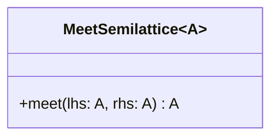



# Полурешётка пересечения

## Формальное определение

**Полурешётка пересечения** (англ. _meet-semilattice_, также известна как **нижняя полурешётка**) — это алгебраическая структура, 
представляющая собой частично упорядоченное множество, в котором для любой пары элементов существует **наибольшая нижняя граница** (infimum).

В терминах абстрактной алгебры, полурешётка пересечения — это множество `A` с бинарной операцией `meet` (обозначается как `∧`), 
удовлетворяющей трём аксиомам:

1. **Идемпотентность**: `a ∧ a = a` для любого `a ∈ A`
2. **Коммутативность**: `a ∧ b = b ∧ a` для любых `a, b ∈ A`
3. **Ассоциативность**: `(a ∧ b) ∧ c = a ∧ (b ∧ c)` для любых `a, b, c ∈ A`

Связь с частичным порядком: для любых `a, b ∈ A` выполняется:

- `a ≤ b` тогда и только тогда, когда `a ∧ b = a`

То есть `meet` выбирает "наименьший" из двух элементов в смысле заданного порядка.

## Код

```dotty
trait MeetSemilattice[A]:
  /** Операция пересечения (meet) — возвращает наибольшую нижнюю границу
    * для двух элементов.
    */
  def meet(lhs: A, rhs: A): A
```

## Примеры

| Множество         | Операция meet              | Частичный порядок     | Описание                  |
|-------------------|----------------------------|-----------------------|---------------------------|
| Булевы значения   | `&&` (AND)                 | `false ≤ true`        | Логическое И              |
| Множества         | `∩` (пересечение)          | `⊆` (включение)       | Пересечение множеств      |
| Натуральные числа | `min`                      | `≤` (обычный порядок) | Минимум из двух чисел     |
| Делители числа N  | `НОД`                      | делимость             | Наибольший общий делитель |
| Типы в Scala      | GLB (Greatest Lower Bound) | подтипизация          | Наибольший общий подтип   |
| Строки            | лексикографический минимум | алфавитный порядок    | "более ранняя" строка     |

`MeetSemilattice` — это фундаментальная структура, дуальная [`JoinSemilattice`](join-semilattice.md). 
Она позволяет:

- **Находить общую часть** между двумя значениями
- **Пересекать информацию** из разных источников
- **Находить наибольший общий подтип** в системах типов
- **Вычислять минимум** в различных структурах данных

Вместе с `JoinSemilattice` образует основу для решёток ([Lattice](lattice.md)), которые объединяют обе операции 
и являются фундаментом для построения булевых алгебр и логических систем в функциональном программировании.

## Схема



## Реализация в библиотеках

### Реализация в Cats

```dotty
import algebra.lattice.MeetSemilattice
import cats.*
import cats.implicits.*

// Реализация для Boolean (AND)
given MeetSemilattice[Boolean] with
  def meet(a: Boolean, b: Boolean): Boolean = a && b

// Реализация для Int (min)
given MeetSemilattice[Int] with
  def meet(a: Int, b: Int): Int = math.min(a, b)

// Реализация для Set (пересечение)
given [A]: MeetSemilattice[Set[A]] with
  def meet(a: Set[A], b: Set[A]): Set[A] = a diff b

// Использование
val boolLattice = summon[MeetSemilattice[Boolean]]
boolLattice.meet(true, false)
// false

val intLattice = summon[MeetSemilattice[Int]]
intLattice.meet(5, 3)
// 3

val setLattice = summon[MeetSemilattice[Set[String]]]
setLattice.meet(Set("a", "b"), Set("b", "c"))
// Set("b")
```

---

**Ссылки:**

- [Ссылка на репозиторий с упражнениями][sample]
- [Cats](https://typelevel.org/cats/)

[sample]: https://gitverse.ru/scalabook/typeclasses
