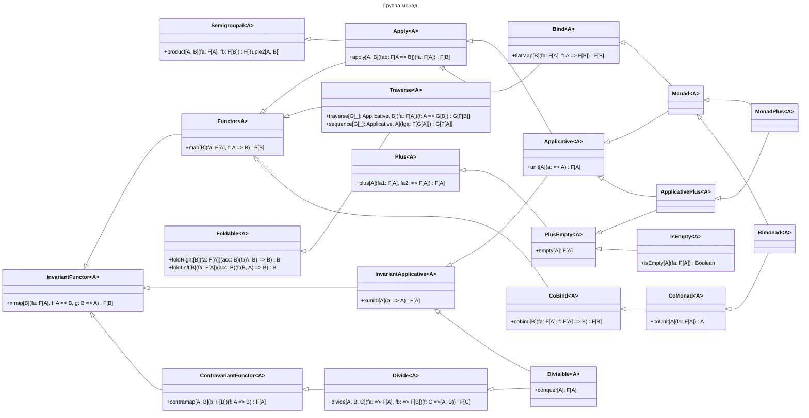

# Группа Monad

## Схема группы

**Ссылки:**

- [Исходный код](https://gitverse.ru/artemkorsakov/scalabook/content/master/examples/src/main/scala/ru/scalabook/typeclass/monad)
- [Тесты](https://gitverse.ru/artemkorsakov/scalabook/content/master/examples/src/test/scala/ru/scalabook/typeclass/monad)
- [A Monads Approach for Beginners, in Scala - Rock the JVM](https://www.youtube.com/watch?v=d-dy1x33moA&list=PLmtsMNDRU0Bzj7INIrLugi3a_WClwQuiS)
