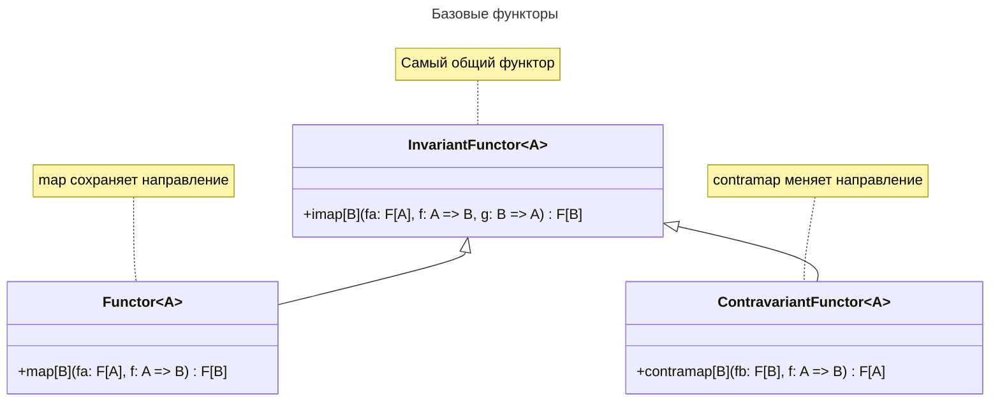
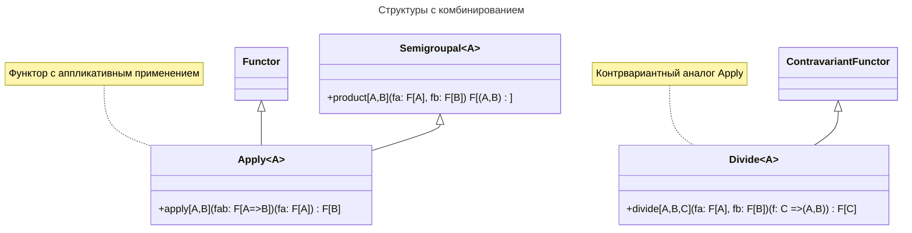
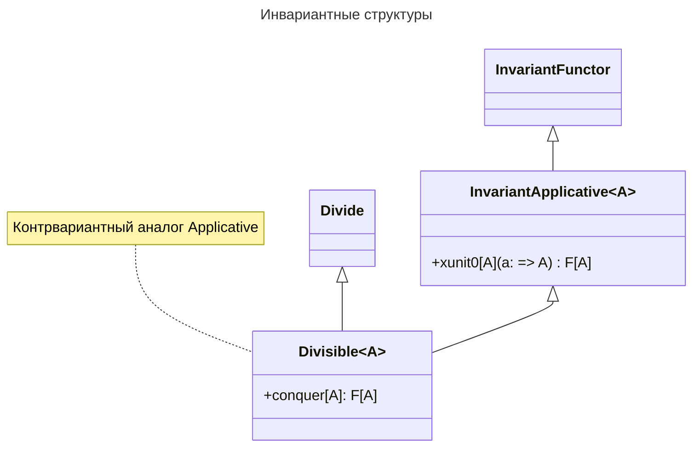
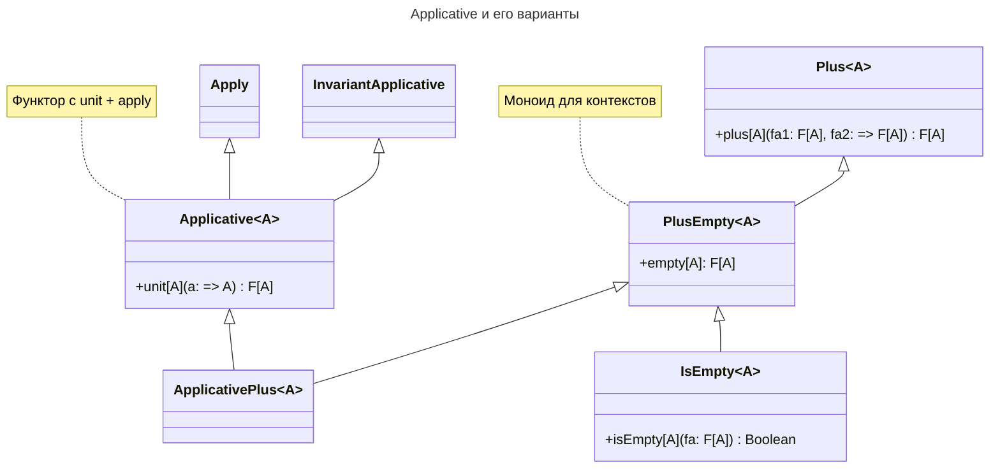
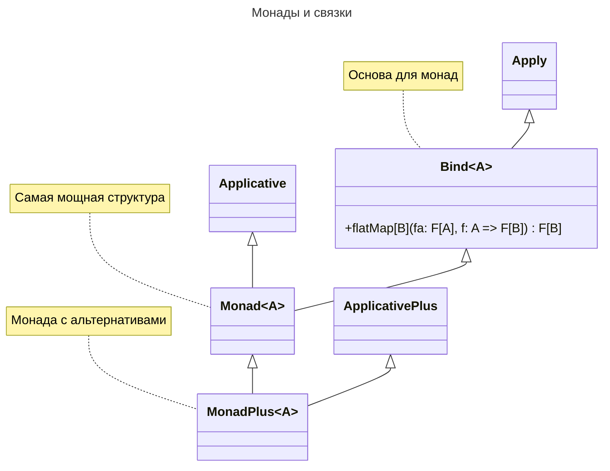
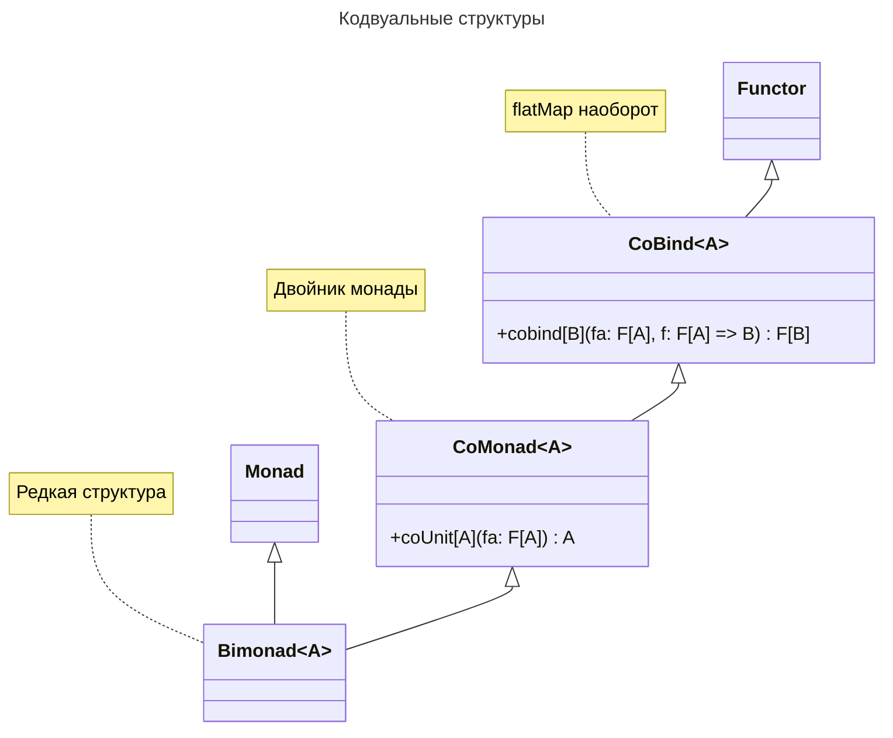
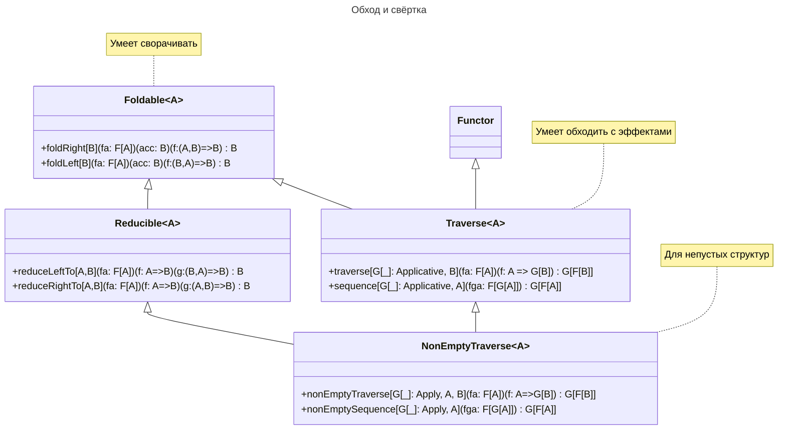
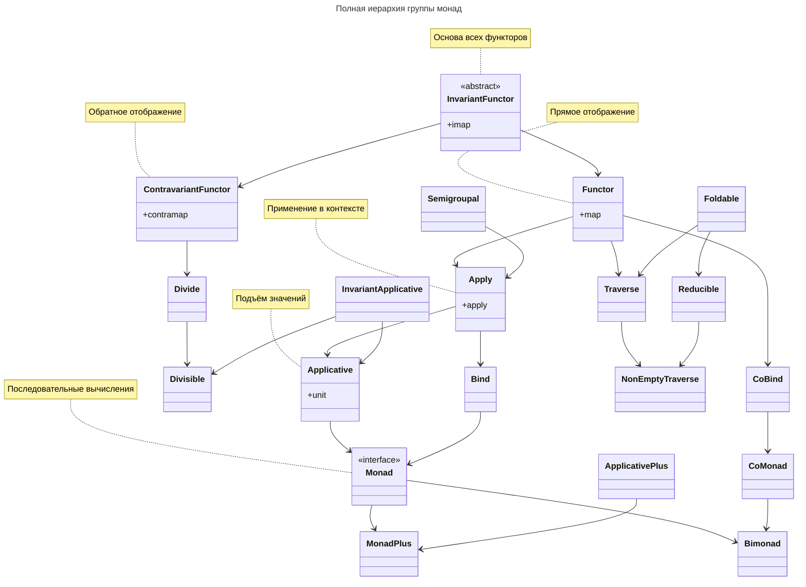



# Группа Monad

## Введение

**Монады** — одна из наиболее важных и одновременно сложных концепций в функциональном программировании и теории категорий. 
Они представляют собой абстрактную структуру, которая позволяет эффективно управлять побочными эффектами, 
такими как обработка ошибок, ввод-вывод, состояние или асинхронные вычисления, 
сохраняя при этом чистоту и композируемость функций. 
Монады обеспечивают единый интерфейс для работы с такими эффектами, 
что делает их незаменимым инструментом в разработке надёжного и предсказуемого программного обеспечения.

Идея монад берёт своё начало в математике, где они используются для описания определённых типов функторов с дополнительной структурой. 
Однако благодаря своей универсальности и выразительности монады нашли широкое применение в языках программирования, 
таких как Scala, Haskell и других. 

## Использование 

Вот основные области, где используются монады:

### Функциональное программирование

- **Управление побочными эффектами**: Монады позволяют изолировать побочные эффекты 
  (например, ввод-вывод, изменение состояния, обработка ошибок) и работать с ними в чисто функциональном стиле.
- **Композиция вычислений**: Монады предоставляют механизм для последовательного выполнения операций, 
  где каждая операция может зависеть от результата предыдущей.

### Обработка ошибок

- Монады, такие как `Option` и `Either`, используются для [безопасной обработки ошибок](../fp/handling-errors.md) без необходимости явного использования исключений.
- Пример: В Scala `Option` позволяет выразить вычисление, которое может вернуть значение (`Some`) или ничего (`None`).

### Работа с состоянием

- Монада `State` позволяет моделировать вычисления, которые [зависят от изменяемого состояния](../fp/state.md), сохраняя при этом чистоту функций.
- Пример: Управление состоянием в функциональных программах без использования изменяемых переменных.

### Асинхронные вычисления

- Монады, такие как `IO` и `Promise`, используются [для работы с асинхронными операциями](../fp/external-effects/common_io.md), такими как чтение файлов, 
  сетевые запросы или взаимодействие с базами данных.
- Пример: В Scala монада `IO` позволяет описывать ввод-вывод в чисто функциональном стиле.

### Парсинг

- Монады используются для создания комбинаторов парсеров, которые позволяют строить сложные парсеры из простых компонентов.
- Пример: Библиотеки парсеров, такие как Circe в Scala.

### Работа с коллекциями

- Монады, такие как `List`, позволяют [работать с последовательностями](../data-structures/linear_list/lists.md) и комбинировать их в сложные вычисления.
- Пример: Генерация всех возможных комбинаций элементов списка.

### Теория категорий

- В математике монады используются для описания определённых типов функторов с дополнительной структурой, 
  что помогает в изучении алгебраических и категориальных свойств.

### Реактивное программирование

- Монады могут использоваться для управления потоками данных и реактивными вычислениями, где значения изменяются со временем.
- Пример: Библиотеки для реактивного программирования, такие как RxJS, вдохновлены монадическими концепциями.

### Тестирование и моделирование

- Монады, такие как `Writer`, позволяют [собирать дополнительную информацию (например, логи)](../fp/writer.md) в процессе вычислений.
- Пример: Логирование в функциональных программах.

### Доменно-специфичные языки (DSL)

- Монады используются для создания встроенных DSL, которые позволяют описывать сложные доменные задачи в удобной и выразительной форме.
- Пример: Языки для описания бизнес-правил или конфигураций.

### Примеры использования в реальных проектах:

- В Haskell монады используются практически повсеместно, начиная от ввода-вывода и заканчивая сложными библиотеками для работы с данными.
- В Scala монады реализованы через такие типы, как `Option`, `Future` и `Try`, которые активно применяются в промышленной разработке.
- В JavaScript библиотеки, такие как `folktale` или `fp-ts`, предоставляют монадические структуры для функционального программирования.

---

Таким образом, монады — это мощный инструмент, который помогает структурировать код, 
управлять сложностью и делать программы более модульными, предсказуемыми и выразительными.

## Пример

В Scala монады активно используются для работы с различными типами вычислений, такими как обработка ошибок, 
асинхронные операции, работа с опциональными значениями и многое другое. 
Scala предоставляет несколько встроенных типов, которые являются монадами, таких как `Option`, `Either`, `Future`, `Try` и `List`. 

### Монада `Option`

`Option` используется для работы со значениями, которые могут отсутствовать (`None`) или присутствовать (`Some(value)`). 
Это позволяет избежать `null` и явных проверок.

```dotty
def divide(a: Int, b: Int): Option[Int] =
  if b == 0 then None else Some(a / b)

val result: Option[Int] =
  for
    x <- divide(10, 2)
    y <- divide(x, 5)
  yield y

result // Some(1)
```

---

### Монада `Either`

`Either` используется для обработки вычислений, которые могут вернуть либо успешный результат (`Right`), либо ошибку (`Left`).

```dotty
def parseNumber(s: String): Either[String, Int] =
  try
    Right(s.toInt)
  catch
    case _: NumberFormatException => Left("Not a number")

val result: Either[String, Int] =
  for
    x <- parseNumber("10")
    y <- parseNumber("5")
  yield x + y

println(result) // Right(15)
```

### Монада `Future`

`Future` используется для асинхронных вычислений, которые выполняются в отдельном потоке.

```dotty
import scala.concurrent.Future
import scala.concurrent.ExecutionContext.Implicits.global

def asyncComputation(x: Int): Future[Int] =
  Future {
    Thread.sleep(1000) // Имитация долгой операции
    x * 2
  }

val result: Future[Int] =
  for
    a <- asyncComputation(10)
    b <- asyncComputation(20)
  yield a + b

result.foreach(println) // Через некоторое время выведет 60
```

### Монада `Try`

`Try` используется для обработки операций, которые могут завершиться успешно (`Success`) или выбросить исключение (`Failure`).

```dotty
import scala.util.{Try, Success, Failure}

def safeDivide(a: Int, b: Int): Try[Int] =
  Try { a / b }

val result: Try[Int] =
  for
    x <- safeDivide(10, 2)
    y <- safeDivide(x, 0) // Деление на ноль
  yield y

println(result) // Failure(java.lang.ArithmeticException: / by zero)
```

### Монада `List`

`List` является монадой, которая позволяет комбинировать списки и выполнять операции над их элементами.

```dotty
val numbers = List(1, 2, 3)
val letters = List('a', 'b', 'c')

val result: List[String] =
  for
    n <- numbers
    l <- letters
  yield s"$n$l"

println(result) // List(1a, 1b, 1c, 2a, 2b, 2c, 3a, 3b, 3c)
```

### Монада `Writer` (из библиотеки Cats)

`Writer` используется для сбора логов или дополнительной информации в процессе вычислений.

```dotty
import cats.data.Writer
import cats.implicits.*

type Logged[A] = Writer[Vector[String], A]

def logNumber(x: Int): Logged[Int] = Writer(Vector(s"Number: $x"), x)

val result: Logged[Int] =
  for
    a <- logNumber(10)
    b <- logNumber(20)
  yield a + b

println(result.run) // (Vector(Number: 10, Number: 20), 30)
```

### Монада `IO` (из библиотеки Cats Effect)

`IO` используется для описания побочных эффектов, таких как ввод-вывод, в чисто функциональном стиле.

```dotty
import cats.effect.IO
import cats.effect.unsafe.implicits.global

val program: IO[Unit] =
  for
    _    <- IO(println("Введите ваше имя:"))
    name <- IO(scala.io.StdIn.readLine())
    _    <- IO(println(s"Привет, $name!"))
  yield ()

program.unsafeRunSync() // Запуск программы
```

### Монада `State` (из библиотеки Cats)

`State` используется для моделирования вычислений, которые зависят от изменяемого состояния.

```dotty
import cats.data.State

type CounterState[A] = State[Int, A]

def increment: CounterState[Int] = State { count =>
  val newCount = count + 1
  (newCount, newCount)
}

val program: CounterState[Int] =
  for
    _      <- increment
    _      <- increment
    result <- increment
  yield result

val (finalState, value) = program.run(0).value
println(s"Final state: $finalState, Value: $value") 
// Final state: 3, Value: 3
```

## Схема группы

### 1. Базовые функторные структуры (ядро)



### 2. Структуры с умножением



### 3. Инвариантные структуры



### 4. Аппликативные структуры



### 5. Монадные структуры (ядро)



### 6. Кодвуальные структуры



### 7. Структуры для работы с коллекциями



### Полная иерархия (общая картина)

**Типы структур:**
- **Функторы** - отображение значений с сохранением контекста
- **Аппликативы** - применение функций внутри контекста
- **Монады** - связывание вычислений с зависимостью от предыдущих результатов
- **Кодвуальные** - двойственные структуры (работают "наоборот")
- **Обходные** - работа с коллекциями и эффектами

**Основные отношения:**
- Стрелка `-->` означает наследование (подтип является расширением надтипа)
- Наследование всегда добавляет новую функциональность



**Ссылки:**

- [Ссылка на репозиторий с упражнениями][sample]
- [Функторы, аппликативные функторы и монады в картинках](https://habr.com/ru/articles/183150)
- [A Monads Approach for Beginners, in Scala - Rock the JVM](https://www.youtube.com/watch?v=d-dy1x33moA&list=PLmtsMNDRU0Bzj7INIrLugi3a_WClwQuiS)
- [Functors and things using Scala - Tony Morris](https://blog.tmorris.net/posts/functors-and-things-using-scala/index.html)
- [Functors, Applicatives, And Monads In Pictures](https://www.adit.io/posts/2013-04-17-functors,_applicatives,_and_monads_in_pictures.html)

[sample]: https://gitverse.ru/scalabook/typeclasses
