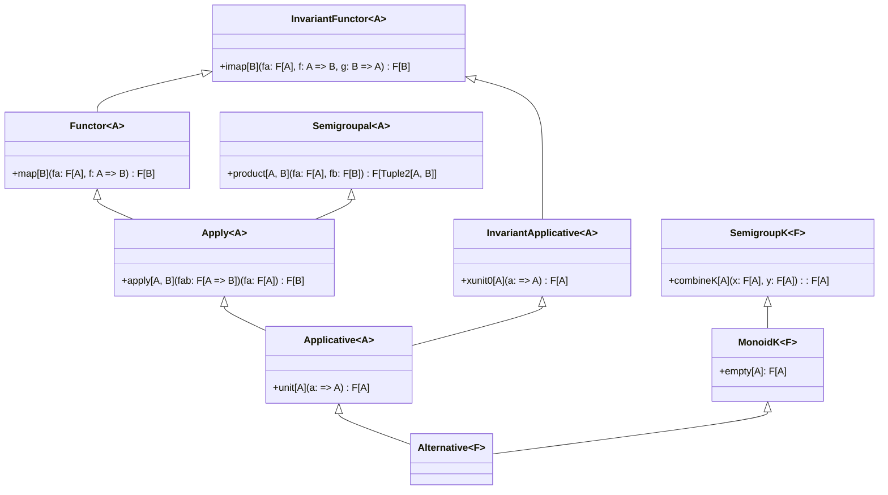

# Alternative

`Alternative` — это абстракция в функциональном программировании, 
которая объединяет возможности [`Applicative` (применение функций в контексте)](applicative.md) 
и [`MonoidK` (комбинирование контекстов)](../monoid/monoid.md). 
Проще говоря, `Alternative` позволяет не только выполнять вычисления в контексте 
(например, `Option`, `List`, `Future`), 
но и выбирать между несколькими вычислениями, комбинировать их или предоставлять "запасной" вариант в случае неудачи. 
Это делает `Alternative` мощным инструментом для написания гибких и устойчивых к ошибкам программ.

## Формальное определение

`Alternative` расширяет `Applicative` и `MonoidK`. 
Давайте кратко перечислим все операции, чтобы напомнить, что это нам дает. 
Основная идея заключается в том, что `Alternative` позволяет работать со значениями в контексте `F[_]`, 
комбинируя их, применяя функции и предоставляя "пустой" контекст.

```dotty
trait SemigroupK[F[_]]:
  /** Комбинирует два контекста */
  def combineK[A](x: F[A], y: F[A]): F[A]
  
trait MonoidK[F[_]] extends SemigroupK[F]:
  /** Пустой контекст (нейтральный элемент для combineK) */
  def empty[A]: F[A]

trait Apply[F[_]] extends Functor[F], Semigroupal[F]:
  /** Применяет функцию в контексте к значению в контексте. */
  def apply[A, B](fab: F[A => B])(fa: F[A]): F[B]

trait Applicative[F[_]] extends Apply[F], InvariantApplicative[F]:
  /** Поднимает значение в контекст аппликативного функтора. */
  def unit[A](a: => A): F[A]
  
trait NonEmptyAlternative[F[_]] extends Applicative[F] with SemigroupK[F]
  
trait Alternative[F[_]] extends NonEmptyAlternative[F] with MonoidK[F]
```

Как видно из определений абстрактных методов классов типов выше:

- `unit` помещает значение в контекст.
- `apply` позволяет выполнять вычисления внутри контекста, применяя функцию `F[A => B]` к значению `F[A]`.
- `combineK` позволяет комбинировать два контекста `F[A]` для любого типа `A`.
- `empty` предоставляет нейтральный (пустой) элемент для операции комбинирования.

## Законы `Alternative`

Как и другие классы типов, экземпляры `Alternative` должны подчиняться определенным законам, 
помимо законов `MonoidK` и `Applicative`. 
Эти законы гарантируют согласованность между операциями `Applicative` и `MonoidK`, 
которые в противном случае могли бы вести себя независимо.

1.  **Правое поглощение (Right Absorption)**: Применение контекстной функции `F[A => B]` к `empty[A]` должно давать `empty[B]`.
    - `ff.apply(F.empty[A]) = F.empty[B]`.
2.  **Левая дистрибутивность (Left Distributivity)**: Отображение (`map`) над скомбинированным элементом эквивалентно комбинации отображенных элементов.
    - `(fa1 combineK fa2) map f = ((fa1 map f) combineK (fa2 map f))`, где `fa1: F[A]`, `fa2: F[A]` и `f: A => B`.
3.  **Правая дистрибутивность (Right Distributivity)**: Применение комбинации двух функций эквивалентно комбинации их применений.
    - `(ff combineK fg) apply fa = (ff apply fa) combineK (fg apply fa)`, где `ff: F[A => B]`, `fg: F[A => B]` и `fa: F[A]`.

## Упражнения

### Упражнение 2.20.1: Реализация экземпляра Alternative для Vector

> [Репозиторий с упражнениями и инструкцией по выполнению][sample]

В этом упражнении вам предстоит реализовать экземпляр типа класса `Alternative` для стандартного Scala-типа `Vector`.

```dotty
given Alternative[Vector] with
  def unit[A](a: => A): Vector[A] =
    ???

  def apply[A, B](fab: Vector[A => B])(fa: Vector[A]): Vector[B] =
    ???

  def empty[A]: Vector[A] =
    ???

  def combineK[A](x: Vector[A], y: Vector[A]): Vector[A] =
    ???
```

**Примеры:**

```dotty
// Создаем векторы с помощью pure (через синтаксис)
val v1 = unit(1)        // Vector(1)
val v2 = unit(2)        // Vector(2)
val v3 = unit(3)        // Vector(3)

// Комбинируем векторы с помощью <+> (combineK)
val combined = v1 combineK v2 combineK v3 // Vector(1, 2, 3)

// Применяем вектор функций к вектору значений
val funcs = Vector((x: Int) => x + 10, (x: Int) => x * 2)
val values = Vector(1, 2, 3)
val result = funcs apply values
// Vector(11, 12, 13, 2, 4, 6) - все комбинации
```

@:note(🔍 Показать решение)

Решение использует стандартные операции над векторами. 
В методе `apply` мы вычисляем декартово произведение с помощью циклов `for`. 
В методе `combineK` мы конкатенируем векторы. 
Метод `unit` просто создает вектор с одним элементом, а `empty` возвращает пустой вектор. 
Такая реализация сохраняет все законы Alternative: правое поглощение (применение к `empty` дает `empty`), 
левую дистрибутивность (отображение комбинации равно комбинации отображений), 
правую дистрибутивность (применение комбинации функций равно комбинации применений), 
а также законы моноида для `combineK` (ассоциативность и нейтральность `empty`). 

```dotty
given Alternative[Vector] with
  def unit[A](a: => A): Vector[A] =
    Vector(a)

  def apply[A, B](fab: Vector[A => B])(fa: Vector[A]): Vector[B] =
    for
      f <- fab
      a <- fa
    yield f(a)

  def empty[A]: Vector[A] =
    Vector.empty

  def combineK[A](x: Vector[A], y: Vector[A]): Vector[A] =
    x ++ y
```

@:@

## Практическое применение

### Парсинг с альтернативами

Представьте, что у нас есть простая библиотека для парсинга с интерфейсом:

```dotty
trait Decoder[A]:
  def decode(in: String): Either[Throwable, A]
  
object Decoder:
  def from[A](f: String => Either[Throwable, A]): Decoder[A] =
    new Decoder[A]:
      def decode(in: String): Either[Throwable, A] = f(in)
```

Мы можем реализовать экземпляр `Alternative` для этого типа `Decoder`. 
Это позволит нам комбинировать несколько стратегий парсинга, пробуя их по очереди:

```dotty
given Alternative[Decoder] = new Alternative[Decoder]:
  /** Всегда успешный парсер, возвращающий заданное значение */
  def unit[A](a: => A): Decoder[A] =
    Decoder.from(Function.const(Right(a)))

  /** Парсер, который всегда завершается ошибкой */
  def empty[A]: Decoder[A] =
    Decoder.from(Function.const(Left(new Error("No dice."))))

  /** Пытается применить левый парсер; если он fails, применяет правый
    */
  def combineK[A](l: Decoder[A], r: Decoder[A]): Decoder[A] =
    (in: String) => l.decode(in).orElse(r.decode(in))

  /** Применяет функцию из одного Decoder к значению из другого */
  def apply[A, B](ff: Decoder[A => B])(fa: Decoder[A]): Decoder[B] =
    (in: String) =>
      for
        a <- fa.decode(in)
        f <- ff.decode(in)
      yield f(a)
```

Благодаря методам `Alternative` мы можем приоритизировать несколько стратегий, компенсируя несоответствия во входных данных.

```dotty
def parseInt(s: String): Either[Throwable, Int] =
  Try(s.toInt).toEither

def parseIntFirstChar(s: String): Either[Throwable, Int] =
  Try(2 * Character.digit(s.charAt(0), 10)).toEither

// Комбинируем два парсера: сначала пробуем распарсить строку целиком, затем — только первый символ.
val decoder: Decoder[Int] =
  Alternative[Decoder].combineK(
    Decoder.from(parseInt),
    Decoder.from(parseIntFirstChar)
  )
```

Этот декодер успешно применяет каждую стратегию по очереди:

```dotty
decoder.decode("555")   
// Успешно: 555
decoder.decode("5a")    
// Первый парсер fails, второй успешно парсит '5' и выдает результат '10'
```

### Разделение результатов с помощью `separate`

`Alternative` предоставляет возможность разделения (partitioning) результатов, если у нас также есть `Bind` (`flatMap`). 
Это реализует метод `separate`.

```dotty
trait MonoidK[F[_]] extends SemigroupK[F]:
  self =>

  def empty[A]: F[A]

  override def algebra[A]: Monoid[F[A]] =
    new Monoid[F[A]]:
      def empty: F[A] =
        self.empty

      def combine(x: F[A], y: F[A]): F[A] =
        self.combineK(x, y)
        
trait Alternative[F[_]] extends NonEmptyAlternative[F] with MonoidK[F]:
  def separate[G[_, _]: Bifoldable as G, A, B](fgab: F[G[A, B]])(using
      B: Bind[F]
  ): (F[A], F[B]) =
    val as =
      B.flatMap(fgab)(gab =>
        G.bifoldMap(gab)(unit)(_ => empty[A])(using algebra[A])
      )
    val bs =
      B.flatMap(fgab)(gab =>
        G.bifoldMap(gab)(_ => empty[B])(unit)(using algebra[B])
      )
    (as, bs)
```

Метод `separate` в `Alternative` позволяет разделить элементы контейнера `F[_]`, 
которые имеют тип `G[A, B]` (например, `Either[A, B]` или `(A, B)`), на две отдельные коллекции: 
одну для значений типа `A` и другую для значений типа `B`. 
Он использует `Bind` (расширение `flatMap`) для прохода по всем элементам 
и `Bifoldable` для извлечения значений из [bifoldable `G`](../bifunctor/bifoldable.md). 
Для каждого элемента применяется `bifoldMap`: при сборе значений `A` — сохраняются левые значения (`unit`), 
а правые игнорируются (`empty`), и наоборот при сборе значений `B`. 
Результат — кортеж `(F[A], F[B])`, где все значения разделены по сторонам bifoldable.

Отличным примером `Bifoldable` является `Either`, а также `Tuple2`.

Представьте, что мы делаем несколько независимых вызовов, которые могут завершиться ошибкой, 
для разных входных данных типа `Int` (например, идентификаторов ресурсов). 
Каждый вызов возвращает `Either[(Int, String), (Int, Long)]`, 
где `Left` содержит код ошибки, а `Right` — успешный результат.

```dotty
// Функция, имитирующая запрос к ресурсу
def requestResource(a: Int): Either[(Int, String), (Int, Long)] =
  if a % 4 == 0 then Left((a, "Bad request"))
  else if a % 3 == 0 then Left((a, "Server error"))
  else Right((a, 200L))
```

Мы можем использовать `separate`, чтобы разделить неудачи и успехи, сгруппированные с входным значением. 
Это позволяет нам логировать ошибки и продолжать работу с успешными результатами.

```dotty
// Применяем функцию ко всем входным данным и разделяем результаты
val partitionedResults =
  separate(apply(unit(requestResource))(Vector(5, 6, 7, 99, 1200, 8, 22)))

// partitionedResults: (Vector[(Int, String)], Vector[(Int, Long)]) — левая часть содержит ошибки, правая — успехи
// (
//   Vector((6,Server error), (99,Server error), (1200,Bad request), (8,Bad request)),
//   Vector((5,200), (7,200), (22,200))
// )
```

В качестве альтернативы (это не каламбур) мы можем использовать экземпляр `Bifoldable` для `Tuple2`, 
чтобы разделить результаты двух вычислений, которые зависят от одного и того же входного значения.

```dotty
// Функция, возвращающая кортеж (регион, список районов)
val double: Int => Int                                  = _ * 2
val addFive: Int => Int                                 = _ + 5
def getRegionAndDistrict(pkey: Int): (Int, Vector[Int]) =
  (5 * pkey, apply(combineK(unit(double), unit(addFive)))(unit(pkey)))

val regionsWithDistricts =
  apply(unit(getRegionAndDistrict))(Vector(5, 6, 7, 97, 1200, 8, 25))
// regionsWithDistricts: Vector[(Int, Vector[Int])] = Vector(
//   (25, Vector(10, 10)),
//   (30, Vector(12, 11)),
//   (35, Vector(14, 12)),
//   (485, Vector(194, 102)),
//   (6000, Vector(2400, 1205)),
//   (40, Vector(16, 13)),
//   (125, Vector(50, 30))
// )
  
// Извлекаем все первые элементы (регионы)
val regionIds = separate(regionsWithDistricts)._1
// Vector(25, 30, 35, 485, 6000, 40, 125)

// Извлекаем все вторые элементы (районы) и объединяем
val districtIds = separate(regionsWithDistricts)._2.flatten
// Vector(10, 10, 12, 11, 14, 12, 194, 102, 2400, 1205, 16, 13, 50, 30)
```

## Схема

Наследование `Alternative` можно наглядно представить следующей диаграммой:



## Реализация в библиотеках

### Реализация в Cats

В Cats `Alternative` доступен через `import cats.*, cats.data.*, cats.syntax.all.*`. 
Вот небольшой пример его использования с `Option` и `List`:

```dotty
import cats.*
import cats.implicits.*

// Option как Alternative
val someResult = (Option(10) <+> Option(20)).map(_ * 2)
// Some(20), т.к. первый Some не пустой
val noneResult = (Option.empty[Int] <+> Option(5)).map(_ + 1)
// Some(6)

// List как Alternative
val listResult = (List(1, 2) <+> List(3, 4)).map(_ + 10)
// List(11, 12, 13, 14)
val emptyListResult = (List.empty[Int] <+> List(5, 6)).map(_ * 2)
// List(10, 12)
```

---

**Ссылки:**

- [Ссылка на репозиторий с упражнениями][sample]
- [Cats](https://typelevel.org/cats/typeclasses/alternative.html)

[sample]: https://gitverse.ru/scalabook/typeclasses
