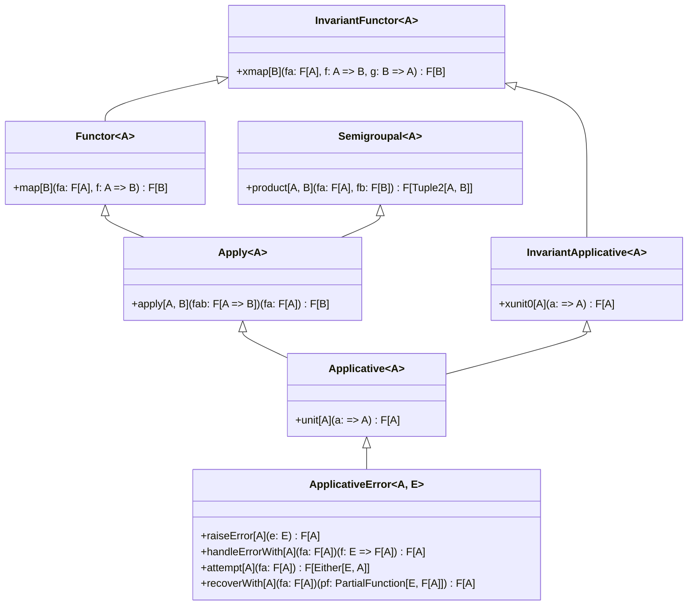



# ApplicativeError

`ApplicativeError` — это класс типов, который расширяет [`Applicative`](applicative.md), 
добавляя возможность работать с ошибками в контексте эффекта `F[_]`. 
Если `Applicative` позволяет поднимать значения и комбинировать вычисления, то `ApplicativeError` позволяет также:

1. **Создавать вычисления, которые немедленно завершаются ошибкой** (через `raiseError`)
2. **Обрабатывать ошибки** и восстанавливаться после них (через `handleErrorWith`, `recoverWith`)
3. **Преобразовывать ошибки в значения** (через `attempt`), чтобы работать с ними на уровне данных

`ApplicativeError` является мостом между чистыми аппликативными вычислениями и вычислениями, которые могут завершаться ошибкой. 
Это фундаментальная абстракция для работы с эффектами, 
которые поддерживают обработку ошибок: `IO`, `Task`, `Either`, `Try` и другие.

**Параметры типа**

- **`F[_]`** — тип контекста (например, `IO`, `Either[E, *]`, `Try`, `Future`)
- **`E`** — тип ошибки (например, `Throwable`, `String`, пользовательский тип ошибки)

## Формальное определение

`ApplicativeError` добавляет к `Applicative` две основные операции:

```dotty
trait ApplicativeError[F[_], E] extends Applicative[F]:
  def raiseError[A](e: E): F[A]
  def handleErrorWith[A](fa: F[A])(f: E => F[A]): F[A]
```

#### Производные операции

Из этих двух примитивов можно выразить полезные комбинаторы:

- **`attempt`** — преобразует ошибку в значение `Either[E, A]`, позволяя работать с ней как с обычными данными
- **`recoverWith`** — обрабатывает ошибку через частичную функцию (обрабатывает только определённые ошибки)

## Законы ApplicativeError

Законы `ApplicativeError` формально определяют семантику ошибок. 
Они гарантируют предсказуемое поведение для любой реализации.

### Группа 1: Законы `attempt`

#### Закон 1: Успешное вычисление

```dotty
unit(a).attempt == unit(Right(a))
```

Если взять успешное вычисление и применить `attempt`, результат будет содержать `Right(a)`. 
`attempt` не должен изменять успешные значения.

**Пример на практике:**

```dotty
val io: IO[Int] = IO.pure(42)
io.attempt // IO(Right(42))
```

#### Закон 2: Поднятая ошибка

```dotty
raiseError(e).attempt == unit(Left(e))
```

Если создать ошибку через `raiseError` и применить `attempt`, ошибка превращается в `Left(e)` на уровне значения. 
Исходная ошибка "ловится" и становится обычным значением.

**Пример на практике:**

```dotty
val ioError: IO[Int] = IO.raiseError(new Exception("boom"))
ioError.attempt // IO(Left(boom))
```

### Группа 2: Законы `handleErrorWith`

#### Закон 3a: Успешное вычисление не обрабатывается

```dotty
unit(a).handleErrorWith(h) == unit(a)
```

Если вычисление успешно, обработчик ошибок `h` **никогда не вызывается**, результат остаётся неизменным.

**Пример:**

```dotty
val success: IO[Int] = IO.pure(42)
success.handleErrorWith(_ => IO.pure(0)) // IO.pure(42) — обработчик не вызван
```

#### Закон 3b: Ошибка передаётся обработчику

```dotty
raiseError(e).handleErrorWith(h) == h(e)
```

Если вычисление завершилось ошибкой, применяется обработчик `h` к этой ошибке. Результат — это результат вызова `h(e)`.

**Пример:**

```dotty
val error: IO[Int] = IO.raiseError(new Exception("boom"))
error.handleErrorWith(e => IO.pure(0)) // IO.pure(0)
```

### Группа 3: Взаимодействие с `flatMap` (важнейший закон)

#### Закон 4: Распространение ошибки через flatMap

```dotty
raiseError(e).flatMap(f) == raiseError(e)
```

Это закон **короткого замыкания**. 
Если вычисление завершилось ошибкой, функция `f` в `flatMap` **никогда не выполняется**. 
Ошибка просто пробрасывается дальше.

**Почему это важно?**

1. **Безопасность** — функция `f` может рассчитывать на валидные входные данные, которые отсутствуют при ошибке
2. **Производительность** — `f` не вычисляется впустую
3. **Консистентность** — это поведение ожидаемо для всех монад с ошибками (`Either`, `Try`, `IO`)

**Пример:**

```dotty
val error: IO[Int] = IO.raiseError(new Exception("boom"))
error.flatMap(x => IO.pure(x * 2)) 
// IO.raiseError("boom") — функция не выполнилась
```

### Законы recoverWith (производные)

Хотя `recoverWith` выражается через `handleErrorWith`, для него ожидается аналогичное поведение:

```dotty
unit(a).recoverWith(pf) == unit(a)                    
// успех не обрабатывается
raiseError(e).recoverWith(pf) == pf.applyOrElse(e, raiseError)  
// ошибка обрабатывается, если подходит
```

## Схема



## Реализация в библиотеках

### Cats

В Cats `ApplicativeError` определён в пакете `cats`. Вот пример использования:

```dotty
import cats.ApplicativeError
import cats.effect.IO
import cats.implicits.*

val ae = ApplicativeError[IO, Throwable]

// raiseError
val error = ae.raiseError[Int](new IllegalArgumentException("boom"))

// handleErrorWith
val recovered = ae.handleErrorWith(error) {
  case ex: IllegalArgumentException => IO.pure(42)
  case other                        => IO.raiseError(other)
}
// IO(42)

// attempt
val attempted = ae.attempt(error)
// IO(Left("boom"))
```

---

**Ссылки:**

- [Ссылка на репозиторий с упражнениями][sample]

[sample]: https://gitverse.ru/scalabook/typeclasses
