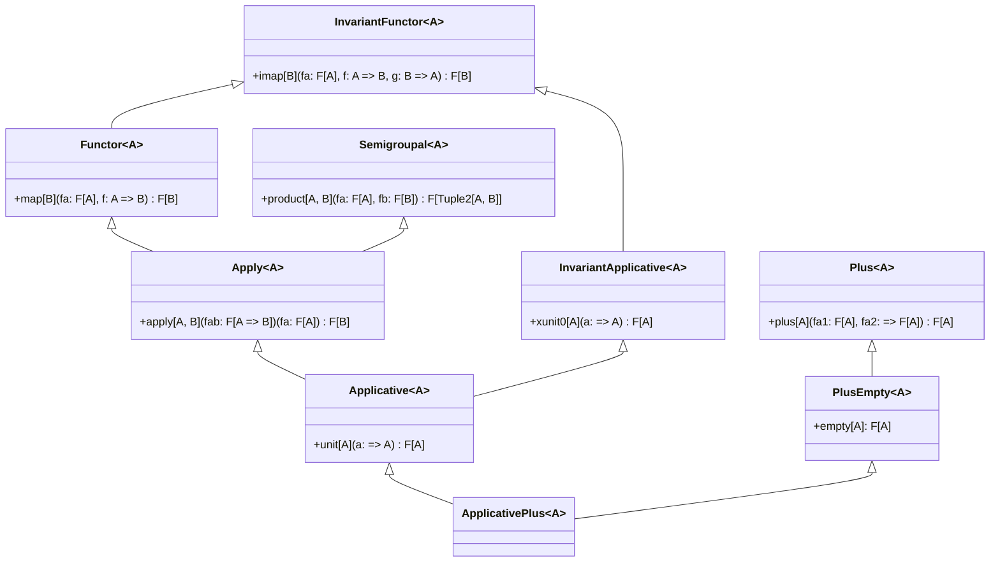

# ApplicativePlus

`ApplicativePlus` — это концепция из функционального программирования, 
объединяющая возможности [**аппликативных функторов** - `Applicative`](applicative.md) 
и [**монадных комбинаторов** - `PlusEmpty`](plus-empty.md). 
Она добавляет возможность комбинировать значения в контексте, 
а также работать с "пустым" значением (нейтральным элементом).

**Основные характеристики `ApplicativePlus`:**

- **Аппликативные вычисления**:
  Как и [аппликативные функторы](applicative.md), `ApplicativePlus` позволяет применять функцию, находящуюся в контексте, 
  к значению, также находящемуся в контексте. Например, можно применить функцию `f: A => B`, "завёрнутую" в контекст, 
  к значению `x: A`, "завёрнутому" в тот же контекст.
- **Комбинирование значений**:
  Как и [`Plus`](plus.md), `ApplicativePlus` позволяет комбинировать два значения в одном контексте с помощью операции, 
  похожей на "сложение" (`plus`, `combine` или `<+>`).
- **Пустое значение**:
  Как и [`PlusEmpty`](plus-empty.md), `ApplicativePlus` вводит понятие "пустого" значения, 
  которое является нейтральным элементом для операции комбинирования.

**Примеры `ApplicativePlus`**

- **Списки (`List`)**.
  Представьте, что у вас есть два списка: `[1, 2, 3]` и `[4, 5, 6]`. 
  `ApplicativePlus` позволяет объединить их в один список: `[1, 2, 3, 4, 5, 6]`. 
  Также можно применять функции к элементам списка, сохраняя контекст. 
  Например, можно применить функцию `x => x * 2` к списку `[1, 2, 3]` и получить `[2, 4, 6]`. 
  Пустым значением здесь является пустой список `[]`.
- **Парсеры**.
  Представьте, что у вас есть два парсера: один разбирает числа, а другой — строки. 
  `ApplicativePlus` позволяет комбинировать результаты работы этих парсеров. 
  Например, если первый парсер не смог разобрать входные данные, второй парсер попытается это сделать. 
  Также можно применять функции к результатам парсинга. 
  Пустым значением здесь является парсер, который всегда возвращает ошибку.
- **Валидаторы**.
  Представьте, что у вас есть два валидатора: один проверяет, что строка не пустая, а другой — что строка содержит только буквы. 
  `ApplicativePlus` позволяет объединить результаты валидации. Например, если первый валидатор вернул ошибку, 
  второй валидатор всё равно будет выполнен, и все ошибки будут собраны вместе. 
  Также можно применять функции к результатам валидации. 
  Пустым значением здесь является валидатор, который всегда возвращает успешный результат.
- **Асинхронные вычисления (`Future`)**.
  Представьте, что у вас есть два асинхронных вычисления: одно возвращает число, а другое — строку. 
  `ApplicativePlus` позволяет выполнить оба вычисления и объединить их результаты. 
  Например, если первое вычисление завершилось с ошибкой, второе всё равно будет выполнено. 
  Также можно применять функции к результатам вычислений. 
  Пустым значением здесь является `Future`, который всегда завершается с ошибкой.

## Формальное определение

`ApplicativePlus` - это моноидальный аппликативный функтор, 
[`Applicative`](applicative.md) комбинированный с [`PlusEmpty`](plus-empty.md).

`ApplicativePlus` должен удовлетворять законам своих родителей.

## Код

```dotty
trait ApplicativePlus[F[_]] extends Applicative[F], PlusEmpty[F]
```

### Связанный список

```dotty
given ApplicativePlus[List] with
  def unit[A](a: => A): List[A] = List(a)

  def apply[A, B](fab: List[A => B])(fa: List[A]): List[B] =
    fab.flatMap { aToB => fa.map(aToB) }

  def plus[A](fa1: List[A], fa2: => List[A]): List[A] = fa1 ++ fa2

  def empty[A]: List[A] = List.empty[A]
```

## Схема



---

**Ссылки:**

- [Ссылка на репозиторий с упражнениями][sample]
- [Learning Scalaz](http://eed3si9n.com/learning-scalaz/MonadPlus.html)
- [Scalaz API](https://javadoc.io/doc/org.scalaz/scalaz-core_3/7.3.6/scalaz/ApplicativePlus.html)

[sample]: https://gitverse.ru/scalabook/typeclasses
