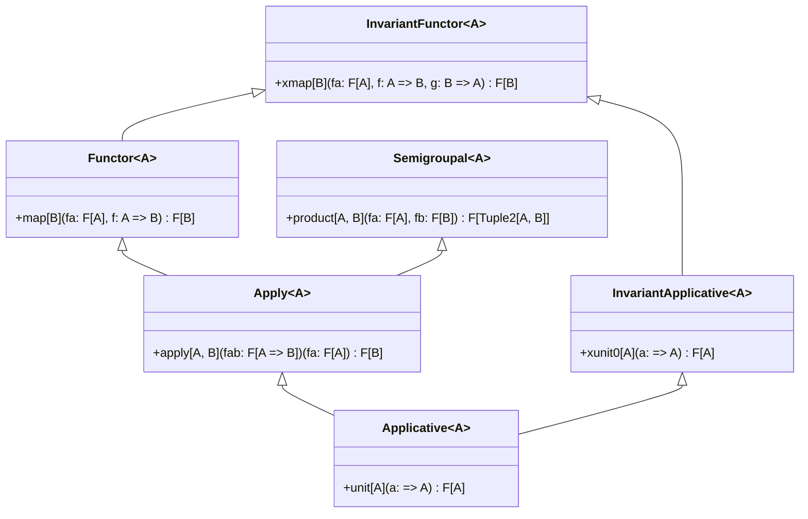



# Applicative

**Applicative** — это концепция из функционального программирования, расширяющая возможности [функтора](functor.md) 
и добавляющая возможность [применения функции](apply.md), находящейся внутри контекста, к значению, 
которое также находится внутри контекста. 
Это позволяет работать с эффектами (например, вычислениями, которые могут завершиться ошибкой, 
или асинхронными вычислениями) в более удобной и композируемой манере.

**Основные идеи Applicative:**

- **Функтор** позволяет применять функцию к значению внутри контекста (например, `Option`, `List`, `Future`).
- **Applicative** добавляет возможность применять функцию, которая сама находится внутри контекста, к значению, 
  также находящемуся внутри контекста.

**Зачем нужен Applicative?**

`Applicative` полезен, когда у вас есть функция, которая принимает несколько аргументов, 
и каждый из этих аргументов находится внутри контекста (например, `Option`, `Either`, `Future`). 
Вместо того чтобы вручную извлекать значения из контекста и применять функцию, 
`Applicative` позволяет сделать это более элегантно.

**Преимущества Applicative:**

- **Композируемость**: `Applicative` позволяет комбинировать вычисления, которые находятся внутри контекста, 
  без необходимости вручную извлекать значения.
- **Чистота кода**: Код становится более декларативным и легче читаемым.
- **Поддержка эффектов**: `Applicative` работает с различными эффектами, такими как `Option`, `Either`, `Future`, `IO` и другими.

**Applicative vs Monad**

- **Applicative** позволяет применять функцию к значениям внутри контекста, 
  но не позволяет использовать результат одного вычисления для определения следующего.
- [**Monad**](monad.md) (например, `flatMap`) позволяет использовать результат одного вычисления для определения следующего, 
  что делает его более мощным, но и более сложным.

## Примеры

Вот несколько примеров использования **Applicative** с описанием:

### Пример 1: Валидация формы

Представьте, что у вас есть форма с несколькими полями (например, имя, email, пароль). 
Каждое поле нужно проверить на корректность (например, email должен содержать "@", пароль должен быть не короче 8 символов). 
Если все поля корректны, вы хотите создать объект пользователя. 
Если есть ошибки, вы хотите собрать их все, а не останавливаться на первой.

- **Контекст**: `Validated` (из библиотеки Cats), который позволяет накапливать ошибки.
- **Применение**: Вы проверяете каждое поле и комбинируете результаты с помощью `Applicative`. 
  Если все поля корректны, создается объект пользователя. Если есть ошибки, возвращается список всех ошибок.

### Пример 2: Параллельные HTTP-запросы

У вас есть несколько независимых HTTP-запросов, которые нужно выполнить параллельно 
(например, получить данные о пользователе, его заказах и истории платежей). 
После выполнения всех запросов вы хотите объединить результаты в один объект.

- **Контекст**: `Future` (асинхронные вычисления).
- **Применение**: Вы запускаете все запросы параллельно и комбинируете их результаты с помощью `Applicative`. 
  Если все запросы успешны, вы объединяете данные. 
  Если хотя бы один запрос завершился ошибкой, весь процесс завершается с ошибкой.

### Пример 3: Работа с конфигурацией

У вас есть конфигурация приложения, которая состоит из нескольких параметров 
(например, URL базы данных, порт сервера, режим отладки). Каждый параметр может быть задан или отсутствовать. 
Вы хотите прочитать все параметры и создать объект конфигурации, только если все параметры присутствуют.

- **Контекст**: `Option` (значение может быть задано или отсутствовать).
- **Применение**: Вы читаете каждый параметр и комбинируете их с помощью `Applicative`. 
  Если все параметры заданы, создается объект конфигурации. Если хотя бы один параметр отсутствует, результат будет `None`.

### Пример 4: Комбинирование списков

У вас есть два списка: один содержит имена, другой — фамилии. Вы хотите создать все возможные комбинации имен и фамилий.

- **Контекст**: `List` (список значений).
- **Применение**: Вы комбинируете два списка с помощью `Applicative`, создавая все возможные пары имен и фамилий.

### Пример 5: Работа с деревьями

У вас есть два дерева, и вы хотите объединить их в одно, применяя функцию к соответствующим узлам.

- **Контекст**: Пользовательский тип данных `Tree`, который представляет собой дерево.
- **Применение**: Вы комбинируете два дерева с помощью `Applicative`, создавая новое дерево, 
  где каждый узел является результатом применения функции к соответствующим узлам исходных деревьев.

### Пример 6: Агрегация данных из нескольких источников

У вас есть несколько источников данных (например, база данных, кэш, внешний API). 
Вы хотите получить данные из всех источников и объединить их в один объект.

- **Контекст**: `IO` (из библиотеки Cats Effect), который представляет собой отложенное вычисление с эффектами.
- **Применение**: Вы получаете данные из каждого источника и комбинируете их с помощью `Applicative`. 
  Если все источники вернули данные, вы объединяете их. 
  Если хотя бы один источник вернул ошибку, весь процесс завершается с ошибкой.

## Формальное определение

`Applicative` расширяет [`Apply`](apply.md) (и [`InvariantApplicative`](invariant-applicative.md)) 
и позволяет работать с несколькими «ящиками».
`Applicative`, дополнительно к операциям `Apply`, реализует операцию `unit` (другие названия: `point`, `pure`),
оборачивающую значение произвольного типа `A` в `Applicative`.

Для `Applicative` должны соблюдаться следующие законы (помимо законов родительских классов типов):

> Ниже подразумеваются следующие сигнатуры: `a: A, f: A => B, fa: F[A], fb: F[B], fc: F[C], fab: F[A => B], fbc: F[B => C]`

- Тождественность (identity): `apply(unit(identity))(fa) == fa` (`unit` тождественной функции - это тождественность для `apply`)
- `unit(a).map(f) == unit(f(a))`
- `fa.map(f) == apply(unit(f))(fa)`
- Гомоморфизм (Homomorphism): `apply(unit(f))(unit(a)) == unit(f(a))` 
  (Другими словами, применение идиоматической функции к `unit` такое же, как и к `unit` обычного применения функции. 
  Точнее, `unit` — это гомоморфизм из `A` в `F[A]` в отношении применения функции.)
- Обмен (interchange): `apply(fab)(unit(a)) == apply(unit((f: A => B) => f(a)))(fab)`
  (Этот закон, по сути, говорит о том, что `unit` не разрешено воздействовать на любую реализацию аппликативного функтора. 
  Если один аргумент, который нужно применить, является `unit`, то другой может появиться в любой позиции. 
  Другими словами, не должно иметь значения, когда мы выполняем `unit`.)
- Тождественность слева (left identity): `unit(()).map2(fa)((_, a) => a) == fa`
- Тождественность справа (right identity): `fa.map2(unit(()))((a, _) => a) == fa`
- Ассоциативность (associativity): `fa.product(fb).product(fc) == fa.product(fb.product(fc)).map(assoc)`, где
  `def assoc[A, B, C](p: (A, (B, C))): ((A, B), C) = p match { case (a, (b, c)) => ((a, b), c) }`
- Естественность (naturality): `fa.map2(fb)((a, b) => (f(a), g(b))) == fa.map(f).product(fb.map(g))`
- Композиция (composition): 
  `apply(fbc)(apply(fab)(fa)) == apply(apply(apply(unit((g: B => C) => (f: A => B) => g compose f))(fbc))(fab))(fa)`
  (Применить `fab` к `fa`, а затем применить `fbc` к этому — то же самое, 
  что применить композицию к `fbc`, затем `fab`, а затем применить составную функцию к `fa`.) 

## Код

```dotty
trait Applicative[F[_]] extends Apply[F], InvariantApplicative[F]:
  def unit[A](a: => A): F[A]
  override def xunit0[A](a: => A): F[A] = unit(a)

  def apply[A, B](fab: F[A => B])(fa: F[A]): F[B]

  override def product[A, B](fa: F[A], fb: F[B]): F[(A, B)] =
    fa.map2(fb)((a, b) => (a, b))

  extension [A](fa: F[A])
    def map[B](f: A => B): F[B] =
      apply(unit(f))(fa)

    def map2[B, C](fb: F[B])(f: (A, B) => C): F[C] =
      apply(apply(unit(f.curried))(fa))(fb)
```

### Виды Applicative

#### Applicative с `unit` и `apply`

`map2` и `map` могут быть выражены так:

```dotty
trait Applicative[F[_]] extends Functor[F]:
  def unit[A](a: => A): F[A]

  def apply[A, B](fab: F[A => B])(fa: F[A]): F[B]

  extension [A](fa: F[A])
    def map2[B,C](fb: F[B])(f: (A, B) => C): F[C] =
      apply(apply(unit(f.curried))(fa))(fb)

    def map[B](f: A => B): F[B] =
      apply(unit(f))(fa)
```

#### Applicative с `unit` и `map2`

`apply` и `map` могут быть выражены так:

```dotty
trait Applicative[F[_]] extends Functor[F]:
  def unit[A](a: => A): F[A]

  extension [A](fa: F[A])
    def map2[B,C](fb: F[B])(f: (A, B) => C): F[C]

    def map[B](f: A => B): F[B] =
      fa.map2(unit(()))((a, _) => f(a))

  def apply[A, B](fab: F[A => B])(fa: F[A]): F[B] =
    fab.map2(fa)((f, a) => f(a))
```

### Комбинаторы Applicative

`Applicative` определяет некоторые комбинаторы:

```dotty
def sequence[A](fas: List[F[A]]): F[List[A]] =
  traverse(fas)(identity)

def traverse[A,B](as: List[A])(f: A => F[B]): F[List[B]] =
  as.foldRight(unit(List[B]()))((a, acc) => f(a).map2(acc)(_ :: _))

def replicateM[A](n: Int, fa: F[A]): F[List[A]] =
  sequence(List.fill(n)(fa))

def product[A, B](fa: F[A], fb: F[B]): F[(A,B)] =
  fa.map2(fb)((a, b) => (a, b))
```

### Tuple applicative

Как и монады, аппликативные функторы замкнуты относительно произведений;
поэтому два независимых аппликативных эффекта обычно могут быть слиты в один, их продукт.

```dotty
given tupleApplicative[F[_]: Applicative, G[_]: Applicative]: Applicative[[X] =>> (F[X], G[X])] with
  type FG[A] = (F[A], G[A])

  override def unit[A](a: => A): FG[A] = (summon[Applicative[F]].unit(a), summon[Applicative[G]].unit(a))

  override def apply[A, B](fab: FG[A => B])(fa: FG[A]): FG[B] =
    (summon[Applicative[F]].apply(fab._1)(fa._1), summon[Applicative[G]].apply(fab._2)(fa._2))
```

### Composite Applicative

В отличие от монад, аппликативные функторы также закрыты по композиции;
поэтому два последовательно зависимых аппликативных эффекта обычно могут быть объединены в один.
Это называется композицией над `Applicative`:

```dotty
given compositeApplicative[F[_]: Applicative, G[_]: Applicative]: Applicative[[X] =>> F[G[X]]] with
  override def unit[A](a: => A): F[G[A]] = summon[Applicative[F]].unit(summon[Applicative[G]].unit(a))

  override def apply[A, B](fab: F[G[A => B]])(fa: F[G[A]]): F[G[B]] =
    val applicativeF = summon[Applicative[F]]
    val applicativeG = summon[Applicative[G]]
    val tmp: F[G[A] => G[B]] = applicativeF.map(fab)(ga2b => applicativeG.apply(ga2b))
    applicativeF.apply(tmp)(fa)
```

Произведение и композиция позволяют комбинировать идиоматические (аппликативные) вычисления двумя разными способами; 
Обычно они называются параллельной и последовательной композицией соответственно. 
Тот факт, что можно составлять аппликативы, и они остаются аппликативными, очень полезен.

### "Обертка"

```dotty
type Id[A] = A
object Id:
  def apply[A](a: A): Id[A] = a

given idApplicative: Applicative[Id] with
  def unit[A](a: => A): Id[A]                        = a
  def apply[A, B](fab: Id[A => B])(fa: Id[A]): Id[B] = fab(fa)
```

### Option

```dotty
given optionApplicative: Applicative[Option] with
  override def unit[A](a: => A): Option[A] = Some(a)

  override def apply[A, B](fab: Option[A => B])(fa: Option[A]): Option[B] =
    (fab, fa) match
      case (Some(aToB), Some(a)) => Some(aToB(a))
      case _                     => None
```

### Последовательность

```dotty
given listApplicative: Applicative[List] with
  override def unit[A](a: => A): List[A] = List(a)

  override def apply[A, B](fab: List[A => B])(fa: List[A]): List[B] =
    fab.flatMap { aToB => fa.map(aToB) }
```

### Either

```dotty
given eitherApplicative[E]: Applicative[[x] =>> Either[E, x]] with
  override def unit[A](a: => A): Either[E, A] = Right(a)

  override def apply[A, B](fab: Either[E, A => B])(fa: Either[E, A]): Either[E, B] =
    (fab, fa) match
      case (Right(fx), Right(a)) => Right(fx(a))
      case (Left(l), _)          => Left(l)
      case (_, Left(l))          => Left(l)
```

### Writer - функциональный журнал

```dotty
case class Writer[W, A](run: () => (W, A))

trait Semigroup[A]:
  def combine(x: A, y: A): A

trait Monoid[A] extends Semigroup[A]:
  def empty: A

given writerApplicative[W](using monoid: Monoid[W]): Applicative[[x] =>> Writer[W, x]] with
  override def unit[A](a: => A): Writer[W, A] =
    Writer[W, A](() => (monoid.empty, a))

  override def apply[A, B](fab: Writer[W, A => B])(fa: Writer[W, A]): Writer[W, B] =
    Writer { () =>
      val (w0, aToB) = fab.run()
      val (w1, a) = fa.run()
      (monoid.combine(w0, w1), aToB(a))
    }
```

### State - функциональное состояние

```dotty
case class State[S, +A](run: S => (S, A))

given stateApplicative[S]: Applicative[[x] =>> State[S, x]] with
  override def unit[A](a: => A): State[S, A] =
    State[S, A](s => (s, a))

  override def apply[A, B](fab: State[S, A => B])(fa: State[S, A]): State[S, B] =
    State { s =>
      val (s0, aToB) = fab.run(s)
      val (s1, a) = fa.run(s0)
      (s1, aToB(a))
    }
```

### Nested

```dotty
final case class Nested[F[_], G[_], A](value: F[G[A]])

given nestedApplicative[F[_], G[_]](using
    applF: Applicative[F],
    applG: Applicative[G],
    functorF: Functor[F]
): Applicative[[X] =>> Nested[F, G, X]] with
  override def unit[A](a: => A): Nested[F, G, A] = Nested(applF.unit(applG.unit(a)))

  override def apply[A, B](fab: Nested[F, G, A => B])(fa: Nested[F, G, A]): Nested[F, G, B] =
    val curriedFuncs: G[A => B] => G[A] => G[B] = gaTob => ga => applG.apply(gaTob)(ga)
    val fgaToB: F[G[A => B]] = fab.value
    val fGaToGb: F[G[A] => G[B]] = functorF.map(fgaToB)(curriedFuncs)
    val fga: F[G[A]] = fa.value
    val fgb: F[G[B]] = applF.apply(fGaToGb)(fga)
    Nested(fgb)
```

### IO

```dotty
final case class IO[R](run: () => R)

given ioApplicative: Applicative[IO] with
  override def unit[A](a: => A): IO[A] = IO(() => a)
  override def apply[A, B](fab: IO[A => B])(fa: IO[A]): IO[B] = IO(() => fab.run()(fa.run()))
```

### Законы

- Тождественность: `apply[A, A](unit(identity))(fa) == fa`
- `unit(x).map(f) == unit(f(x))`
- `fa.map(f) == apply(unit(f))(fa)`
- Гомоморфизм: `apply(unit(f))(unit(x)) == unit(f(x))`
- Обмен (interchange): `apply(fab)(unit(a)) == apply(unit((f: A => B) => f(a)))(fab)`
- Тождественность слева (left identity): `unit(()).map2(fa)((_, a) => a) == fa`
- Тождественность справа (right identity): `fa.map2(unit(()))((a, _) => a) == fa`
- Ассоциативность (associativity): `fa.product(fb).product(fc) == fa.product(fb.product(fc)).map(assoc)`, где
  `def assoc[A, B, C](p: (A, (B, C))): ((A, B), C) = p match { case (a, (b, c)) => ((a, b), c) }`
- Естественность (naturality): `fa.map2(fb)((a, b) => (f(a), g(b))) == fa.map(f).product(fb.map(g))`
- Композиция (composition): 
  `apply(fbc)(apply(fab)(fa)) == apply(apply(apply(unit((g: B => C) => (f: A => B) => g compose f))(fbc))(fab))(fa)`


```dotty
def checkApplyIdentity[F[_], A](fa: F[A])(using
    ap: Applicative[F]
): ValidatedNel[String, Unit] =
  import ap.*
  Either.cond[String, Unit](
    apply[A, A](unit(identity))(fa) == fa,
    (),
    "Не соблюдается тождественность: apply(unit(identity))(fa) == fa"
  ).toValidatedNel
  
def checkUnitMap[F[_], A, B](a: A, f: A => B)(using
    ap: Applicative[F]
): ValidatedNel[String, Unit] =
  import ap.*
  Either.cond[String, Unit](
    unit(a).map(f) == unit(f(a)),
    (),
    "Не соблюдается закон: unit(x).map(f) == unit(f(x))"
  ).toValidatedNel  
  
def checkApplyUnit[F[_], A, B](fa: F[A], f: A => B)(using
    ap: Applicative[F]
): ValidatedNel[String, Unit] =
  import ap.*
  Either.cond[String, Unit](
    fa.map(f) == apply(unit(f))(fa),
    (),
    "Не соблюдается закон: fa.map(f) == apply(unit(f))(fa)"
  ).toValidatedNel  
  
def checkHomomorphism[F[_], A, B](a: A, f: A => B)(using
    ap: Applicative[F]
): ValidatedNel[String, Unit] =
  import ap.*
  Either.cond[String, Unit](
    apply(unit(f))(unit(a)) == unit(f(a)),
    (),
    "Не соблюдается гомоморфизм: apply(unit(f))(unit(x)) == unit(f(x))"
  ).toValidatedNel

def checkInterchange[F[_], A, B](a: A, fab: F[A => B])(using
    ap: Applicative[F]
): ValidatedNel[String, Unit] =
  import ap.*
  Either.cond[String, Unit](
    apply(fab)(unit(a)) == apply(unit((f: A => B) => f(a)))(fab),
    (),
    "Не соблюдается обмен: apply(fab)(unit(a)) == apply(unit((f: A => B) => f(a)))(fab)"
  ).toValidatedNel

def checkLeftIdentity[F[_], A](fa: F[A])(using
    ap: Applicative[F]
): ValidatedNel[String, Unit] =
  import ap.*
  Either.cond[String, Unit](
    unit(()).map2(fa)((_, a) => a) == fa,
    (),
    "Не соблюдается тождественность слева: unit(()).map2(fa)((_, a) => a) == fa"
  ).toValidatedNel

def checkRightIdentity[F[_], A](fa: F[A])(using
    ap: Applicative[F]
): ValidatedNel[String, Unit] =
  import ap.*
  Either.cond[String, Unit](
    fa.map2(unit(()))((a, _) => a) == fa,
    (),
    "Не соблюдается тождественность справа: fa.map2(unit(()))((a, _) => a) == fa"
  ).toValidatedNel  

def checkAssociativity[F[_], A, B, C](
    fa: F[A],
    fb: F[B],
    fc: F[C]
)(using ap: Applicative[F]): ValidatedNel[String, Unit] =
  import ap.*
  def assoc(p: (A, (B, C))): ((A, B), C) = p match
    case (a, (b, c)) => ((a, b), c)
  Either.cond[String, Unit](
    product(product(fa, fb), fc) == product(fa, product(fb, fc)).map(assoc),
    (),
    "Не соблюдается ассоциативность: product(product(fa, fb), fc) == product(fa, product(fb, fc)).map(assoc)"
  ).toValidatedNel  
  
def checkNaturality[F[_], A, B, C](
    fa: F[A],
    fb: F[B],
    f: A => B,
    g: B => C
)(using ap: Applicative[F]): ValidatedNel[String, Unit] =
  import ap.*
  Either.cond[String, Unit](
    fa.map2(fb)((a, b) => (f(a), g(b))) == product(fa.map(f), fb.map(g)),
    (),
    "Не соблюдается естественность: fa.map2(fb)((a, b) => (f(a), g(b))) == fa.map(f).product(fb.map(g))"
  ).toValidatedNel 
  
def checkApplicativeComposition[F[_], A, B, C](
    fa: F[A],
    fab: F[A => B],
    fbc: F[B => C]
)(using ap: Applicative[F]): ValidatedNel[String, Unit] =
  import ap.*
  Either.cond[String, Unit](
    apply(fbc)(apply(fab)(fa)) ==
      apply(apply(
        apply(unit((g: B => C) => (f: A => B) => g compose f))(fbc)
      )(fab))(fa),
    (),
    "Не соблюдается композиция: apply(fbc)(apply(fab)(fa)) == apply(apply(apply(unit((g: B => C) => (f: A => B) => g compose f))(fbc))(fab))(fa)"
  ).toValidatedNel   
```

## Схема



## Реализация в библиотеках

### Реализация в Cats

```dotty
import cats.*, cats.data.*, cats.syntax.all.*

Applicative[List].pure(1)    // List(1)
Applicative[Option].pure(1)  // Some(1)
```

### Реализация в ScalaZ

```dotty
import scalaz.*
import Scalaz.*

// ... Все операции родителей

1.point[List]                                         // List(1)
1.η[List]                                             // List(1)
```

---

**Ссылки:**

- [Ссылка на репозиторий с упражнениями][sample]
- [Классические абстракции используемые в ФП](https://habr.com/ru/articles/896660/)
- [Algebird](https://twitter.github.io/algebird/typeclasses/applicative.html)
- [Applicative Programming with Effects](https://www.staff.city.ac.uk/~ross/papers/Applicative.html)
- [Cats](https://typelevel.org/cats/typeclasses/applicative.html)
- [Functional Programming in Scala, Second Edition](https://www.manning.com/books/functional-programming-in-scala-second-edition?query=Functional%20Programming%20in%20Scala,%20Second%20Edition)
- [Functional Programming in Scala, Second Edition, Wiki](https://github.com/fpinscala/fpinscala/wiki/Chapter-12:-Applicative-and-traversable-functors)
- [Herding Cats](http://eed3si9n.com/herding-cats/Applicative.html)
- [Learn Functional Programming course/tutorial on Scala](https://github.com/dehun/learn-fp)
- [Learning Scalaz](http://eed3si9n.com/learning-scalaz/Applicative.html)
- [Scala with Cats](https://scalawithcats.com/dist/scala-with-cats.html#apply-and-applicative)
- [Scalaz API](https://javadoc.io/doc/org.scalaz/scalaz-core_3/7.3.6/scalaz/Applicative.html)
- [SKB – Scala Applicative](https://leobenkel.com/2021/01/skb-scala-applicative/)
- [Tour of Scala](https://tourofscala.com/scala/applicative)

[sample]: https://gitverse.ru/scalabook/typeclasses
