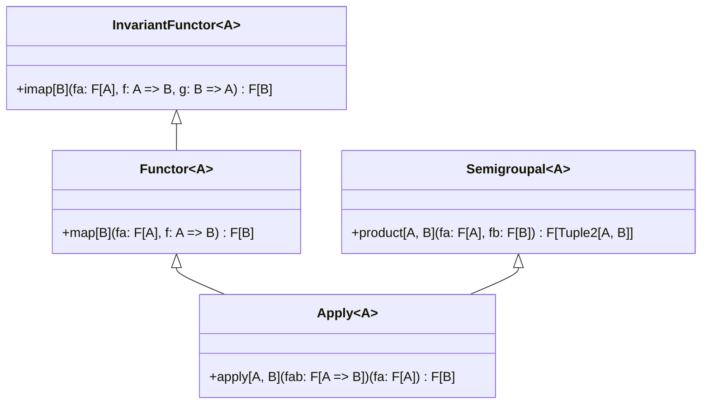

# Apply

**Apply** — это абстракция в функциональном программировании, которая расширяет возможности [`Semigroupal`](semigroupal.md), 
добавляя возможность применять функцию, находящуюся в контексте, к значению, также находящемуся в контексте. 
`Apply` является менее строгой версией [`Applicative`](applicative.md), 
так как не требует наличия операции `pure` (которая помещает значение в контекст).

**Основная идея Apply**

`Apply` — это тип, который реализует две основные операции:

- `product` (или `tuple2`, `tuple3` и т.д.) — комбинирует два значения в контексте в пару (или кортеж) в том же контексте.
- `ap` (или `apply`) — применяет функцию в контексте к значению в контексте.

`Apply` полезен, когда вам нужно:

- Применять функции, находящиеся в контексте, к значениям, также находящимся в контексте.
- Комбинировать несколько значений в контексте (например, результаты нескольких асинхронных вычислений или несколько опциональных значений).
- Работать с эффектами (например, асинхронность, опциональность, ошибки) в композируемом стиле, 
  но без необходимости использовать более строгую абстракцию `Applicative`.

**Примеры Apply**

- `Option` как `Apply`. `Option` — это контейнер, который может содержать значение (`Some`) или быть пустым (`None`). 
  `Apply` позволяет применять функцию к нескольким опциональным значениям.
- `List` как `Apply`. `List` — это контейнер, содержащий множество значений. 
  `Apply` позволяет применять функцию ко всем возможным комбинациям элементов из нескольких списков.
- `Future` как `Apply`. `Future` — это контейнер, представляющий асинхронное вычисление. 
  `Apply` позволяет комбинировать несколько асинхронных вычислений.

## Формальное определение

`Apply` реализует операцию `apply`
(также встречаются названия `join`, `sequence`, `joinWith`, `ap`, `applicate` - названия взаимозаменяемы),
которая объединяет `F[A]` и `F[A => B]` в `F[B]`.
`Apply` расширяет [`Functor`](functor.md) и [`Semigroupal`](semigroupal.md).

Об `apply` можно думать как о своего рода усиленной `map`. 
В то время как `map` берет функцию и функтор и применяет функцию внутри значения функтора,
`apply` берет функтор, в котором есть функция, и другой функтор, 
извлекает эту функцию из первого функтора, а затем отображает ее на второй.

`Apply` должен удовлетворять следующим законам:

- Композиция (composition) - `apply(fbc)(apply(fab)(fa)) == apply(apply(fbc.map((bc: B => C) => (ab: A => B) => bc compose ab))(fab))(fa)`

## Код

```dotty
trait Apply[F[_]] extends Functor[F], Semigroupal[F]:
  def apply[A, B](fab: F[A => B])(fa: F[A]): F[B]

  def apply2[A, B, C](fa: => F[A], fb: => F[B])(f: (A, B) => C): F[C] =
    apply(fa.map(f.curried))(fb)

  override def product[A, B](fa: F[A], fb: F[B]): F[(A, B)] =
    apply2(fa, fb)((_, _))

  def lift2[A, B, C](f: (A, B) => C): (F[A], F[B]) => F[C] =
    apply2(_, _)(f)
```

С помощью операций `apply` и `map` можно реализовать следующие операции:

- `apply2`, принимающую два `Apply` и функцию преобразования из типов этих `Apply` в третий тип `C` и возвращающую `Apply` от `C`. 
- `tuple2`, принимающую два `Apply` и возвращающую `Apply` от кортежа этих типов.
- `lift2`, "поднимающую" функцию `(A, B) => C` до функции преобразования `Apply`: `(F[A], F[B]) => F[C]`

Очевидно, эти операции можно дальше расширять на более длинные кортежи: `apply3`, `apply4` и т.д.

### Законы

- Закон `Apply` гласит, что композиция функций внутри аппликативного функтора должна быть согласована
  с применением функций по отдельности. Формально это можно выразить так:
  `apply(fbc)(apply(fab)(fa)) == apply(apply(fbc.map((bc: B => C) => (ab: A => B) => bc compose ab))(fab))(fa)`

## Упражнения

### Упражнение 2.4.1: Реализация Apply для типа Option.

> [Репозиторий с упражнениями и инструкцией по выполнению][sample]

Реализуйте экземпляр `Apply` для типа `Option`. Семантика должна быть следующей:
- Если оба значения — `Some`, функция применяется к значению, результат — `Some`
- Если хотя бы одно значение — `None`, результат — `None`

Также требуется реализовать `map`.

```dotty
given Apply[Option] with
  def apply[A, B](fab: Option[A => B])(fa: Option[A]): Option[B] = ???

  extension [A](as: Option[A])
    def map[B](f: A => B): Option[B] = ???
```

**Примеры:**

```dotty
import Apply.given

// product из Semigroupal (должен работать автоматически)
val product1 = product(someNum, someStr)   // Some((42, "Hello"))
val product2 = product(someNum, none)      // None

// apply (ap) — применение функции из контекста
val optFunc: Option[Int => String] = Some(_.toString)
val applied1 = apply(optFunc)(someNum)    // Some("42")
val applied2 = apply(optFunc)(none)       // None

val optNoneFunc: Option[Int => String] = None
val applied3 = apply(optNoneFunc)(someNum) // None

// map
val mapped1 = someNum.map(_ * 2)          // Some(84)
val mapped2 = none.map(_ * 2)             // None
```

@:note(🔍 Показать решение)

Решение использует сопоставление с шаблоном для обработки двух случаев. 
В методе `apply` мы сопоставляем пару `(fab, fa)`: 
если оба значения являются `Some` — извлекаем функцию `aToB` и значение `a`, 
применяем функцию к значению и возвращаем `Some(aToB(a))`. 
Во всех остальных случаях (когда хотя бы одно значение — `None`) возвращаем `None`. 

В методе `map` мы также используем сопоставление с шаблоном: 
если значение — `Some(a)`, применяем функцию `f` и возвращаем `Some(f(a))`; 
если значение — `None`, возвращаем `None`. 

Обратите внимание, что `Apply` наследуется от `Semigroupal`, 
поэтому метод `product` уже реализован через `apply` и `map` (или должен быть предоставлен отдельно), 
но в данном экземпляре мы полагаемся на реализации по умолчанию в трейте `Apply`.

```dotty
given Apply[Option] with
  def apply[A, B](fab: Option[A => B])(fa: Option[A]): Option[B] =
    (fab, fa) match
      case (Some(aToB), Some(a)) => Some(aToB(a))
      case _                     => None

  extension [A](as: Option[A])
    def map[B](f: A => B): Option[B] =
      as match
        case Some(a) => Some(f(a))
        case None    => None
```

@:@

### Упражнение 2.4.2: Реализация Apply для типа List.

Реализуйте экземпляр `Apply` для типа `List`: 
эта реализация должна создавать декартово произведение всех функций на все значения.
Также требуется реализовать `map`, который применяет функцию к каждому элементу списка.

```dotty
given Apply[List] with
  def apply[A, B](fab: List[A => B])(fa: List[A]): List[B] = ???

  extension [A](as: List[A])
    def map[B](f: A => B): List[B] = ???
```

**Примеры:**

```dotty
import Apply.given

val numbers = List(1, 2, 3, 4, 5)
val strings = List("a", "b", "c")
val booleans = List(true, false)
val empty = List.empty[Int]

// product из Semigroupal (должен работать автоматически)
val product1 = product(numbers, strings)   
// List((1,"a"), (2,"b"), (3,"c"))

val product2 = product(numbers, booleans)  
// List((1,true), (2,false))

val product3 = product(numbers, empty)     
// Nil

val funcs1: List[Int => String] = List(_.toString, x => s"num:$x")
val applied2 = apply(funcs1)(List(10, 20))  
// List("10", "num:10", "20", "num:20")
```

@:note(🔍 Показать решение)

Это реализация `Apply[List]`, где операция `apply` (известная как `ap`) комбинирует список функций со списком значений, 
применяя каждую функцию из `fab` ко всем элементам `fa` и объединяя результаты. 

Метод `map` реализован стандартно через рекурсивный обход списка и применяет функцию `f` к каждому элементу, сохраняя структуру. 
Эта реализация соответствует поведению декартова произведения, где результат содержит `|fab| * |fa|` элементов — 
в отличие от "зип-подобной" реализации, где результат ограничен минимальной длиной.

```dotty
given Apply[List] with
  def apply[A, B](fab: List[A => B])(fa: List[A]): List[B] =
    fab match
      case Nil    => Nil
      case h :: t =>
        fa.map(h) ++ apply(t)(fa)

  extension [A](as: List[A])
    def map[B](f: A => B): List[B] =
      as match
        case h :: t => f(h) :: t.map(f)
        case Nil    => Nil
```

@:@

## Схема



## Реализация в библиотеках

### Реализация в Cats

```dotty
import cats.*, cats.data.*, cats.syntax.all.*

Apply[Option].ap({{(_: Int) + 3}.some })(10.some)               // Some(13)
Apply[Option].ap({{(_: String) + "hahah"}.some })(none[String]) // None
Apply[Option].ap({ none[String => String] })("woot".some)       // None
```

### Реализация в ScalaZ

```dotty
import scalaz.*
import Scalaz.*

// Наследуются операции от функтора
...

val intToString: Int => String = _.toString
val double: Int => Int = _ * 2
val addTwo: Int => Int = _ + 2
Apply[Option].ap(1.some)(some(intToString))           // Some(1)
Apply[Option].ap(none)(some(double))                  // None
Apply[List].ap(List(1,2,3))(List(double, addTwo))     // List(2, 4, 6, 3, 4, 5)

val add2 = ((_:Int) + (_:Int))
Apply[Option].apply2(some(1), some(2))(add2)          // Some(3)

Apply[List].tuple2(List(1,2,3), List("a", "b"))       // List((1,a), (1,b), (2,a), (2,b), (3,a), (3,b))

Apply[List].lift2 {(_: Int) * (_: Int)} (List(1, 2), List(3, 4)) // List(3, 4, 6, 8)

1.some <*> {(_: Int) + 2}.some                                   // Some(3)
1.some <*> { 2.some <*> {(_: Int) + (_: Int)}.curried.some }     // Some(3)
1.some <* 2.some                                                 // Some(1)
1.some *> 2.some                                                 // Some(2)
(3.some |@| 5.some) {_ + _}                                      // Some(8)
```

---

**Ссылки:**

- [Ссылка на репозиторий с упражнениями][sample]
- [Cats](https://typelevel.org/cats/typeclasses/applicative.html)
- [Herding Cats](http://eed3si9n.com/herding-cats/Apply.html)
- [Learning Scalaz](http://eed3si9n.com/learning-scalaz/Applicative.html)
- [Scala with Cats](https://scalawithcats.com/dist/scala-with-cats.html#apply-and-applicative)
- [Scalaz API](https://javadoc.io/doc/org.scalaz/scalaz-core_3/7.3.6/scalaz/Apply.html)

[sample]: https://gitverse.ru/scalabook/typeclasses
