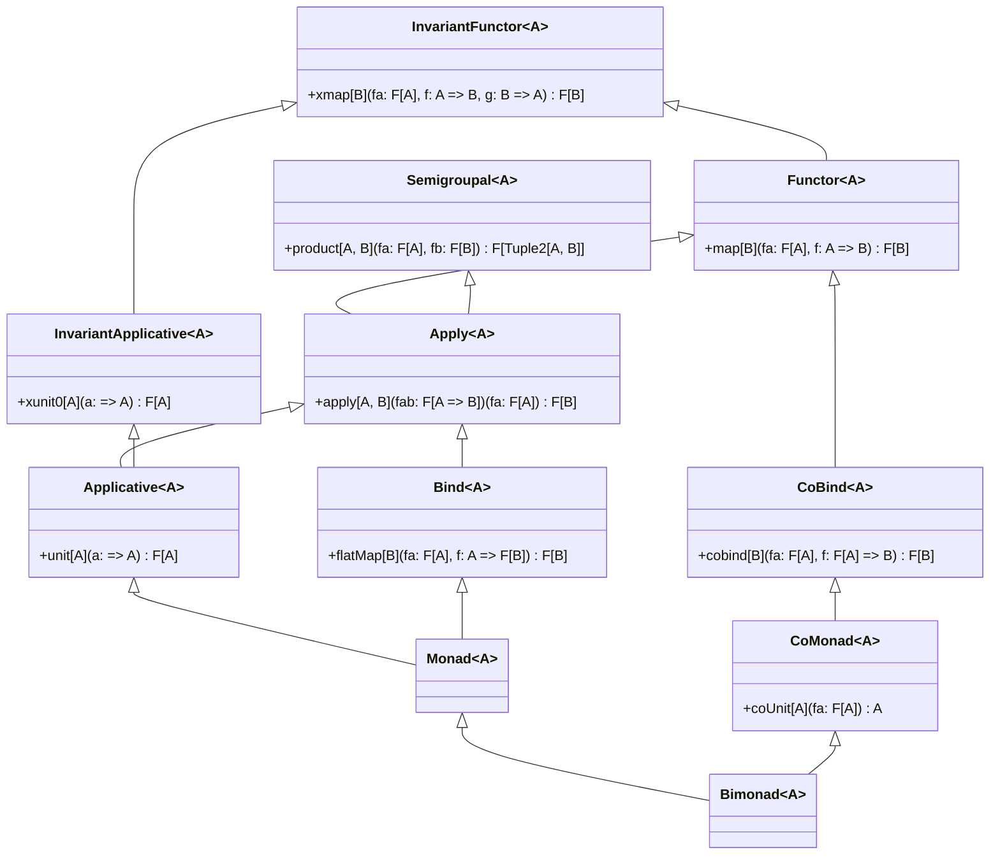

# Bi-Monad

## Формальное определение

`Bimonad` напрямую расширяет [Monad](monad.md) и [Comonad](co-monads.md) без введения новых методов. 
`Bimonad` отличается от других классов типов **Bi**, 
таких как [Bifunctor](../bifunctor/bifunctor.md), [Bifoldable](../bifunctor/bifoldable.md) 
или [Bitraverse](../bifunctor/bitraverse.md), где префикс описывает `F[_, _]`.
`Bimonad` — это `F[_]`, а префикс **Bi** здесь имеет другое значение: это и монада, и комонада. 
Имейте в виду, что бимонада имеет свои собственные дополнительные законы, 
поэтому то, что является одновременно монадическим и комонадным, необязательно может быть законной бимонадой.

## Код

```dotty
trait Bimonad[F[_]] extends Monad[F], CoMonad[F]
```

### Непустой список

```dotty
given Bimonad[NonEmptyList] with
  def unit[A](a: => A): NonEmptyList[A] = NonEmptyList(a, List.empty)

  def coUnit[A](fa: NonEmptyList[A]): A = fa.head

  extension [A](fa: NonEmptyList[A])
    def flatMap[B](f: A => NonEmptyList[B]): NonEmptyList[B] =
      fa match
        case NonEmptyList(head, Nil) => f(head)
        case NonEmptyList(head, h :: tail) =>
          f(head) ++ NonEmptyList(h, tail).flatMap(f)

    def cobind[B](f: NonEmptyList[A] => B): NonEmptyList[B] =
      NonEmptyList(f(fa), Nil)
```

## Схема



## Реализация в библиотеках

### Реализация в Cats

```dotty
import cats.*
import cats.data.*
import cats.syntax.all.*

def make[T[_]: Bimonad](config: T[String]): String = 
  config
    .flatMap(c => Bimonad[T].pure(c + " with option A"))
    .flatMap(c => Bimonad[T].pure(c + " with option B"))
    .flatMap(c => Bimonad[T].pure(c + " with option C"))
    .extract

make(NonEmptyList.one("config"))
// res0: String = "config with option A with option B with option C"
```

---

**Ссылки:**

- [Cats](https://typelevel.org/cats/typeclasses/bimonad.html)
