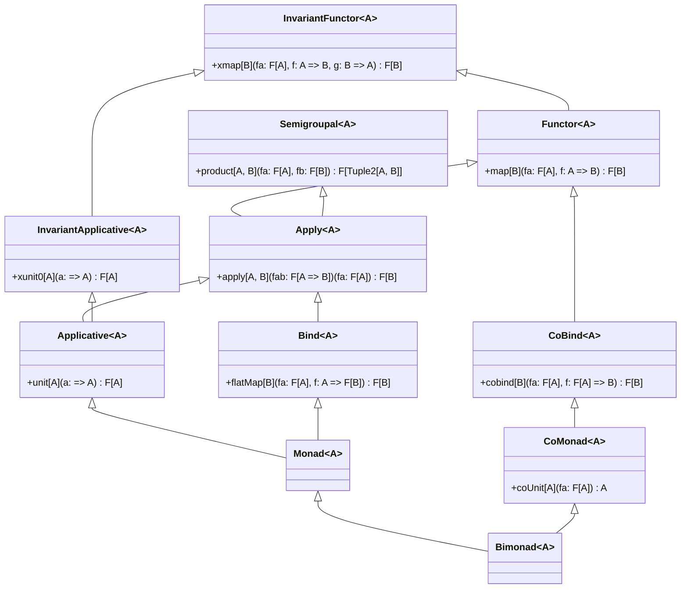



# Bi-Monad

**Bi-Monad** (или **Bimonad**) — это типовой класс в функциональном программировании, 
который объединяет свойства [**монады**](monad.md) и [**комонады**](co-monads.md). 
Это означает, что `Bi-Monad` одновременно поддерживает операции для работы с контекстом (как монада) 
и для извлечения значений из контекста (как комонада).

**Примеры использования**

- **Работа с двусторонними структурами данных**:
    - Например, для работы с потоками данных, которые могут быть как источниками (извлечение данных), 
      так и приёмниками (последовательные вычисления).
- **Обработка данных в контексте**:
    - Например, для работы с таблицами или матрицами, где требуется как извлекать значения, 
      так и применять последовательные преобразования.
- **Анализ данных**:
    - Например, для анализа временных рядов, где требуется учитывать как текущие значения, так и их контекст.

**Краткие примеры**

- **Бесконечные потоки**:
    - У вас есть бесконечный поток чисел (`LazyList[Int]`).
    - С помощью `extract` вы можете извлечь текущее значение из потока.
    - С помощью `flatMap` вы можете создать новый поток, где каждое значение является результатом последовательных вычислений.
- **Таблицы данных**:
    - У вас есть таблица данных (`Table[A]`), где каждая ячейка зависит от соседних ячеек.
    - С помощью `extract` вы можете извлечь значение из конкретной ячейки.
    - С помощью `flatMap` вы можете создать новую таблицу, где каждая ячейка является результатом последовательных преобразований.
- **Временные ряды**:
    - У вас есть временной ряд (`TimeSeries[A]`), где каждое значение зависит от предыдущих и следующих значений.
    - С помощью `extract` вы можете извлечь текущее значение из ряда.
    - С помощью `flatMap` вы можете создать новый временной ряд, где каждое значение является результатом последовательных вычислений.

> `Bimonad` отличается от других классов типов **Bi**,
> таких как [Bifunctor](../bifunctor/bifunctor.md), [Bifoldable](../bifunctor/bifoldable.md)
> или [Bitraverse](../bifunctor/bitraverse.md), где префикс описывает `F[_, _]`.
> `Bimonad` — это `F[_]`, а префикс **Bi** здесь имеет другое значение: это и монада, и комонада.
> Имейте в виду, что бимонада имеет свои собственные дополнительные законы,
> поэтому то, что является одновременно монадическим и комонадным, необязательно может быть законной бимонадой.

## Формальное определение

Для типа `F[_]` тип класса `Bi-Monad` предоставляет методы:

- **Методы монады**:
    - `pure: A => F[A]` — создаёт контекст из значения (другие названия: `point`, `unit`).
    - `flatMap: (F[A], A => F[B]) => F[B]` — последовательно вычисляет значения в контексте
      (другое название: `bind`).
- **Методы комонады**:
    - `extract: F[A] => A` — извлекает значение из контекста (другие названия: `coUnit`, `coPoint`, `coPure`).
    - `coflatMap: (F[A], F[A] => B) => F[B]` — преобразует контекст с учётом всей структуры
      (другое название: `cobind`).

### Законы

`Bi-Monad` должен удовлетворять законам как для монады, так и для комонады:

- [**Законы монады**](monad.md):
    - **Закон ассоциативности**: `fa.flatMap(f).flatMap(g) == fa.flatMap { a => f(a).flatMap(g) }`.
      Закон гласит, что когда у нас есть цепочка приложений монадических функций с `flatMap`, 
      не должно иметь значения, как они вложены. 
    - **Закон тождественности слева**: `unit(a).flatMap(afb) == afb(a)`.
      Закон гласит, что если мы берем значение (`A`),
      помещаем его в контекст по умолчанию с помощью `unit` и затем передаем его функции с помощью `flatMap` (`A => F[B]`) -
      это то же самое, что просто взять значение и применить к нему функцию.
    - **Закон тождественности справа**: `fa.flatMap(unit _) == fa`.
      Закон гласит, что если у нас есть монадическое значение (`F[A]`), и мы используем `flatMap`,
      чтобы передать его для `unit` (`A => F[A]`), результатом будет исходное монадическое значение. 
- [**Законы комонады**](co-monads.md):
    - **Закон ассоциативности**:
      `fa.coflatMap(f).coflatMap(g) == fa.coflatMap(x => g(x.coflatMap(f)))`.
      Это означает, что последовательное применение `coflatMap` должно быть ассоциативным.
    - **Закон тождественности слева**: `fa.coflatMap(f).extract == f(fa)`.
      Здесь `extract` — это метод, который извлекает значение из контекста (обычно предоставляемый `Comonad`).
      Этот закон гарантирует, что `coflatMap` корректно взаимодействует с `extract`.
    - **Закон тождественности справа**: `fa.coflatMap(_.extract) == fa`.
      Этот закон гарантирует, что если функция `f` просто извлекает значение из контекста,
      то `coflatMap` возвращает исходный контекст.

## Код

```dotty
trait Bimonad[F[_]] extends Monad[F], CoMonad[F]
```

### "Обертка"

```dotty
type Id[A] = A
object Id:
  def apply[A](a: A): Id[A] = a

given Bimonad[Id] with
  def unit[A](a: => A): Id[A] = Id(a)

  def coUnit[A](fa: Id[A]): A = fa

  extension [A](as: Id[A])
    override def map[B](f: A => B): Id[B] = Id(f(as))

    def flatMap[B](f: A => Id[B]): Id[B] = f(as)

    def cobind[B](f: Id[A] => B): Id[B] = Id(f(as))
```

### Непустой список

```dotty
given Bimonad[NonEmptyList] with
  def unit[A](a: => A): NonEmptyList[A] = NonEmptyList(a, List.empty)

  def coUnit[A](fa: NonEmptyList[A]): A = fa.head

  extension [A](fa: NonEmptyList[A])
    def flatMap[B](f: A => NonEmptyList[B]): NonEmptyList[B] =
      fa match
        case NonEmptyList(head, Nil) => f(head)
        case NonEmptyList(head, h :: tail) =>
          f(head) ++ NonEmptyList(h, tail).flatMap(f)

    def cobind[B](f: NonEmptyList[A] => B): NonEmptyList[B] =
      NonEmptyList(f(fa), Nil)
```

## Схема



## Реализация в библиотеках

### Реализация в Cats

```dotty
import cats.*
import cats.data.*
import cats.syntax.all.*

def make[T[_]: Bimonad](config: T[String]): String = 
  config
    .flatMap(c => Bimonad[T].pure(c + " with option A"))
    .flatMap(c => Bimonad[T].pure(c + " with option B"))
    .flatMap(c => Bimonad[T].pure(c + " with option C"))
    .extract

make(NonEmptyList.one("config"))
// res0: String = "config with option A with option B with option C"
```

---

**Ссылки:**

- [Cats](https://typelevel.org/cats/typeclasses/bimonad.html)
