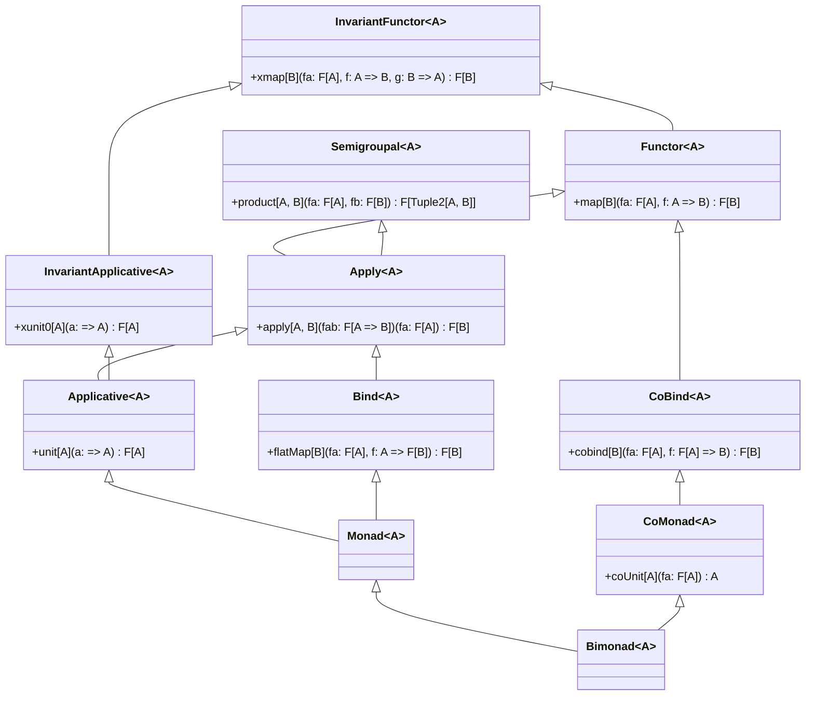



# Bi-Monad

**Bi-Monad** (или **Bimonad**) — это класс типов в функциональном программировании, 
который объединяет свойства [**монады**](monad.md) и [**комонады**](co-monads.md). 
Это означает, что `Bi-Monad` одновременно поддерживает операции для работы с контекстом (как монада) 
и для извлечения значений из контекста (как комонада).

**Примеры использования**

- **Работа с двусторонними структурами данных**:
    - Например, для работы с потоками данных, которые могут быть как источниками (извлечение данных), 
      так и приёмниками (последовательные вычисления).
- **Обработка данных в контексте**:
    - Например, для работы с таблицами или матрицами, где требуется как извлекать значения, 
      так и применять последовательные преобразования.
- **Анализ данных**:
    - Например, для анализа временных рядов, где требуется учитывать как текущие значения, так и их контекст.

> `Bimonad` отличается от других классов типов **Bi**,
> таких как [Bifunctor](../bifunctor/bifunctor.md), [Bifoldable](../bifunctor/bifoldable.md)
> или [Bitraverse](../bifunctor/bitraverse.md), где префикс описывает `F[_, _]`.
> `Bimonad` — это `F[_]`, а префикс **Bi** здесь имеет другое значение: это и монада, и комонада.
> Бимонада имеет свои собственные дополнительные законы,
> поэтому то, что является одновременно монадическим и комонадным, необязательно может быть законной бимонадой.

## Формальное определение

Для типа `F[_]` тип класса `Bi-Monad` предоставляет методы:

- **Методы монады**:
    - `pure: A => F[A]` — создаёт контекст из значения (другие названия: `point`, `unit`).
    - `flatMap: (F[A], A => F[B]) => F[B]` — последовательно вычисляет значения в контексте
      (другое название: `bind`).
- **Методы комонады**:
    - `extract: F[A] => A` — извлекает значение из контекста (другие названия: `coUnit`, `coPoint`, `coPure`).
    - `coflatMap: (F[A], F[A] => B) => F[B]` — преобразует контекст с учётом всей структуры
      (другое название: `cobind`).

### Законы

`Bi-Monad` должен удовлетворять законам как для монады, так и для комонады:

- [**Законы монады**](monad.md):
    - **Закон ассоциативности**: `fa.flatMap(f).flatMap(g) == fa.flatMap { a => f(a).flatMap(g) }`.
      Закон гласит, что когда у нас есть цепочка приложений монадических функций с `flatMap`, 
      не должно иметь значения, как они вложены. 
    - **Закон тождественности слева**: `unit(a).flatMap(afb) == afb(a)`.
      Закон гласит, что если мы берем значение (`A`),
      помещаем его в контекст по умолчанию с помощью `unit` и затем передаем его функции с помощью `flatMap` (`A => F[B]`) -
      это то же самое, что просто взять значение и применить к нему функцию.
    - **Закон тождественности справа**: `fa.flatMap(unit _) == fa`.
      Закон гласит, что если у нас есть монадическое значение (`F[A]`), и мы используем `flatMap`,
      чтобы передать его для `unit` (`A => F[A]`), результатом будет исходное монадическое значение. 
- [**Законы комонады**](co-monads.md):
    - **Закон ассоциативности**:
      `fa.coflatMap(f).coflatMap(g) == fa.coflatMap(x => g(x.coflatMap(f)))`.
      Это означает, что последовательное применение `coflatMap` должно быть ассоциативным.
    - **Закон тождественности слева**: `fa.coflatMap(f).extract == f(fa)`.
      Здесь `extract` — это метод, который извлекает значение из контекста (обычно предоставляемый `Comonad`).
      Этот закон гарантирует, что `coflatMap` корректно взаимодействует с `extract`.
    - **Закон тождественности справа**: `fa.coflatMap(_.extract) == fa`.
      Этот закон гарантирует, что если функция `f` просто извлекает значение из контекста,
      то `coflatMap` возвращает исходный контекст.

## Код

```dotty
trait Bimonad[F[_]] extends Monad[F], CoMonad[F]
```

## Упражнения

### Упражнение 2.16.1: Реализация Bimonad для NonEmptyList

> [Репозиторий с упражнениями и инструкцией по выполнению][sample]

`NonEmptyList` (непустой список) — классический пример бимонады.
Почему именно `NonEmptyList`, а не обычный `List`? 
Потому что:

- Для комонады нужна операция `coUnit` — извлечение значения из контекста
- У обычного списка нет гарантированного первого элемента (он может быть пустым)
- `NonEmptyList` всегда имеет хотя бы один элемент, поэтому `coUnit` всегда может вернуть `head`

**Структура `NonEmptyList[A]`**:

- `head: A` — первый элемент (всегда присутствует)
- `tail: List[A]` — хвост списка (может быть пустым)

**Операции, которые нужно реализовать**:

1. **`unit` (из монады)** — поднимает значение в контекст
2. **`coUnit` (из комонады)** — извлекает значение из контекста
3. **`flatMap` (из монады)** — последовательное преобразование
4. **`cobind` (из комонады)** — расширение контекста
5. **`map` (наследуется)** — преобразование всех элементов
   - Реализуется через `flatMap` и `unit` (или через `cobind` и `coUnit`)

Реализуйте экземпляр `Bimonad` для `NonEmptyList`. 

```dotty
import ru.scalabook.typeclasses.Bimonad

case class NonEmptyList[A](head: A, tail: List[A]):
  def toList: List[A] = head :: tail
  def ++(than: NonEmptyList[A]): NonEmptyList[A] =
    NonEmptyList(head = head, tail = tail ++ than.toList)

// TODO: Реализуйте given экземпляр Bimonad для NonEmptyList
given Bimonad[NonEmptyList] with
  override def unit[A](a: => A): NonEmptyList[A] = ???
  override def coUnit[A](fa: NonEmptyList[A]): A = ???

  extension [A](fa: NonEmptyList[A])
    override def flatMap[B](f: A => NonEmptyList[B]): NonEmptyList[B] = ???
    override def cobind[B](f: NonEmptyList[A] => B): NonEmptyList[B] = ???
```

**Примеры:**

```dotty
import Bimonad.given

val nel = NonEmptyList(1, List(2, 3, 4))

// unit — создание одноэлементного списка
unit(42)  // NonEmptyList(42, Nil)

// flatMap — последовательное преобразование
val doubled = nel.flatMap(x => NonEmptyList(x, List(x * 2)))
// NonEmptyList(1, List(2, 2, 4, 3, 6, 4, 8))
// Пошагово:
// 1 → [1,2]
// 2 → [2,4]
// 3 → [3,6]
// 4 → [4,8]
// Результат: [1,2,2,4,3,6,4,8]

// coUnit — извлечение головы
coUnit(nel)  // 1

// cobind — сумма каждого суффикса
val sums = nel.cobind(_.toList.sum)
// NonEmptyList(10, List(9, 7, 4))
// Суффиксы и их суммы:
// [1,2,3,4] → 10
// [2,3,4]   → 9
// [3,4]     → 7
// [4]       → 4
```

@:note(🔍 Показать решение)

**`unit`** создаёт одноэлементный список: `NonEmptyList(a, Nil)`.

**`coUnit`** извлекает голову: `fa.head`.

**`flatMap`** использует рекурсию: для списка из одного элемента применяем `f` к голове; 
для списка из нескольких элементов применяем `f` к голове 
и рекурсивно обрабатываем хвост, затем конкатенируем результаты через `++`. 
Важно, что результат всегда будет непустым, так как `f(head)` возвращает `NonEmptyList[B]`.

**`cobind`** использует хвостовую рекурсию для обхода всех непустых суффиксов:

1. Функция `loop` принимает текущий суффикс `nel` и аккумулятор `acc`
2. На каждом шаге применяет `f` к текущему `nel` и добавляет результат в аккумулятор
3. Если хвост пуст — переворачивает аккумулятор и создаёт `NonEmptyList` из первого элемента и остальных
4. Если хвост непуст — рекурсивно вызывает `loop` с новым суффиксом `NonEmptyList(h, t)`

```dotty
given Bimonad[NonEmptyList] with
  override def unit[A](a: => A): NonEmptyList[A] = NonEmptyList(a, Nil)

  override def coUnit[A](fa: NonEmptyList[A]): A = fa.head

  extension [A](fa: NonEmptyList[A])
    override def flatMap[B](f: A => NonEmptyList[B]): NonEmptyList[B] =
      fa match
        case NonEmptyList(head, Nil)       => f(head)
        case NonEmptyList(head, h :: tail) =>
          f(head) ++ NonEmptyList(h, tail).flatMap(f)

    override def cobind[B](f: NonEmptyList[A] => B): NonEmptyList[B] =
      @annotation.tailrec
      def loop(nel: NonEmptyList[A], acc: List[B]): NonEmptyList[B] =
        val newAcc = f(nel) :: acc
        nel.tail match
          case Nil =>
            val newList = newAcc.reverse
            // Вызывать head безопасно, потому что мы знаем, что newAcc не пустой
            NonEmptyList(newList.head, newList.tail)
          case h :: t =>
            loop(NonEmptyList(h, t), newAcc)

      loop(fa, Nil)
  end extension
end given
```

@:@

## Схема



## Реализация в библиотеках

### Реализация в Cats

```dotty
import cats.*
import cats.data.*
import cats.syntax.all.*

def make[T[_]: Bimonad](config: T[String]): String = 
  config
    .flatMap(c => Bimonad[T].pure(c + " with option A"))
    .flatMap(c => Bimonad[T].pure(c + " with option B"))
    .flatMap(c => Bimonad[T].pure(c + " with option C"))
    .extract

make(NonEmptyList.one("config"))
// res0: String = "config with option A with option B with option C"
```

---

**Ссылки:**

- [Ссылка на репозиторий с упражнениями][sample]
- [Cats](https://typelevel.org/cats/typeclasses/bimonad.html)

[sample]: https://gitverse.ru/scalabook/typeclasses
