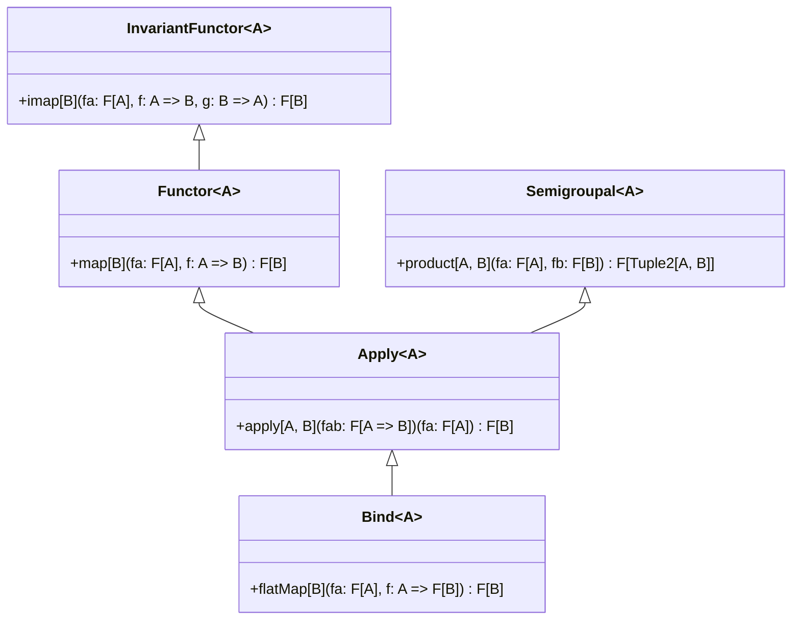



# Bind (FlatMap)

В функциональном программировании, в частности в Scala, `bind` (или `flatMap`) — это операция, 
которая используется для работы с монадическими типами данных. 
[Монады](monad.md) — абстракция, которая позволяет последовательно выполнять вычисления, 
сохраняя контекст (например, обработку ошибок, асинхронность, состояние и т.д.).

**Что такое `bind` (`flatMap`)?**

`bind` (чаще называемый `flatMap` в Scala) — это метод, который принимает значение, 
"завёрнутое" в монаду (например, `Option`, `List`, `Future` и т.д.), 
и функцию, которая возвращает новое значение, также "завёрнутое" в монаду. 
Результатом `flatMap` является "развёрнутое" значение, полученное после применения функции.

**Зачем нужен `bind` (`flatMap`)?**

- **Последовательное выполнение вычислений**:
  `flatMap` позволяет связывать вычисления, которые возвращают монадические значения. 
  Например, если есть несколько операций, каждая из которых может вернуть `Option`, 
  вы можете использовать `flatMap`, чтобы последовательно их выполнить, не заботясь о проверке на `None`.
- **Работа с контекстом**:
  Монады позволяют работать с контекстом (например, обработка ошибок, асинхронность, состояние). 
  `flatMap` помогает сохранять этот контекст между вычислениями.
- **Композиция операций**:
  `flatMap` позволяет комбинировать несколько операций в одну цепочку, что делает код более читаемым и выразительным.
- **Избегание "адского вложенного кода"**:
  Без `flatMap` при работе с монадами пришлось бы вручную проверять контекст 
  (например, `None` для `Option` или `Failure` для `Future`), что привело бы к вложенным условиям и сложному коду.

`bind` (`flatMap`) — мощный инструмент в функциональном программировании, 
который позволяет работать с монадическими типами данных, сохраняя контекст и упрощая композицию операций. 
В Scala он широко используется для работы с `Option`, `List`, `Future`, `Either` и другими монадами.

Вот несколько примеров использования `bind` (или `flatMap`) в различных контекстах:

- **Работа с `Option` (возможное отсутствие значения)**.
  Представим, что есть функция, которая ищет пользователя по его ID, и другая функция, которая ищет заказы этого пользователя. 
  Если пользователь не найден, то и заказы искать не нужно. С помощью `bind` можно связать эти две операции: 
  сначала найти пользователя, а затем, если он существует, найти его заказы. 
  Если пользователь не найден, процесс просто остановится, и будет получено "ничего" (`None`).
- **Работа с `State` (управление состоянием)**.
  Представим, что есть программа, которая работает с некоторым состоянием (например, счётчик). 
  Есть несколько операций, каждая из которых изменяет состояние и возвращает результат. 
  С помощью `bind` можно связать эти операции так, чтобы состояние передавалось между ними автоматически, 
  без необходимости явно управлять им вручную.
- **Работа с `IO` (побочные эффекты)**.
  Представим, что есть программа, которая читает данные из файла, а затем записывает их в другой файл. 
  С помощью `bind` можно связать эти две операции так, чтобы вторая операция (запись) выполнялась 
  только после успешного завершения первой (чтение). Если чтение завершится с ошибкой, запись даже не начнётся.
- **Работа с `Try` (обработка исключений)**.
  Представим, что есть функция, которая может выбросить исключение, 
  и другая функция, которая работает с результатом первой функции. 
  С помощью `bind` можно связать эти две функции так, чтобы вторая функция выполнялась только в том случае, 
  если первая завершилась успешно. Если первая функция выбросит исключение, вторая даже не начнётся.

## Формальное определение

`Bind` - это [`Apply`](apply.md) функтор, 
в котором функция может вводить новые значения и новый контекст функтора, 
включенный в контекст "подъемника". Эта операция называется `flatMap[B](f: A => F[B]): F[B]` (или её синоним - `bind`)

Для `Bind` должны соблюдаться следующие законы:

- соответствие `apply` и `flatMap`:
    - `apply(fab)(fa) == fab.flatMap(a2b => fa.map(a2b))`
- ассоциативность на `flatMap` (как и в случае с полугруппами, монадические эффекты изменяются только при изменении их порядка,
  а не при изменении порядка их объединения):
    - `fa.flatMap(f).flatMap(g) == fa.flatMap { a => f(a).flatMap(g) }`

Функция `flatMap` позволяет нам определить операцию `join[A](ffa: F[F[A]]): F[A]`, "схлопывающую" слои функтора.
Синоним `join` - это `flatten`.


## Код

```dotty
trait Bind[F[_]] extends Apply[F]:
  extension [A](fa: F[A])
    def flatMap[B](f: A => F[B]): F[B]

    def bind[B](f: A => F[B]): F[B] = flatMap(f)

  extension [A](ffa: F[F[A]])
    def flatten: F[A] = ffa.flatMap(identity)

    def join: F[A] = flatten

  override def apply[A, B](fab: F[A => B])(fa: F[A]): F[B] =
    flatMap(fab)(x => fa.map(x))

  override def apply2[A, B, C](fa: => F[A], fb: => F[B])(f: (A, B) => C): F[C] =
    flatMap(fa)(a => fb.map(b => f(a, b)))
```

### Законы

- соответствие `apply` и `flatMap`: `apply(fab)(fa) == fab.flatMap(a2b => fa.map(a2b))`
- ассоциативность на `flatMap`: `fa.flatMap(f).flatMap(g) == fa.flatMap { a => f(a).flatMap(g) }`

## Упражнения

### Упражнение 2.6.1: Реализация Bind для типа Option.

> [Репозиторий с упражнениями и инструкцией по выполнению][sample]

Реализуйте экземпляр `Bind` для типа `Option`:

```dotty
given optionBind: Bind[Option] with
  extension [A](fa: Option[A])
    override def flatMap[B](f: A => Option[B]): Option[B] = ???

  extension [A](fa: Option[A])
    override def map[B](f: A => B): Option[B] = ???
```

**Примеры:**

```dotty
import Bind.given

// flatMap
Some(42).flatMap(x => Some(x * 2))  // Some(84)
Some(42).flatMap(_ => None)         // None
None.flatMap((x: Int) => Some(x))   // None

// map через flatMap (автоматически)
Some(5).map(_ * 3)                  // Some(15)
None.map(_ * 3)                     // None
```

@:note(🔍 Показать решение)

В реализации `flatMap` используется сопоставление с шаблоном по значению `fa`. 
Если `fa` равно `Some(a)`, мы извлекаем значение `a` и применяем к нему функцию `f`, возвращая результат `f(a)`. 
Если `fa` равно `None`, мы возвращаем `None` без вызова `f`. 
Это соответствует семантике "короткого замыкания": 
если вычисление уже завершилось с ошибкой (отсутствием значения), дальнейшие шаги не выполняются. 
В реализации `map` также используется сопоставление с шаблоном: для `Some(a)` возвращаем `Some(f(a))`, для `None` — `None`. 

```dotty
given optionBind: Bind[Option] with
  extension [A](fa: Option[A])
    override def flatMap[B](f: A => Option[B]): Option[B] =
      fa match
        case Some(a) => f(a)
        case None    => None

  extension [A](fa: Option[A])
    override def map[B](f: A => B): Option[B] =
      fa match
        case Some(a) => Some(f(a))
        case None    => None
```

@:@

### Упражнение 2.6.2: Реализация Bind для типа List.

`Bind` для `List` позволяет последовательно выполнять вычисления, где каждая функция
возвращает список, а результаты всех применений объединяются в один плоский список.
Это фундаментальная операция для работы с недетерминированными вычислениями.

Реализуйте экземпляр `Bind` для типа `List`:

```dotty
given listBind: Bind[List] with
  extension [A](fa: List[A])
    override def flatMap[B](f: A => List[B]): List[B] = ???

  extension [A](fa: List[A])
    override def map[B](f: A => B): List[B] = ???
```

**Примеры:**

```dotty
import Bind.given

// flatMap — создание декартова произведения
List(1, 2, 3).flatMap(x => List(x, x * 2))
// Результат: List(1, 2, 2, 4, 3, 6)
// Пояснение: для 1 -> [1,2], для 2 -> [2,4], для 3 -> [3,6], затем конкатенация

List(1, 2, 3).flatMap(x => List.empty)
// Результат: Nil

// map
List(1, 2, 3).map(_ * 2)  // List(2, 4, 6)
```

@:note(🔍 Показать решение)

В реализации `flatMap` используется рекурсивное сопоставление с шаблоном. 
Базовый случай — пустой список `Nil`, для которого возвращается `Nil`. 
Рекурсивный случай — непустой список с головой `h` и хвостом `t`. 
Сначала применяем функцию `f` к голове, получая список `f(h)`. 
Затем рекурсивно применяем `flatMap` к хвосту `t`, получая результат `flatMap(t)`. 
После этого объединяем эти два списка с помощью оператора конкатенации `++`. 
Важно, что порядок применения сохраняется: сначала обрабатывается голова, затем хвост, 
и результаты объединяются в правильном порядке. 
В реализации `map` мы рекурсивно обходим список: 
для непустого списка применяем функцию `f` к голове и рекурсивно обрабатываем хвост; для пустого возвращаем `Nil`. 

```dotty
given listBind: Bind[List] with
  extension [A](fa: List[A])
    override def flatMap[B](f: A => List[B]): List[B] =
      fa match
        case h :: t =>
          f(h) ++ this.flatMap(t)(f)
        case Nil => Nil

  extension [A](fa: List[A])
    override def map[B](f: A => B): List[B] =
      fa match
        case h :: t =>
          f(h) :: this.map(t)(f)
        case Nil => Nil
```

@:@

## Схема



## Реализация в библиотеках

### Реализация в ScalaZ

```dotty
import scalaz.*
import Scalaz.*

3.some flatMap { x => (x + 1).some }  // Some(4)
3.some >>= { x => (x + 1).some }      // Some(4)
3.some >> 4.some                      // Some(4)
List(List(1, 2), List(3, 4)).join     // List(1, 2, 3, 4)
```

---

**Ссылки:**

- [Ссылка на репозиторий с упражнениями][sample]
- [Herding Cats](http://eed3si9n.com/herding-cats/FlatMap.html)
- [Learning Scalaz](http://eed3si9n.com/learning-scalaz/Monad.html)
- [Scalaz API](https://javadoc.io/doc/org.scalaz/scalaz-core_3/7.3.6/scalaz/Bind.html)

[sample]: https://gitverse.ru/scalabook/typeclasses
