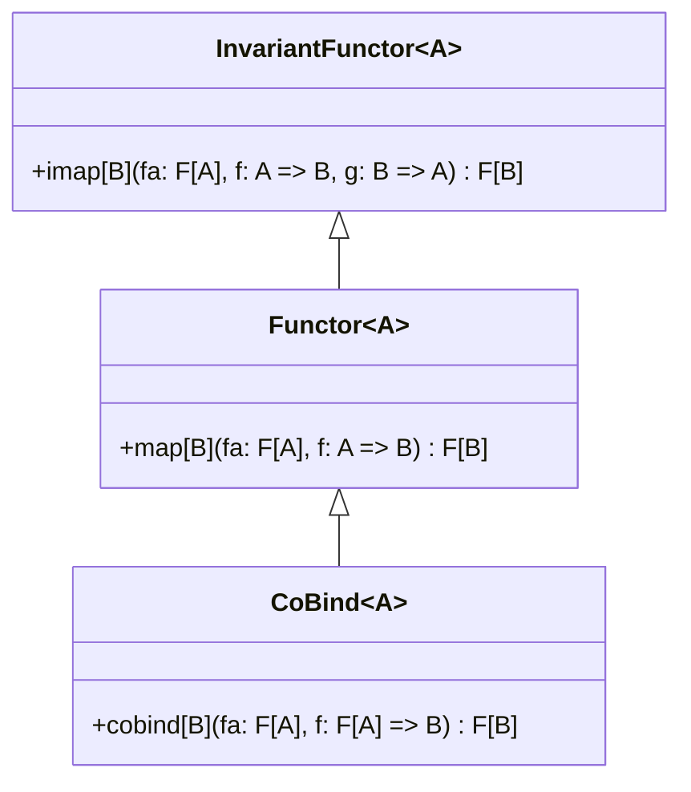



# CoBind

**`CoBind`** (или **`Cobind`**) — это класс типов, который расширяет возможности [**функтора**](functor.md) 
и предоставляет операцию `coflatMap`.
Этот класс типов используется для работы с контекстами, которые поддерживают "расширение" или "развёртывание" значений, 
сохраняя при этом структуру контекста.

`CoBind` реализует противоположные для [`Bind`](bind.md) операции.

`CoBind` определяется для типа `F[_]` и предоставляет метод: `coflatMap: (F[A], F[A] => B) => F[B]`

- Он принимает:
    - Значение типа `F[A]`.
    - Функцию, которая преобразует `F[A]` в `B`.
- Возвращает значение типа `F[B]`.

`CoBind` позволяет "развернуть" значение в контексте, применяя функцию ко всему контексту, а не к отдельному значению. 
Это полезно в ситуациях, где требуется работать с "окрестностями" значений 
или с контекстами, которые сохраняют структуру.

**Примеры использования**

- **Бесконечные потоки**:
    - У вас есть бесконечный поток чисел (`LazyList[Int]`).
    - С помощью `coflatMap` вы можете создать новый поток, где каждое значение является 
      результатом применения функции ко всему потоку (например, скользящее среднее).
- **Таблицы данных**:
    - У вас есть таблица данных (`Table[A]`), где каждая ячейка зависит от соседних ячеек.
    - С помощью `coflatMap` вы можете создать новую таблицу, где каждая ячейка является 
      результатом применения функции ко всей таблице (например, сводка по строкам и столбцам).
- **Временные ряды**:
    - У вас есть временной ряд (`TimeSeries[A]`), где каждое значение зависит от предыдущих и следующих значений.
    - С помощью `coflatMap` вы можете создать новый временной ряд, где каждое значение является 
      результатом применения функции ко всему ряду (например, фильтрация или сглаживание).

## Формальное определение

**`CoBind`** (или **`Cobind`**) — это класс типов в функциональном программировании, 
который формально определяется следующим образом:

Для типа `F[_]` тип класса `CoBind` предоставляет метод: `coflatMap: (F[A], F[A] => B) => F[B]`

- **Входные данные**:
    - Значение типа `F[A]` (контекст, содержащий значение типа `A`).
    - Функция `F[A] => B`, которая принимает весь контекст `F[A]` и возвращает значение типа `B`.
- **Выходные данные**:
    - Новое значение типа `F[B]`, где каждый элемент контекста преобразован с помощью функции.

### Законы

`CoBind` должен удовлетворять определённым законам, которые обеспечивают его корректное поведение:

- **Закон ассоциативности**:
  `fa.coflatMap(f).coflatMap(g) == fa.coflatMap(x => g(x.coflatMap(f)))`
  Это означает, что последовательное применение `coflatMap` должно быть ассоциативным.

## Код

```dotty
trait CoBind[F[_]] extends Functor[F]:
  extension [A](fa: F[A])
    /** Также известно как `extend` и `coFlatMap` */
    def cobind[B](f: F[A] => B): F[B]

    final def extend[B](f: F[A] => B): F[B] = fa.cobind(f)

    final def coFlatMap[B](f: F[A] => B): F[B] = fa.cobind(f)

    /** Также известно как `duplicate` */
    final def cojoin: F[F[A]] = fa.cobind(fa => fa)
```

## Упражнения

### Упражнение 2.16.1: Реализация CoBind (комонады) для NonEmptyList

> [Репозиторий с упражнениями и инструкцией по выполнению][sample]

`NonEmptyList` (непустой список) — классический пример комонады. 
Каждый непустой список можно представить как:

- `head`: первый элемент (всегда присутствует)
- `tail`: хвост списка (может быть пустым)

Операции `CoBind`:

- `map`: преобразует каждый элемент списка, сохраняя структуру
- `cobind`: применяет функцию `f` к каждому непустому суффиксу (хвосту) списка, создавая новый непустой список из результатов

Реализуйте экземпляр `CoBind` для `NonEmptyList`. 

```dotty
import ru.scalabook.typeclasses.CoBind

case class NonEmptyList[A](head: A, tail: List[A]):
  def toList: List[A] = head :: tail
  def ++(than: NonEmptyList[A]): NonEmptyList[A] =
    NonEmptyList(head = head, tail = tail ++ than.toList)

given CoBind[NonEmptyList] with
  extension [A](fa: NonEmptyList[A])
    override def map[B](f: A => B): NonEmptyList[B] = ???
    override def cobind[B](f: NonEmptyList[A] => B): NonEmptyList[B] = ???
```

**Примеры:**

```dotty
import CoBind.given

val nel = NonEmptyList(1, List(2, 3, 4))

// map — преобразование всех элементов
nel.map(_ * 2)  
// NonEmptyList(2, List(4, 6, 8))

nel.map(_.toString)  
// NonEmptyList("1", List("2", "3", "4"))

// cobind — сумма каждого суффикса
val sumSuffixes = nel.cobind(_.toList.sum)
// NonEmptyList(10, List(9, 7, 4))
// Пояснение: 
// - суффикс [1,2,3,4] → 1+2+3+4=10
// - суффикс [2,3,4] → 2+3+4=9
// - суффикс [3,4] → 3+4=7
// - суффикс [4] → 4

// cobind — произведение каждого суффикса
val productSuffixes = nel.cobind(_.toList.product)
// NonEmptyList(24, List(24, 12, 4))
// 1*2*3*4=24, 2*3*4=24, 3*4=12, 4=4

// cobind с преобразованием в строку
val describe = nel.cobind(nel => s"[${nel.toList.mkString(",")}]")
// NonEmptyList("[1,2,3,4]", List("[2,3,4]", "[3,4]", "[4]"))
```

@:note(🔍 Показать решение)

В реализации `map` используется рекурсивный обход списка: для пустого хвоста применяем функцию только к голове; 
для непустого хвоста применяем функцию к голове и рекурсивно к хвосту, 
затем конструируем новый список через `NonEmptyList(f(head), tail.map(f).toList)`.

В `cobind` используется хвостовая рекурсия с аккумулятором `acc: List[B]`. 
На каждом шаге:

- Применяем `f` к текущему `nel`, добавляем результат в аккумулятор.
- Если хвост пуст — возвращаем список из накопленных результатов в обратном порядке,
  т.к. каждый текущий результат добавлялся в начало списка;
  вызов `newList.head` безопасен, т.к. мы точно знаем, что там есть хотя бы `f(nel)`.
- Если хвост непуст — рекурсивно вызываем `loop` с новым `NonEmptyList(h, t)`.

```dotty
given CoBind[NonEmptyList] with
  extension [A](fa: NonEmptyList[A])
    override def map[B](f: A => B): NonEmptyList[B] =
      fa match
        case NonEmptyList(head, Nil)       => NonEmptyList(f(head), Nil)
        case NonEmptyList(head, h :: tail) =>
          NonEmptyList(f(head), NonEmptyList(h, tail).map(f).toList)

    override def cobind[B](f: NonEmptyList[A] => B): NonEmptyList[B] =
      @annotation.tailrec
      def loop(nel: NonEmptyList[A], acc: List[B]): NonEmptyList[B] =
        val newAcc = f(nel) :: acc
        nel.tail match
          case Nil =>
            val newList = newAcc.reverse
            NonEmptyList(newList.head, newList.tail)
          case h :: t =>
            loop(NonEmptyList(h, t), newAcc)

      loop(fa, Nil)
  end extension
```

@:@

## Схема



## Реализация в библиотеках

### Реализация в Cats

```dotty
import cats.*
import cats.data.*
import cats.syntax.all.*
import cats.instances.list.*

List(1, 2, 3, 4, 5).coflatMap(identity)
// res2: List[List[Int]] = List(
//   List(1, 2, 3, 4, 5),
//   List(2, 3, 4, 5),
//   List(3, 4, 5),
//   List(4, 5),
//   List(5)
// )
```

---

**Ссылки:**

- [Ссылка на репозиторий с упражнениями][sample]
- [Cats](https://typelevel.org/cats/typeclasses/comonad.html)
- [Scalaz API](https://javadoc.io/doc/org.scalaz/scalaz-core_3/7.3.6/scalaz/Cobind.html)

[sample]: https://gitverse.ru/scalabook/typeclasses
