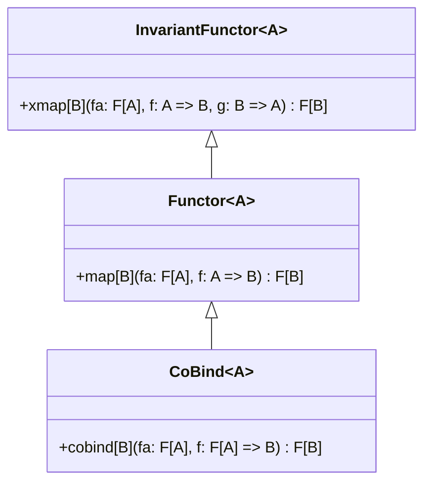



# CoBind

**`CoBind`** (или **`Cobind`**) — это класс типов, который расширяет возможности [**функтора**](functor.md) 
и предоставляет операцию `coflatMap`.
Этот класс типов используется для работы с контекстами, которые поддерживают "расширение" или "развёртывание" значений, 
сохраняя при этом структуру контекста.

`CoBind` реализует противоположные для [`Bind`](bind.md) операции.

`CoBind` определяется для типа `F[_]` и предоставляет метод: `coflatMap: (F[A], F[A] => B) => F[B]`

- Он принимает:
    - Значение типа `F[A]`.
    - Функцию, которая преобразует `F[A]` в `B`.
- Возвращает значение типа `F[B]`.

`CoBind` позволяет "развернуть" значение в контексте, применяя функцию ко всему контексту, а не к отдельному значению. 
Это полезно в ситуациях, где требуется работать с "окрестностями" значений 
или с контекстами, которые сохраняют структуру.

**Примеры использования**

- **Бесконечные потоки**:
    - У вас есть бесконечный поток чисел (`LazyList[Int]`).
    - С помощью `coflatMap` вы можете создать новый поток, где каждое значение является 
      результатом применения функции ко всему потоку (например, скользящее среднее).
- **Таблицы данных**:
    - У вас есть таблица данных (`Table[A]`), где каждая ячейка зависит от соседних ячеек.
    - С помощью `coflatMap` вы можете создать новую таблицу, где каждая ячейка является 
      результатом применения функции ко всей таблице (например, сводка по строкам и столбцам).
- **Временные ряды**:
    - У вас есть временной ряд (`TimeSeries[A]`), где каждое значение зависит от предыдущих и следующих значений.
    - С помощью `coflatMap` вы можете создать новый временной ряд, где каждое значение является 
      результатом применения функции ко всему ряду (например, фильтрация или сглаживание).

## Формальное определение

**`CoBind`** (или **`Cobind`**) — это класс типов в функциональном программировании, 
который формально определяется следующим образом:

Для типа `F[_]` тип класса `CoBind` предоставляет метод: `coflatMap: (F[A], F[A] => B) => F[B]`

- **Входные данные**:
    - Значение типа `F[A]` (контекст, содержащий значение типа `A`).
    - Функция `F[A] => B`, которая принимает весь контекст `F[A]` и возвращает значение типа `B`.
- **Выходные данные**:
    - Новое значение типа `F[B]`, где каждый элемент контекста преобразован с помощью функции.

### Законы

`CoBind` должен удовлетворять определённым законам, которые обеспечивают его корректное поведение:

- **Закон ассоциативности**:
  `fa.coflatMap(f).coflatMap(g) == fa.coflatMap(x => g(x.coflatMap(f)))`
  Это означает, что последовательное применение `coflatMap` должно быть ассоциативным.

## Код

```dotty
trait CoBind[F[_]] extends Functor[F]:
  extension [A](fa: F[A])
    /** Также известно как `extend` и `coFlatMap` */
    def cobind[B](f: F[A] => B): F[B]

    final def extend[B](f: F[A] => B): F[B] = fa.cobind(f)

    final def coFlatMap[B](f: F[A] => B): F[B] = fa.cobind(f)

    /** Также известно как `duplicate` */
    final def cojoin: F[F[A]] = fa.cobind(fa => fa)
```

## Упражнения

### Упражнение 2.14.1: Реализация CoBind для типа Env (контекст с окружением)

> [Репозиторий с упражнениями и инструкцией по выполнению][sample]

Реализуйте экземпляр `CoBind` для типа `Env[A, R]` с фиксированным типом окружения `R`.

```dotty
import ru.scalabook.typeclasses.CoBind

final case class Env[A, R](a: A, r: R)

given envCoBind[R]: CoBind[[X] =>> Env[X, R]] with
  extension [A](as: Env[A, R])
    override def map[B](f: A => B): Env[B, R] = ???
    override def cobind[B](f: Env[A, R] => B): Env[B, R] = ???
```

**Примеры:**

```dotty
import CoBind.given

// Создаём Env со значением и окружением
val env = Env(42, "config")

// Пример 1: map преобразует значение
env.map(_ * 2)        // Env(84, "config")
env.map(_.toString)   // Env("42", "config")
env.map(_ % 10)       // Env(2, "config")

// Пример 2: cobind применяет функцию ко всему Env
val extractValue: Env[Int, String] => String = (e: Env[Int, String]) => s"value: ${e.a}"
val newEnv = env.cobind(extractValue)  // Env("value: 42", "config")

// Пример 3: cobind с функцией, использующей окружение
val useEnv: Env[Int, String] => String = (e: Env[Int, String]) => s"${e.r}: ${e.a}"
env.cobind(useEnv)  // Env("config: 42", "config")
```

@:note(🔍 Показать решение)

Реализация `map` извлекает значение `a` и окружение `r` из `Env`, применяет функцию `f` к значению `a` 
и создаёт новый `Env` с преобразованным значением и исходным окружением. 
Реализация `cobind` извлекает окружение `r` из исходного `Env`, 
применяет функцию `f` ко всему исходному `Env` (получая значение типа `B`), 
и создаёт новый `Env` с этим значением и исходным окружением. 
Ключевая особенность `cobind` в том, что он сохраняет окружение неизменным, 
позволяя создавать новые контексты на основе анализа текущего контекста.

```dotty
final case class Env[A, R](a: A, r: R)

given envCoBind[R]: CoBind[[X] =>> Env[X, R]] with
  extension [A](as: Env[A, R])
    override def map[B](f: A => B): Env[B, R] =
      Env(f(as.a), as.r)

    override def cobind[B](f: Env[A, R] => B): Env[B, R] =
      Env(f(as), as.r)
```

@:@

## Схема



---

**Ссылки:**

- [Ссылка на репозиторий с упражнениями][sample]
- [Scalaz API](https://javadoc.io/doc/org.scalaz/scalaz-core_3/7.3.6/scalaz/Cobind.html)

[sample]: https://gitverse.ru/scalabook/typeclasses
