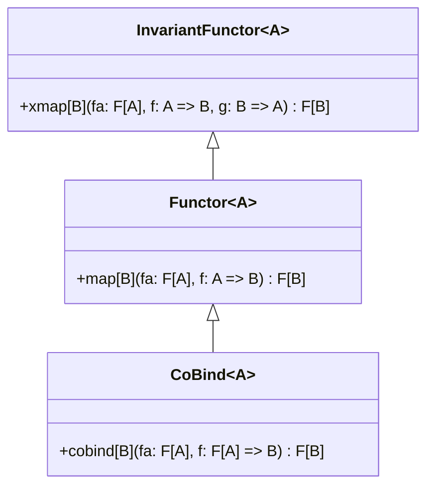



# CoBind

**`CoBind`** (или **`Cobind`**) — это класс типов, который расширяет возможности [**функтора**](functor.md) 
и предоставляет операцию `coflatMap`.
Этот класс типов используется для работы с контекстами, которые поддерживают "расширение" или "развёртывание" значений, 
сохраняя при этом структуру контекста.

`CoBind` реализует противоположные для [`Bind`](bind.md) операции.

**Определение**

`CoBind` определяется для типа `F[_]` и предоставляет метод: `coflatMap: (F[A], F[A] => B) => F[B]`

- Он принимает:
    - Значение типа `F[A]`.
    - Функцию, которая преобразует `F[A]` в `B`.
- Возвращает значение типа `F[B]`.

`CoBind` позволяет "развернуть" значение в контексте, применяя функцию ко всему контексту, а не к отдельному значению. 
Это полезно в ситуациях, где требуется работать с "окрестностями" значений 
или с контекстами, которые сохраняют структуру.

**Примеры использования**

- **Работа с бесконечными структурами данных**:
    - Например, для работы с бесконечными потоками или бесконечными списками, 
      где требуется применять функции ко всей структуре.
- **Обработка данных в контексте**:
    - Например, для работы с двумерными структурами данных, такими как таблицы или матрицы, 
      где требуется применять функции ко всей структуре.
- **Анализ данных**:
    - Например, для анализа временных рядов, где требуется учитывать окрестности значений.

**Краткие примеры**

- **Бесконечные потоки**:
    - У вас есть бесконечный поток чисел (`LazyList[Int]`).
    - С помощью `coflatMap` вы можете создать новый поток, где каждое значение является 
      результатом применения функции ко всему потоку (например, скользящее среднее).
- **Таблицы данных**:
    - У вас есть таблица данных (`Table[A]`), где каждая ячейка зависит от соседних ячеек.
    - С помощью `coflatMap` вы можете создать новую таблицу, где каждая ячейка является 
      результатом применения функции ко всей таблице (например, сводка по строкам и столбцам).
- **Временные ряды**:
    - У вас есть временной ряд (`TimeSeries[A]`), где каждое значение зависит от предыдущих и следующих значений.
    - С помощью `coflatMap` вы можете создать новый временной ряд, где каждое значение является 
      результатом применения функции ко всему ряду (например, фильтрация или сглаживание).

## Формальное определение

**`CoBind`** (или **`Cobind`**) — это класс типов в функциональном программировании, 
который формально определяется следующим образом:

Для типа `F[_]` тип класса `CoBind` предоставляет метод: `coflatMap: (F[A], F[A] => B) => F[B]`

- **Входные данные**:
    - Значение типа `F[A]` (контекст, содержащий значение типа `A`).
    - Функция `F[A] => B`, которая принимает весь контекст `F[A]` и возвращает значение типа `B`.
- **Выходные данные**:
    - Новое значение типа `F[B]`, где каждый элемент контекста преобразован с помощью функции.

### Законы

`CoBind` должен удовлетворять определённым законам, которые обеспечивают его корректное поведение:

- **Закон ассоциативности**:
  `fa.coflatMap(f).coflatMap(g) == fa.coflatMap(x => g(x.coflatMap(f)))`
  Это означает, что последовательное применение `coflatMap` должно быть ассоциативным.

## Код

```dotty
trait CoBind[F[_]] extends Functor[F]:
  extension [A](fa: F[A])
    /** Также известно как `extend` и `coFlatMap` */
    def cobind[B](f: F[A] => B): F[B]

    final def extend[B](f: F[A] => B): F[B] = fa.cobind(f)

    final def coFlatMap[B](f: F[A] => B): F[B] = fa.cobind(f)

    /** Также известно как `duplicate` */
    final def cojoin: F[F[A]] = fa.cobind(fa => fa)
```

### "Обертка"

```dotty
type Id[A] = A
object Id:
  def apply[A](a: A): Id[A] = a

given CoBind[Id] with
  extension [A](as: Id[A])
    override def map[B](f: A => B): Id[B] = Id(f(as))

    override def cobind[B](f: Id[A] => B): Id[B] = Id(f(as))
```

### Переменные окружения

```dotty
final case class Env[A, R](a: A, r: R)

given envCoBind[R]: CoBind[[X] =>> Env[X, R]] with
  extension [A](as: Env[A, R])
    override def map[B](f: A => B): Env[B, R] =
      val Env(a, r) = as
      Env(f(a), r)

    override def cobind[B](f: Env[A, R] => B): Env[B, R] =
      val Env(_, r) = as
      Env(f(as), r)
```

### Законы

- **Закон ассоциативности**:
  `fa.coflatMap(f).coflatMap(g) == fa.coflatMap(x => g(x.coflatMap(f)))`

```dotty
def checkCobindAssociativity[F[_], A, B, C](
    fa: F[A],
    fab: F[A] => B,
    fbc: F[B] => C
)(using cob: CoBind[F]): ValidatedNel[String, Unit] =
  import cob.*

  Either.cond[String, Unit](
    fa.cobind(fab).cobind(fbc) == fa.cobind(x => fbc(x.cobind(fab))),
    (),
    "Не соблюдается ассоциативность CoBind: fa.cobind(fab).cobind(fbc) == fa.cobind(x => fbc(x.cobind(fab)))"
  ).toValidatedNel
```

## Схема



---

**Ссылки:**

- [Ссылка на репозиторий с упражнениями][sample]
- [Scalaz API](https://javadoc.io/doc/org.scalaz/scalaz-core_3/7.3.6/scalaz/Cobind.html)

[sample]: https://gitverse.ru/scalabook/typeclasses
