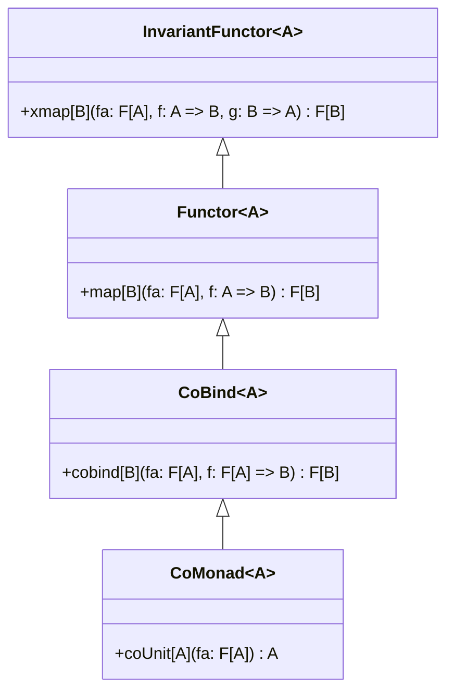



# Co-Monad

**`CoMonad`** (или **`Comonad`**) — это класс типов в функциональном программировании, 
расширяющий [`CoBind`](co-bind.md),
который представляет собой двойственную концепцию к [**`Monad`**](monad.md). 
Если монады позволяют последовательно вычислять значения в контексте, 
то комонады позволяют извлекать значения из контекста и работать с "расширенными" контекстами.

Для типа `F[_]` тип класса `CoMonad` предоставляет два основных метода:

- **`extract`** (также встречаются названия `coUnit`, `coPoint`, `coPure`):
    - Извлекает значение типа `A` из контекста `F[A]`.
    - Сигнатура: `extract: F[A] => A`.
- **`coflatMap`** (также встречается название `cobind`):
    - Принимает контекст `F[A]` и функцию `F[A] => B`, а затем возвращает новый контекст `F[B]`.
    - Сигнатура: `coflatMap: (F[A], F[A] => B) => F[B]`.

**Примеры использования**

- **Работа с бесконечными структурами данных**:
    - Например, для работы с бесконечными потоками (streams) или бесконечными списками, 
      где требуется извлекать значения и работать с "окрестностями" значений.
- **Обработка данных в контексте**:
    - Например, для работы с двумерными структурами данных, такими как таблицы или матрицы, 
      где требуется извлекать значения и применять функции ко всей структуре.

## Формальное определение

**`CoMonad`** (или **`Comonad`**) — это класс типов в функциональном программировании, 
который определяется следующим образом:

Для типа `F[_]` тип класса `CoMonad` предоставляет два основных метода:

- **`extract`**:
    - Извлекает значение типа `A` из контекста `F[A]`.
    - Сигнатура: `extract: F[A] => A`.
- **`coflatMap`**:
    - Принимает контекст `F[A]` и функцию `F[A] => B`, а затем возвращает новый контекст `F[B]`.
    - Сигнатура: `coflatMap: (F[A], F[A] => B) => F[B]`.

### Законы

`CoMonad` должен удовлетворять определённым законам, которые обеспечивают его корректное поведение:

- **Закон ассоциативности**:
  `fa.coflatMap(f).coflatMap(g) == fa.coflatMap(x => g(x.coflatMap(f)))`.
  Это означает, что последовательное применение `coflatMap` должно быть ассоциативным.
- **Закон тождественности слева**: `fa.coflatMap(f).extract == f(fa)`.
  Здесь `extract` — это метод, который извлекает значение из контекста (обычно предоставляемый `Comonad`).
  Этот закон гарантирует, что `coflatMap` корректно взаимодействует с `extract`.
- **Закон тождественности справа**: `fa.coflatMap(_.extract) == fa`.
  Этот закон гарантирует, что если функция `f` просто извлекает значение из контекста,
  то `coflatMap` возвращает исходный контекст.

### Связь с другими классами типов

- **`CoMonad`** и **`CoBind`** расширяют **`Functor`**, так как `cobind` и `coUnit`
  могут быть использованы для реализации `map`: `map(fa)(f) = cobind(fa)(x => f(x.coUnit))`

## Код

```dotty
trait CoMonad[F[_]] extends CoBind[F]:
  def coUnit[A](fa: F[A]): A

  final def coPoint[A](p: F[A]): A = coUnit(p)

  final def coPure[A](p: F[A]): A = coUnit(p)

  extension [A](fa: F[A])
    override def map[B](f: A => B): F[B] =
      fa.cobind(x => f(coUnit(x)))
```

## Упражнения

### Упражнение 2.15.1: Реализация CoMonad для типа Env (окружение)

> [Репозиторий с упражнениями и инструкцией по выполнению][sample]

Тип `Env[A, R]` представляет значение `A` в контексте окружения `R`. Реализуйте экземпляр `CoMonad` для `Env`, где:

- `coUnit` извлекает значение, игнорируя окружение
- `cobind` применяет функцию ко всему текущему контексту (значение + окружение) 
  и создаёт новый контекст с тем же окружением

```dotty
import ru.scalabook.typeclasses.CoMonad

final case class Env[A, R](a: A, r: R)

// TODO: Реализуйте given экземпляр CoMonad для Env
given envCoMonad[R]: CoMonad[[X] =>> Env[X, R]] with
  override def coUnit[A](fa: Env[A, R]): A = ???

  extension [A](as: Env[A, R])
    override def cobind[B](f: Env[A, R] => B): Env[B, R] = ???
```

**Примеры:**

```dotty
import CoMonad.given

val env = Env(42, "config")

// coUnit — извлечение значения
coUnit(env)  // 42

// map — преобразование значения
env.map(_ * 2)        // Env(84, "config")
env.map(_.toString)   // Env("42", "config")

// cobind — применение функции ко всему контексту
val describe: Env[Int, String] => String = e => s"value=${e.a}, env=${e.r}"
env.cobind(describe)  // Env("value=42, env=config", "config")

// цепочка cobind
val double: Env[Int, String] => Int = _.a * 2
env.cobind(double).cobind(describe)  // Env("value=84, env=config", "config")
```

@:note(🔍 Показать решение)

`coUnit` возвращает значение `fa.a`, игнорируя окружение. 
`map` создаёт новый `Env` с преобразованным значением и исходным окружением. 
`cobind` применяет функцию `f` к текущему `Env`, получая значение `B`, 
и создаёт новый `Env` с этим значением и исходным окружением. 
Окружение остаётся неизменным во всех операциях.

```dotty
final case class Env[A, R](a: A, r: R)

given envCoMonad[R]: CoMonad[[X] =>> Env[X, R]] with
  override def coUnit[A](fa: Env[A, R]): A = fa.a

  extension [A](as: Env[A, R])
    override def cobind[B](f: Env[A, R] => B): Env[B, R] =
      Env(f(as), as.r)    
```

@:@

## Схема



---

**Ссылки:**

- [Ссылка на репозиторий с упражнениями][sample]
- [Life Is A Comonad](https://eli-jordan.github.io/2018/02/16/life-is-a-comonad/)
- [Scalaz API](https://javadoc.io/static/org.scalaz/scalaz-core_3/7.3.6/scalaz/Comonad.html)

[sample]: https://gitverse.ru/scalabook/typeclasses
