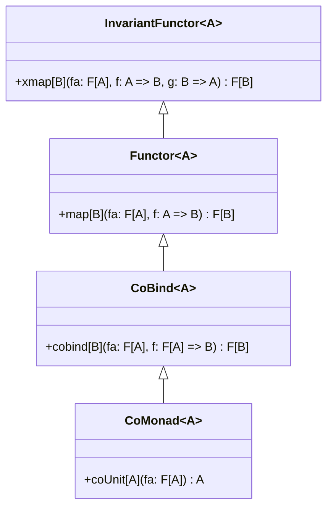



# Co-Monad

**`CoMonad`** (или **`Comonad`**) — это класс типов в функциональном программировании, 
расширяющий [`CoBind`](co-bind.md),
который представляет собой двойственную концепцию к [**`Monad`**](monad.md). 
Если монады позволяют последовательно вычислять значения в контексте, 
то комонады позволяют извлекать значения из контекста и работать с "расширенными" контекстами.

Для типа `F[_]` тип класса `CoMonad` предоставляет два основных метода:

- **`extract`** (также встречаются названия `coUnit`, `coPoint`, `coPure`):
    - Извлекает значение типа `A` из контекста `F[A]`.
    - Сигнатура: `extract: F[A] => A`.
- **`coflatMap`** (также встречается название `cobind`):
    - Принимает контекст `F[A]` и функцию `F[A] => B`, а затем возвращает новый контекст `F[B]`.
    - Сигнатура: `coflatMap: (F[A], F[A] => B) => F[B]`.

**Примеры использования**

- **Работа с бесконечными структурами данных**:
    - Например, для работы с бесконечными потоками (streams) или бесконечными списками, 
      где требуется извлекать значения и работать с "окрестностями" значений.
- **Обработка данных в контексте**:
    - Например, для работы с двумерными структурами данных, такими как таблицы или матрицы, 
      где требуется извлекать значения и применять функции ко всей структуре.

## Формальное определение

**`CoMonad`** (или **`Comonad`**) — это класс типов в функциональном программировании, 
который определяется следующим образом:

Для типа `F[_]` тип класса `CoMonad` предоставляет два основных метода:

- **`extract`**:
    - Извлекает значение типа `A` из контекста `F[A]`.
    - Сигнатура: `extract: F[A] => A`.
- **`coflatMap`**:
    - Принимает контекст `F[A]` и функцию `F[A] => B`, а затем возвращает новый контекст `F[B]`.
    - Сигнатура: `coflatMap: (F[A], F[A] => B) => F[B]`.

### Законы

`CoMonad` должен удовлетворять определённым законам, которые обеспечивают его корректное поведение:

- **Закон ассоциативности**:
  `fa.coflatMap(f).coflatMap(g) == fa.coflatMap(x => g(x.coflatMap(f)))`.
  Это означает, что последовательное применение `coflatMap` должно быть ассоциативным.
- **Закон тождественности слева**: `fa.coflatMap(f).extract == f(fa)`.
  Здесь `extract` — это метод, который извлекает значение из контекста (обычно предоставляемый `Comonad`).
  Этот закон гарантирует, что `coflatMap` корректно взаимодействует с `extract`.
- **Закон тождественности справа**: `fa.coflatMap(_.extract) == fa`.
  Этот закон гарантирует, что если функция `f` просто извлекает значение из контекста,
  то `coflatMap` возвращает исходный контекст.

### Связь с другими классами типов

- **`CoMonad`** и **`CoBind`** расширяют **`Functor`**, так как `cobind` и `coUnit`
  могут быть использованы для реализации `map`: `map(fa)(f) = cobind(fa)(x => f(x.coUnit))`

## Код

```dotty
trait CoMonad[F[_]] extends CoBind[F]:
  def coUnit[A](fa: F[A]): A

  final def coPoint[A](p: F[A]): A = coUnit(p)

  final def coPure[A](p: F[A]): A = coUnit(p)

  extension [A](fa: F[A])
    override def map[B](f: A => B): F[B] =
      fa.cobind(x => f(coUnit(x)))
```

## Упражнения

### Упражнение 2.15.1: Реализация CoMonad (комонады) для NonEmptyList

> [Репозиторий с упражнениями и инструкцией по выполнению][sample]

Реализуйте экземпляр `CoMonad` для `NonEmptyList`:

- Реализовать `coUnit` — извлечение головы
- Реализовать `cobind` — применение функции ко всем непустым суффиксам

```dotty
import ru.scalabook.typeclasses.CoMonad

case class NonEmptyList[A](head: A, tail: List[A]):
  def toList: List[A] = head :: tail
  def ++(than: NonEmptyList[A]): NonEmptyList[A] =
    NonEmptyList(head = head, tail = tail ++ than.toList)

// TODO: Реализуйте given экземпляр CoMonad для NonEmptyList
given CoMonad[NonEmptyList] with
  override def coUnit[A](fa: NonEmptyList[A]): A = ???

  extension [A](fa: NonEmptyList[A])
    override def cobind[B](f: NonEmptyList[A] => B): NonEmptyList[B] = ???
```

**Примеры:**

```dotty
import CoMonad.given

val nel = NonEmptyList(1, List(2, 3, 4))

// coUnit — извлечение головы (первого элемента)
coUnit(nel)  // 1

// cobind — сумма каждого суффикса
val sums = nel.cobind(_.toList.sum)
// NonEmptyList(10, List(9, 7, 4))
// Пояснение: 
// - суффикс [1,2,3,4] → 1+2+3+4=10
// - суффикс [2,3,4] → 2+3+4=9
// - суффикс [3,4] → 3+4=7
// - суффикс [4] → 4
```

@:note(🔍 Показать решение)

Реализация `coUnit` тривиальна — просто возвращаем `fa.head` (голову непустого списка).

В `cobind` используется хвостовая рекурсия с аккумулятором `acc: List[B]`.
На каждом шаге:

- Применяем `f` к текущему `nel`, добавляем результат в аккумулятор.
- Если хвост пуст — возвращаем список из накопленных результатов в обратном порядке,
  т.к. каждый текущий результат добавлялся в начало списка;
  вызов `newList.head` безопасен, т.к. мы точно знаем, что там есть хотя бы `f(nel)`.
- Если хвост непуст — рекурсивно вызываем `loop` с новым `NonEmptyList(h, t)`.

```dotty
given CoMonad[NonEmptyList] with
  override def coUnit[A](fa: NonEmptyList[A]): A = fa.head

  extension [A](fa: NonEmptyList[A])
    override def cobind[B](f: NonEmptyList[A] => B): NonEmptyList[B] =
      @annotation.tailrec
      def loop(nel: NonEmptyList[A], acc: List[B]): NonEmptyList[B] =
        val newAcc = f(nel) :: acc
        nel.tail match
          case Nil =>
            val newList = newAcc.reverse
            // Вызывать head безопасно, потому что мы знаем, что newAcc не пустой
            NonEmptyList(newList.head, newList.tail)
          case h :: t =>
            loop(NonEmptyList(h, t), newAcc)

      loop(fa, Nil)
  end extension   
```

@:@

## Схема



---

**Ссылки:**

- [Ссылка на репозиторий с упражнениями][sample]
- [Life Is A Comonad](https://eli-jordan.github.io/2018/02/16/life-is-a-comonad/)
- [Scalaz API](https://javadoc.io/static/org.scalaz/scalaz-core_3/7.3.6/scalaz/Comonad.html)

[sample]: https://gitverse.ru/scalabook/typeclasses
