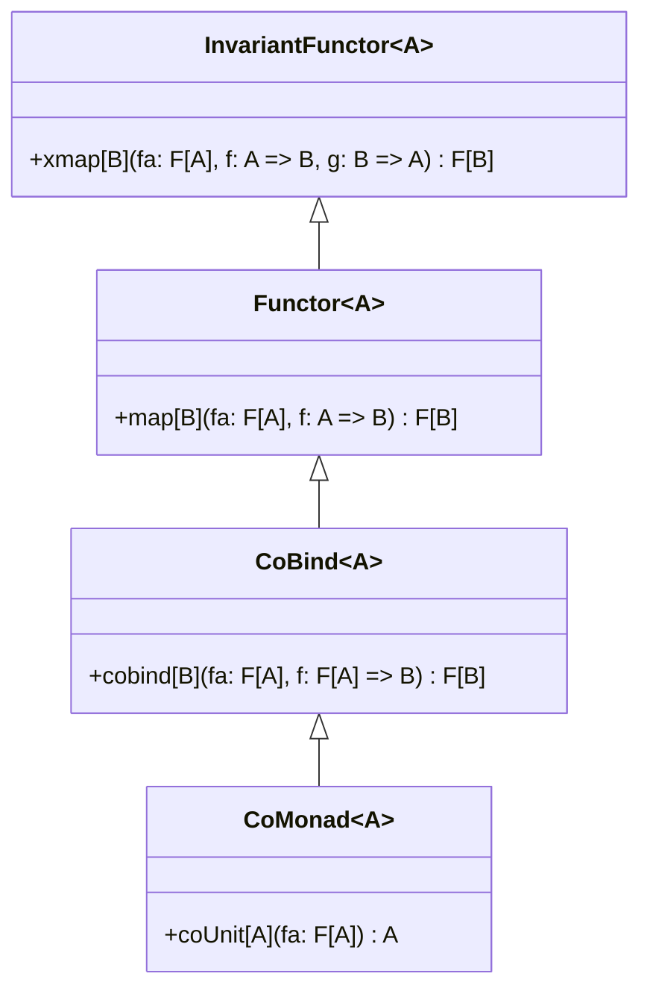

# Co-Monad

## Формальное определение

Комонада реализует противоположные для [монады](monad.md) операции и расширяет [`CoBind`](co-bind.md).

## Код

```dotty
trait CoMonad[F[_]] extends CoBind[F]:
  /** Также известно как `coPoint` и `coPure` */
  def coUnit[A](fa: F[A]): A

  final def coPoint[A](p: F[A]): A = coUnit(p)

  final def coPure[A](p: F[A]): A = coUnit(p)
```

### "Обертка"

```dotty
case class Id[A](value: A)

given CoMonad[Id] with
  override def coUnit[A](fa: Id[A]): A = fa.value

  extension [A](as: Id[A])
    override def map[B](f: A => B): Id[B] = Id(f(as.value))

    override def cobind[B](f: Id[A] => B): Id[B] = Id(f(as))
```

### Переменные окружения

```dotty
final case class Env[A, R](a: A, r: R)

given envCoMonad[R]: CoMonad[[X] =>> Env[X, R]] with
  override def coUnit[A](fa: Env[A, R]): A = fa.a

  extension [A](as: Env[A, R])
    override def map[B](f: A => B): Env[B, R] =
      val Env(a, r) = as
      Env(f(a), r)

    override def cobind[B](f: Env[A, R] => B): Env[B, R] =
      val Env(_, r) = as
      Env(f(as), r)
```

## Схема



---

**Ссылки:**

- [Life Is A Comonad](https://eli-jordan.github.io/2018/02/16/life-is-a-comonad/)
- [Scalaz API](https://javadoc.io/static/org.scalaz/scalaz-core_3/7.3.6/scalaz/Comonad.html)
