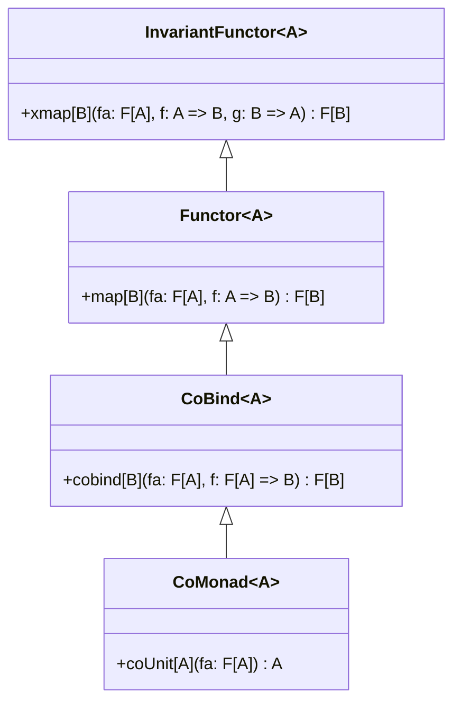



# Co-Monad

**`CoMonad`** (или **`Comonad`**) — это типовой класс в функциональном программировании, 
расширяющий [`CoBind`](co-bind.md),
который представляет собой двойственную концепцию к [**`Monad`**](monad.md). 
Если монады позволяют последовательно вычислять значения в контексте, 
то комонады позволяют извлекать значения из контекста и работать с "расширенными" контекстами.

Для типа `F[_]` тип класса `CoMonad` предоставляет два основных метода:

- **`extract`** (также встречаются названия `coUnit`, `coPoint`, `coPure`):
    - Извлекает значение типа `A` из контекста `F[A]`.
    - Сигнатура: `extract: F[A] => A`.
- **`coflatMap`** (также встречается название `cobind`):
    - Принимает контекст `F[A]` и функцию `F[A] => B`, а затем возвращает новый контекст `F[B]`.
    - Сигнатура: `coflatMap: (F[A], F[A] => B) => F[B]`.

**Примеры использования**

- **Работа с бесконечными структурами данных**:
    - Например, для работы с бесконечными потоками (streams) или бесконечными списками, 
      где требуется извлекать значения и работать с "окрестностями" значений.
- **Обработка данных в контексте**:
    - Например, для работы с двумерными структурами данных, такими как таблицы или матрицы, 
      где требуется извлекать значения и применять функции ко всей структуре.
- **Анализ данных**:
    - Например, для анализа временных рядов, где требуется учитывать окрестности значений.

**Краткие примеры**

- **Бесконечные потоки**:
    - У вас есть бесконечный поток чисел (`LazyList[Int]`).
    - С помощью `extract` вы можете извлечь текущее значение из потока.
    - С помощью `coflatMap` вы можете создать новый поток, где каждое значение является 
      результатом применения функции ко всему потоку (например, скользящее среднее).
- **Таблицы данных**:
    - У вас есть таблица данных (`Table[A]`), где каждая ячейка зависит от соседних ячеек.
    - С помощью `extract` вы можете извлечь значение из конкретной ячейки.
    - С помощью `coflatMap` вы можете создать новую таблицу, где каждая ячейка является
      результатом применения функции ко всей таблице (например, сводка по строкам и столбцам).
- **Временные ряды**:
    - У вас есть временной ряд (`TimeSeries[A]`), где каждое значение зависит от предыдущих и следующих значений.
    - С помощью `extract` вы можете извлечь текущее значение из ряда.
    - С помощью `coflatMap` вы можете создать новый временной ряд, где каждое значение является 
      результатом применения функции ко всему ряду (например, фильтрация или сглаживание).

## Формальное определение

**`CoMonad`** (или **`Comonad`**) — это типовой класс в функциональном программировании, 
который определяется следующим образом:

Для типа `F[_]` тип класса `CoMonad` предоставляет два основных метода:

- **`extract`**:
    - Извлекает значение типа `A` из контекста `F[A]`.
    - Сигнатура: `extract: F[A] => A`.
- **`coflatMap`**:
    - Принимает контекст `F[A]` и функцию `F[A] => B`, а затем возвращает новый контекст `F[B]`.
    - Сигнатура: `coflatMap: (F[A], F[A] => B) => F[B]`.

### Законы

`CoMonad` должен удовлетворять определённым законам, которые обеспечивают его корректное поведение:

- **Закон ассоциативности**:
  `fa.coflatMap(f).coflatMap(g) == fa.coflatMap(x => g(x.coflatMap(f)))`.
  Это означает, что последовательное применение `coflatMap` должно быть ассоциативным.
- **Закон тождественности слева**: `fa.coflatMap(f).extract == f(fa)`.
  Здесь `extract` — это метод, который извлекает значение из контекста (обычно предоставляемый `Comonad`).
  Этот закон гарантирует, что `coflatMap` корректно взаимодействует с `extract`.
- **Закон тождественности справа**: `fa.coflatMap(_.extract) == fa`.
  Этот закон гарантирует, что если функция `f` просто извлекает значение из контекста,
  то `coflatMap` возвращает исходный контекст.

### Связь с другими типовыми классами

- **`CoMonad`** и **`CoBind`** расширяют **`Functor`**, так как `cobind` и `coUnit`
  могут быть использованы для реализации `map`: `map(fa)(f) = cobind(fa)(x => f(x.coUnit))`

## Код

```dotty
trait CoMonad[F[_]] extends CoBind[F]:
  def coUnit[A](fa: F[A]): A

  final def coPoint[A](p: F[A]): A = coUnit(p)

  final def coPure[A](p: F[A]): A = coUnit(p)

  extension [A](fa: F[A])
    override def map[B](f: A => B): F[B] =
      fa.cobind(x => f(coUnit(x)))
```

### "Обертка"

```dotty
type Id[A] = A
object Id:
  def apply[A](a: A): Id[A] = a

given CoMonad[Id] with
  override def coUnit[A](fa: Id[A]): A = fa

  extension [A](as: Id[A])
    override def map[B](f: A => B): Id[B] = Id(f(as))

    override def cobind[B](f: Id[A] => B): Id[B] = Id(f(as))
```

### Переменные окружения

```dotty
final case class Env[A, R](a: A, r: R)

given envCoMonad[R]: CoMonad[[X] =>> Env[X, R]] with
  override def coUnit[A](fa: Env[A, R]): A = fa.a

  extension [A](as: Env[A, R])
    override def map[B](f: A => B): Env[B, R] =
      val Env(a, r) = as
      Env(f(a), r)

    override def cobind[B](f: Env[A, R] => B): Env[B, R] =
      val Env(_, r) = as
      Env(f(as), r)
```

## Схема



---

**Ссылки:**

- [Life Is A Comonad](https://eli-jordan.github.io/2018/02/16/life-is-a-comonad)
- [Scalaz API](https://javadoc.io/static/org.scalaz/scalaz-core_3/7.3.6/scalaz/Comonad.html)
