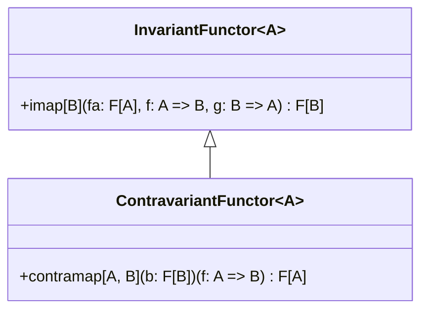

# Контравариантный функтор

**Контравариантный функтор** (contravariant functor) — это класс типов, 
обобщающий операцию "подготовки" или "преобразования" данных в противоположном направлении 
по сравнению с [обычным (ковариантным) функтором](functor.md). 
Контравариантный функтор определяется через класс типов `Contravariant`, который предоставляет операцию `contramap`.

Для типа `F[_]` контравариантный функтор предоставляет метод: `contramap: (F[A], B => A) => F[B]`

- Он принимает:
    - Значение типа `F[A]`.
    - Функцию, которая преобразует `B` в `A`.
- Возвращает значение типа `F[B]`.

Контравариантный функтор "подготавливает" данные для обработки. 
Если у вас есть функтор `F[A]`, который работает с типом `A`, и функция `B => A`, 
то с помощью `contramap` вы можете адаптировать этот функтор для работы с типом `B`.

**Примеры использования**

- **Сериализация и кодирование**:
    - Если у вас есть кодировщик для типа `A` (`F[A]`), и вы хотите адаптировать его для работы с типом `B`, 
      то можете использовать `contramap`, предоставив функцию `B => A`.
- **Валидация данных**:
    - Если у вас есть валидатор для типа `A` (`F[A]`), и вы хотите валидировать тип `B`, 
      то можете использовать `contramap`, предоставив функцию `B => A`.
- **Предикаты и фильтры**:
    - Если у вас есть предикат для типа `A` (`F[A]`), и вы хотите применить его к типу `B`, 
      то можете использовать `contramap`, предоставив функцию `B => A`.

Контравариантные функторы полезны в ситуациях, где требуется адаптация существующих обработчиков
(например, кодировщиков, валидаторов, предикатов) для работы с другими типами.
Они часто используются в библиотеках для функционального программирования, таких как **Cats** или **Scalaz**.

## Формальное определение

Контравариантный функтор (`F`) похож на [функтор](functor.md), 
только с противоположной операцией `cmap`:

- `cmap(b: F[B])(f: A => B): F[A]`.

Контравариантный функтор создает новые экземпляры классов типов, добавляя функцию в начало цепочки преобразований,
в отличие от функтора, который добавляет её в конец.

Законы контравариантного функтора:

- Тождественность (identity): Если определен метод идентификации `id` такой, что: `id(a) == a`,
  тогда `cmap(fa)(id) == fa`.
- Композиция (composition): Если определены два метода `f: A => B` и `g: B => C`, 
  тогда `cmap(cmap(fc)(g))(f) == cmap(fc)(g(f(_)))`.

## Код

```dotty
trait ContravariantFunctor[F[_]] extends InvariantFunctor[F]:
  self =>

  def cmap[A, B](b: F[B])(f: A => B): F[A]

  def contramap[A, B](b: F[B])(f: A => B): F[A] = cmap(b)(f)

  extension [A](fa: F[A]) override def imap[B](f: A => B, g: B => A): F[B] = cmap(fa)(g)

  /** Композиция двух контравариантных функторов ковариантна */
  def compose[G[_]: ContravariantFunctor as cfu]: Functor[[X] =>> F[G[X]]] =
    new Functor[[X] =>> F[G[X]]]:
      extension [A](as: F[G[A]])
        def map[B](f: A => B): F[G[B]] =
          cmap(as)(gb => cfu.cmap(gb)(f))

  /** Композиция контравариантного и ковариантного функторов контравариантна */
  def icompose[G[_]: Functor as fu]: ContravariantFunctor[[X] =>> F[G[X]]] =
    new ContravariantFunctor[[X] =>> F[G[X]]]:
      def cmap[A, B](fa: F[G[B]])(f: A => B): F[G[A]] =
        self.cmap(fa)(fu.lift(f))

  /** Произведение двух контравариантных функторов контравариантно */
  def product[G[_]: ContravariantFunctor as cfu]
      : ContravariantFunctor[[X] =>> (F[X], G[X])] =
    new ContravariantFunctor[[X] =>> (F[X], G[X])]:
      def cmap[A, B](fa: (F[B], G[B]))(f: A => B): (F[A], G[A]) =
        (self.contramap(fa._1)(f), cfu.contramap(fa._2)(f))
```

### Композиции

#### Композиция двух контравариантных функторов

```dotty
def compose[G[_]: ContravariantFunctor]: Functor[[X] =>> F[G[X]]]
```

**Почему это работает**:

- Внешний функтор `F` — контравариантный (преобразует входные типы назад)
- Внутренний функтор `G` — тоже контравариантный

**Результат**: Композиция двух контравариантных функторов даёт **ковариантный** функтор! 
Это может показаться неожиданным, но вот логика:

1. Нам нужно преобразовать `F[G[A]]` в `F[G[B]]` с помощью функции `A => B`
2. Поскольку `F` контравариантен, чтобы из `F[G[A]]` получить `F[G[B]]`, нам нужна функция из `G[B]` в `G[A]`
3. Поскольку `G` контравариантен, мы можем получить `G[A]` из `G[B]` с помощью функции `A => B`

В коде:
```dotty
extension [A](as: F[G[A]])
  def map[B](f: A => B): F[G[B]] =
    cmap(as)(gb => cfu.cmap(gb)(f))
```

**Шаг за шагом**:

1. `as` имеет тип `F[G[A]]`
2. Нам нужно получить `F[G[B]]`
3. Используем `cmap` на `as`: `cmap(as)(fun)`
4. Функция `fun` должна преобразовывать `G[B]` в `G[A]`
5. Используем внутренний `cfu.cmap(gb)(f)` где:
    - `gb` это `G[B]`
    - `f: A => B`
    - Так как `G` контравариантен, `cmap` даёт `G[A]` из `G[B]`!

Ключевое наблюдение:

- Контравариантный функтор переворачивает стрелки: `A => B` становится `F[B] => F[A]`
- Два переворота возвращают исходное направление!

#### Композиция контравариантного и ковариантного = контравариантный

```dotty
def icompose[G[_]: Functor]: ContravariantFunctor[[X] =>> F[G[X]]]
```

**Почему это работает**:

- Внешний `F` — контравариантный
- Внутренний `G` — ковариантный (обычный функтор)

**Результат**: Композиция контравариантного и ковариантного даёт **контравариантный** функтор.

```dotty
def cmap[A, B](fa: F[G[B]])(f: A => B): F[G[A]] =
  self.cmap(fa)(fu.lift(f))
```

**Шаг за шагом**:

1. `fa` имеет тип `F[G[B]]`
2. Нам нужно получить `F[G[A]]`
3. Используем `self.cmap(fa)(fun)`
4. Функция `fun` должна преобразовывать `G[A]` в `G[B]`
5. Используем `fu.lift(f)`, который поднимает `f: A => B` в `G[A] => G[B]` (так как `G` — функтор)

#### Произведение двух контравариантных функторов

```dotty
def product[G[_]: ContravariantFunctor]: ContravariantFunctor[[X] =>> (F[X], G[X])]
```

**Почему это работает**: Произведение двух контравариантных функторов остаётся контравариантным.

```dotty
def cmap[A, B](fa: (F[B], G[B]))(f: A => B): (F[A], G[A]) =
  (self.contramap(fa._1)(f), cfu.contramap(fa._2)(f))
```

**Шаг за шагом**:

1. Вход: пара `(F[B], G[B])` и функция `f: A => B`
2. Нужно получить: пару `(F[A], G[A])`
3. Для первого компонента используем `self.contramap(fa._1)(f)`
4. Для второго используем `cfu.contramap(fa._2)(f)`
5. Возвращаем пару результатов

### Важные закономерности

| Композиция  | Тип первого  | Тип второго  | Результат            |
|-------------|--------------|--------------|----------------------|
| `compose`   | `F` (контра) | `G` (контра) | **Ковариантный**     |
| `icompose`  | `F` (контра) | `G` (ковари) | **Контравариантный** |
| `product`   | `F` (контра) | `G` (контра) | **Контравариантный** |

### Законы

- Тождественность (identity): `cmap(fa)(id) == fa`.
- Композиция (composition): `cmap(cmap(fc)(g))(f) == cmap(fc)(g(f(_)))`.

## Упражнения

### Упражнение 2.11.1: Реализация контравариантного функтора для функции.

> [Репозиторий с упражнениями и инструкцией по выполнению][sample]

Контравариантный функтор для типа `Function1` (функция от `X` к `R`) позволяет преобразовывать входной тип функции. 

Реализуйте экземпляр `ContravariantFunctor` для типа `Function1[X, R]` с фиксированным возвращаемым типом `R`. 

```dotty
given functionContravariantFunctor[R]: ContravariantFunctor[[X] =>> Function1[X, R]] with
  def cmap[A, B](function: B => R)(f: A => B): A => R = ???
```

**Примеры:**

```dotty
val boolToString: Boolean => String = (b: Boolean) => if b then "true" else "false"
val intToBool: Int => Boolean = (x: Int) => x > 0

val positiveToString = 
  summon[ContravariantFunctor[[X] =>> X => String]]
    .cmap(boolToString)(intToBool)

positiveToString(5)   // "true"
positiveToString(-3)  // "false"
```

@:note(🔍 Показать решение)

Реализация тривиальна: чтобы получить функцию `A => R`, мы применяем функцию `f: A => B` к аргументу `a`, получая `B`, 
а затем применяем исходную функцию `function: B => R` к результату. Это стандартная композиция функций.
Это ключевое свойство `Function1` — он контравариантен по входному типу.

```dotty
given functionContravariantFunctor[R]: ContravariantFunctor[[X] =>> Function1[X, R]] with
  def cmap[A, B](function: B => R)(f: A => B): A => R =
    a => function(f(a))
```

Частным случаем предыдущего примера является предикат — функция, возвращающая `Boolean`:

```dotty
opaque type Predicate = [X] =>> X => Boolean

given predicateContravariantFunctor: ContravariantFunctor[Predicate] with
  def cmap[A, B](predicate: Predicate[B])(f: A => B): Predicate[A] =
    a => predicate(f(a))
```

Или отображение значений (Show):

```dotty
opaque type ShowX = [X] =>> X => String
object ShowX:
  def apply[X](f: X => String): ShowX[X] = f

given showContravariantFunctor: ContravariantFunctor[ShowX] with
  def cmap[A, B](show: ShowX[B])(f: A => B): ShowX[A] =
    a => show(f(a))
```

@:@

## Схема



## Реализация в библиотеках

### Реализация в Cats

```dotty
import cats.syntax.contravariant.*
import cats.Show

val showString = Show[String]
showString
  .contramap[Symbol](sym => s"'${sym.name}")
  .show(Symbol("dave"))
// val res0: String = 'dave
```

---

**Ссылки:**

- [Ссылка на репозиторий с упражнениями][sample]
- Category Theory for Programmers - Bartosz Milewski:
    - [Теория категорий для программистов](https://henrychern.wordpress.com/2022/09/15/%d1%82%d0%b5%d0%be%d1%80%d0%b8%d1%8f-%d0%ba%d0%b0%d1%82%d0%b5%d0%b3%d0%be%d1%80%d0%b8%d0%b9-%d0%b4%d0%bb%d1%8f-%d0%bf%d1%80%d0%be%d0%b3%d1%80%d0%b0%d0%bc%d0%bc%d0%b8%d1%81%d1%82%d0%be%d0%b2/)
    - [Category Theory for Programmers, Functoriality](https://bartoszmilewski.com/2015/02/03/functoriality/)
- [Cats](https://typelevel.org/cats/typeclasses/contravariant.html)
- [Learn Functional Programming course/tutorial on Scala](https://github.com/dehun/learn-fp) 
- [Scala with Cats](https://scalawithcats.com/dist/scala-with-cats.html#contravariant)
- [Scalaz API](https://javadoc.io/static/org.scalaz/scalaz-core_3/7.3.6/scalaz/Contravariant.html)

[sample]: https://gitverse.ru/scalabook/typeclasses
