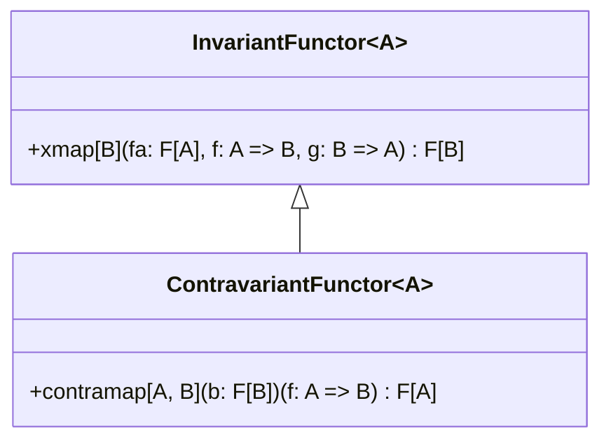



# Контравариантный функтор

**Контравариантный функтор** (contravariant functor) — это типовой класс, 
обобщающий операцию "подготовки" или "преобразования" данных в противоположном направлении 
по сравнению с [обычным (ковариантным) функтором](functor.md). 
Контравариантный функтор определяется через типовой класс `Contravariant`, который предоставляет операцию `contramap`.

Для типа `F[_]` контравариантный функтор предоставляет метод: `contramap: (F[A], B => A) => F[B]`

- Он принимает:
    - Значение типа `F[A]`.
    - Функцию, которая преобразует `B` в `A`.
- Возвращает значение типа `F[B]`.

Контравариантный функтор "подготавливает" данные для обработки. 
Если у вас есть функтор `F[A]`, который работает с типом `A`, и функция `B => A`, 
то с помощью `contramap` вы можете адаптировать этот функтор для работы с типом `B`.

**Примеры использования**

- **Сериализация и кодирование**:
    - Если у вас есть кодировщик для типа `A` (`F[A]`), и вы хотите адаптировать его для работы с типом `B`, 
      то можете использовать `contramap`, предоставив функцию `B => A`.
- **Валидация данных**:
    - Если у вас есть валидатор для типа `A` (`F[A]`), и вы хотите валидировать тип `B`, 
      то можете использовать `contramap`, предоставив функцию `B => A`.
- **Предикаты и фильтры**:
    - Если у вас есть предикат для типа `A` (`F[A]`), и вы хотите применить его к типу `B`, 
      то можете использовать `contramap`, предоставив функцию `B => A`.

**Краткие примеры**

- **Кодировщик JSON**:
    - У вас есть кодировщик для типа `Person` (`JsonEncoder[Person]`).
    - Вы хотите закодировать тип `Employee`, который можно преобразовать в `Person` с помощью функции `Employee => Person`.
    - С помощью `contramap` вы создаёте кодировщик для `Employee`.
- **Валидатор формы**:
    - У вас есть валидатор для типа `Email` (`Validator[Email]`).
    - Вы хотите валидировать тип `User`, который содержит поле `Email`, используя функцию `User => Email`.
    - С помощью `contramap` вы создаёте валидатор для `User`.
- **Предикат для фильтрации**:
    - У вас есть предикат для проверки, является ли число положительным (`Predicate[Int]`).
    - Вы хотите применить этот предикат к типу `Double`, используя функцию `Double => Int` (например, округление).
    - С помощью `contramap` вы создаёте предикат для `Double`.

Контравариантные функторы полезны в ситуациях, где требуется адаптация существующих обработчиков
(например, кодировщиков, валидаторов, предикатов) для работы с другими типами.
Они часто используются в библиотеках для функционального программирования, таких как **Cats** или **Scalaz**.

## Формальное определение

Контравариантный функтор (`F`) похож на [функтор](functor.md), 
только с противоположной операцией `cmap`:

- `cmap(b: F[B])(f: A => B): F[A]`.

Контравариантный функтор создает новые экземпляры классов типов, добавляя функцию в начало цепочки преобразований,
в отличие от функтора, который добавляет её в конец.

Законы контравариантного функтора:

- Тождественность (identity): Если определен метод идентификации `id` такой, что: `id(a) == a`,
  тогда `cmap(fa)(id) == fa`.
- Композиция (composition): Если определены два метода `f: A => B` и `g: B => C`, 
  тогда `cmap(cmap(fc)(g))(f) == cmap(fc)(g(f(_)))`.

## Код

```dotty
trait ContravariantFunctor[F[_]] extends InvariantFunctor[F]:
  self =>

  def cmap[A, B](b: F[B])(f: A => B): F[A]

  def contramap[A, B](b: F[B])(f: A => B): F[A] = cmap(b)(f)

  extension [A](fa: F[A]) override def xmap[B](f: A => B, g: B => A): F[B] = cmap(fa)(g)

  /** Композиция ковариантного и контравариантного функторов ковариантна */
  def compose[G[_]: ContravariantFunctor]: Functor[[X] =>> F[G[X]]] =
    new Functor[[X] =>> F[G[X]]]:
      private val g = summon[ContravariantFunctor[G]]
      extension [A](as: F[G[A]]) def map[B](f: A => B): F[G[B]] = cmap(as)(gb => g.cmap(gb)(f))

  /** Композиция контравариантного и ковариантного функторов контравариантна */
  def icompose[G[_]: Functor]: ContravariantFunctor[[X] =>> F[G[X]]] =
    new ContravariantFunctor[[X] =>> F[G[X]]]:
      private val g = summon[Functor[G]]
      def cmap[A, B](fa: F[G[B]])(f: A => B): F[G[A]] = self.cmap(fa)(g.lift(f))

  /** Произведение двух контравариантных функторов контравариантно */
  def product[G[_]: ContravariantFunctor]: ContravariantFunctor[[X] =>> (F[X], G[X])] =
    new ContravariantFunctor[[X] =>> (F[X], G[X])]:
      private val g = summon[ContravariantFunctor[G]]
      def cmap[A, B](fa: (F[B], G[B]))(f: A => B): (F[A], G[A]) =
        (self.contramap(fa._1)(f), g.contramap(fa._2)(f))
```

### Унарная функция

```dotty
given functionContravariantFunctor[R]: ContravariantFunctor[[X] =>> Function1[X, R]] with
  def cmap[A, B](function: B => R)(f: A => B): A => R =
    a => function(f(a))
```

### Предикат

Частным случаем предыдущего примера является предикат:

```dotty
trait Predicate[A] extends Function1[A, Boolean]  
  
given ContravariantFunctor[Predicate] with
  def cmap[A, B](b: Predicate[B])(f: A => B): Predicate[A] =
    a => b(f(a))
```

### Законы

- Тождественность (identity): `cmap(fa)(id) == fa`.
- Композиция (composition): `cmap(cmap(fc)(g))(f) == cmap(fc)(g(f(_)))`.

```dotty
def checkContravariantFunctorIdentity[F[_], A](fa: F[A])(using
    cf: ContravariantFunctor[F]
): ValidatedNel[String, Unit] =
  import cf.*
  Either.cond[String, Unit](
    cmap[A, A](fa)(identity) == fa,
    (),
    "Не соблюдается Тождественность контравариантного функтора: cmap(fa)(id) == fa"
  ).toValidatedNel

def checkContravariantFunctorComposition[F[_], A, B, C](fc: F[C])(
    using
    cf: ContravariantFunctor[F],
    f: A => B,
    g: B => C
): ValidatedNel[String, Unit] =
  import cf.*
  Either.cond[String, Unit](
    cmap(cmap(fc)(g))(f) == cmap(fc)(g compose f),
    (),
    "Не соблюдается Композиция контравариантного функтора: cmap(cmap(fc)(g))(f) == cmap(fc)(g(f(_)))"
  ).toValidatedNel
```

## Схема



## Реализация в библиотеках

### Реализация в Cats

```dotty
import cats.syntax.contravariant.*
import cats.Show

val showString = Show[String]
showString
  .contramap[Symbol](sym => s"'${sym.name}")
  .show(Symbol("dave"))
// val res0: String = 'dave
```

---

**Ссылки:**

- Category Theory for Programmers - Bartosz Milewski:
    - [Теория категорий для программистов](https://henrychern.files.wordpress.com/2023/05/mil-ct3.pdf#page=137)
    - [Category Theory for Programmers, Functoriality](https://bartoszmilewski.com/2015/02/03/functoriality)
- [Cats](https://typelevel.org/cats/typeclasses/contravariant.html)
- [Learn Functional Programming course/tutorial on Scala](https://github.com/dehun/learn-fp) 
- [Scala with Cats](https://scalawithcats.com/dist/scala-with-cats.html#contravariant)
- [Scalaz API](https://javadoc.io/static/org.scalaz/scalaz-core_3/7.3.6/scalaz/Contravariant.html)
