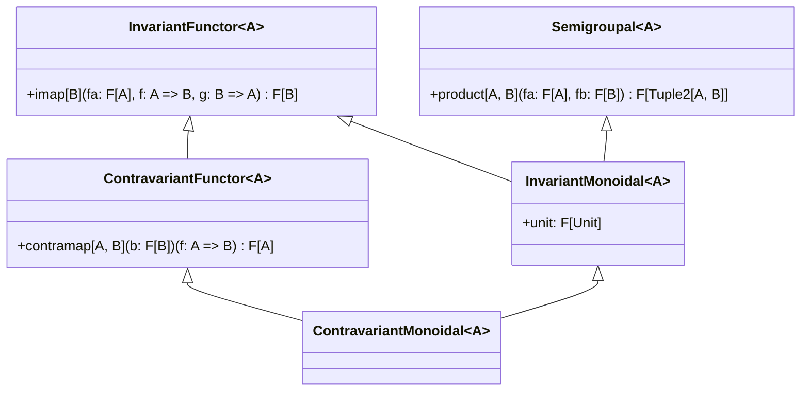



# Contravariant Monoidal

Класс типов `ContravariantMonoidal` предназначен для [контравариантных функторов](contravariant-functor.md),
которые могут определять функции `product` (произведение) и `unit` (единица), наследованные от [InvariantMonoidal](invariant-monoidal.md).
Это можно рассматривать как контравариантный аналог [`Applicative`](applicative.md) —
вместо комбинирования значений с помощью `map2` и `unit`,
мы комбинируем их в обратном направлении с помощью `contramap2` и `point`.

## Код

```dotty
trait InvariantMonoidal[F[_]] extends InvariantSemigroupal[F]:
  def point[A](a: A): F[A] = unit.imap(_ => a, _ => ())

  def unit: F[Unit]

trait ContravariantMonoidal[F[_]] extends InvariantMonoidal[F]
    with ContravariantFunctor[F]:
  def contramap2[A, B, C](fb: F[B], fc: F[C])(f: A => (B, C)): F[A] =
    contramap(product(fb, fc))(f)
```

### Ключевая идея

Если у вас есть два контекста `F[B]` и `F[C]` для типов `B` и `C`,
а также способ одновременно получить значения `B` и `C` из значения типа `A`,
то `ContravariantMonoidal` позволяет вам получить контекст `F[A]` для типа `A`.

Проще говоря:

- **Applicative** позволяет создавать `F[A]` из `A` (метод `def unit[A](a: => A): F[A]`) 
  и комбинировать `F[A]` и `F[B]` в `F[C]` с помощью функции `f: (A, B) => C` 
  (метод расширения `extension [A](fa: F[A]) def map2[B, C](fb: F[B])(f: (A, B) => C): F[C]`)
  Это мы знаем из [Упражнения 2.5.9](applicative.md).
- **ContravariantMonoidal** позволяет также создавать `F[A]` из `A` (метод `point`) 
  и «отображать назад» `F[B]` и `F[C]` в `F[A]` (метод `contramap2`) через функцию `A => (B, C)`

## Примеры экземпляров

Классические примеры `ContravariantMonoidal`:

- [`Equal`](../equal/equal.md) — сравнение на равенство.
- Предикаты (`A => Boolean`).

### Сравнение на равенство как `ContravariantMonoidal`

```dotty
given ContravariantMonoidal[Equal] with
  def unit: Equal[Unit] =
    (a1: Unit, a2: Unit) => true

  def cmap[A, B](b: Equal[B])(f: A => B): Equal[A] =
    (a1: A, a2: A) => b.equal(f(a1), f(a2))

  def product[A, B](fa: Equal[A], fb: Equal[B]): Equal[(A, B)] =
    (ab1: (A, B), ab2: (A, B)) =>
      fa.equal(ab1._1, ab2._1) && fb.equal(ab1._2, ab2._2)
```

Реализация `ContravariantMonoidal` для `Equal` позволяет комбинировать сравнения на равенство для составных типов. 
Метод `unit` определяет, что любые два значения `Unit` всегда равны, что служит нейтральным элементом для комбинирования. 
Метод `product` комбинирует два экземпляра `Equal` — для типов `A` и `B` — в один экземпляр для пары `(A, B)`, 
проверяя равенство компонентов попарно с помощью логического И. 
Метод `contramap` (`cmap`) позволяет адаптировать сравнение на равенство: 
если у нас есть `Equal[B]` и функция преобразования `A => B`, 
мы можем получить `Equal[A]`, сравнивая значения `A` через их преобразование в `B`.

Этот подход особенно полезен при работе с доменными моделями: 
вы можете определить базовые `Equal` для примитивных типов (строки, числа) 
и затем комбинировать их для сложных case-классов, используя `contramap` для доступа к полям. 
Например, `Equal[(String, Int)]` может быть построен из `Equal[String]` и `Equal[Int]` через `product`. 
Благодаря контравариантности, `ContravariantMonoidal[Equal]` позволяет создавать сравнения на равенство для любых типов, 
для которых существует способ разложить их на компоненты с уже определёнными сравнениями, 
что делает код более модульным и переиспользуемым.

### Предикаты как `ContravariantMonoidal`

Рассмотрим практический пример с типом `Predicate` (предикат), который представляет собой функцию,
проверяющую некоторое условие.

Мы можем реализовать `ContravariantMonoidal` для `Predicate`, основываясь на моноиде `Boolean` с операцией `&&` (логическое И):

```dotty
given ContravariantMonoidal[[X] =>> X => Boolean] with
  def unit: Unit => Boolean = _ => true

  def cmap[A, B](b: B => Boolean)(f: A => B): A => Boolean =
    a => b(f(a))

  def product[A, B](fa: A => Boolean, fb: B => Boolean): ((A, B)) => Boolean =
    (a, b) => fa(a) && fb(b)
```

**Что здесь происходит?**

1. **`unit`** — предикат для `Unit`, который всегда возвращает `true`.
   Это нейтральный элемент для комбинирования: `predicate && true == predicate`.
2. **`product`** — комбинирует два предиката в один, который проверяет оба условия на соответствующих компонентах пары.
3. **`contramap`** — позволяет преобразовать входной тип предиката.
   Если у нас есть `Predicate[A]` и функция `B => A`, мы можем получить `Predicate[B]`.

Мы могли бы также использовать `false` и `||` (логическое ИЛИ):

```dotty
given ContravariantMonoidal[[X] =>> X => Boolean] with
  def unit: Unit => Boolean = _ => false

  def cmap[A, B](b: B => Boolean)(f: A => B): A => Boolean =
    a => b(f(a))

  def product[A, B](fa: A => Boolean, fb: B => Boolean): ((A, B)) => Boolean =
    (a, b) => fa(a) || fb(b)
```

### Использование `contramap` для преобразования предикатов

С помощью `contramap` мы можем адаптировать предикаты к новым типам:

```dotty
case class Money(value: Long)

// Предикат для Long: проверяет чётность
def isEven: Long => Boolean = _ % 2 == 0

// Преобразуем предикат для Long в предикат для Money
def isEvenMoney: Money => Boolean =
  ContravariantMonoidal[[X] =>> X => Boolean]
    .contramap[Money, Long](isEven)(_.value)

// Проверяем
isEvenMoney(Money(55)) // false (55 — нечётное)
isEvenMoney(Money(56)) // true (56 — чётное)
```

## Связь с другими классами типов

### Сравнение `Applicative` и `ContravariantMonoidal`

| Характеристика                   | `Applicative[F]`                               | `ContravariantMonoidal[F]`                     |
|:---------------------------------|:-----------------------------------------------|:-----------------------------------------------|
| **Направление**                  | Ковариантное                                   | Контравариантное                               |
| **Базовый класс**                | `Apply` + `Functor`                            | `Semigroupal` + `ContravariantFunctor`         |
| **Нейтральный элемент**          | `pure[A](a: A): F[A]`                          | `unit: F[Unit]`                                |
| **Комбинация**                   | `product[A, B](fa: F[A], fb: F[B]): F[(A, B)]` | `product[A, B](fa: F[A], fb: F[B]): F[(A, B)]` |
| **Отображение**                  | `map(fa)(f: A => B): F[B]`                     | `contramap(fa)(f: B => A): F[B]`               |
| **Комбинация с преобразованием** | `map2(fa, fb)(f: (A, B) => C)`                 | `contramap2(fa, fb)(f: C => (A, B))`           |

## Схема



---

**Ссылки:**

- [Ссылка на репозиторий с упражнениями][sample]
- [Cats](https://typelevel.org/cats/typeclasses/contravariantmonoidal.html)

[sample]: https://gitverse.ru/scalabook/typeclasses
