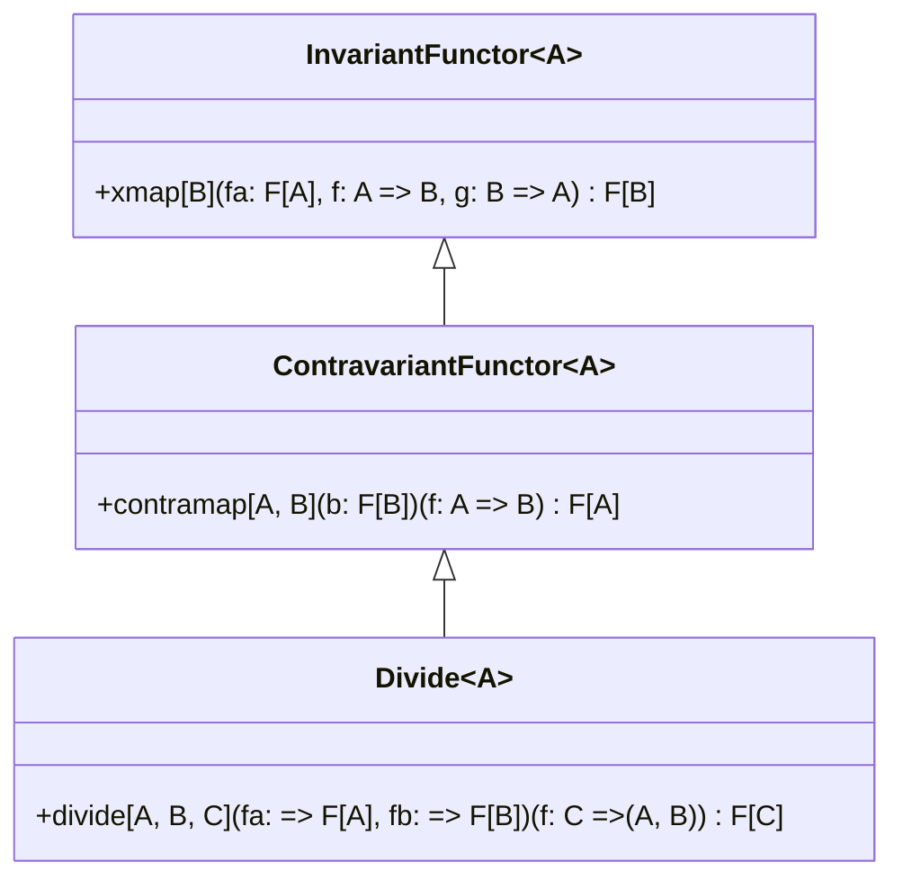



# Divide

**`Divide`** — это класс типов, который представляет собой обобщение операции, 
обратной по смыслу к [`Semigroup`](../monoid/semigroup.md) или [`Applicative`](applicative.md). 
В то время как `Semigroup` позволяет комбинировать значения (например, сложение или конкатенация), 
`Divide` позволяет "разделять" или "декомпозировать" значения.

`Divide` определяется как класс типов, который для типа `F[_]` предоставляет операцию `divide`. 
Эта операция принимает:

- Два значения типа `F[A]` и `F[B]`.
- Функцию, которая из значения типа `C` извлекает пару `(A, B)`.
- Возвращает значение типа `F[C]`.

Формально: `divide: (F[A], F[B], C => (A, B)) => F[C]`

`Divide` можно рассматривать как операцию, которая позволяет "собрать" значение типа `F[C]` 
из двух компонентов `F[A]` и `F[B]`, используя функцию, которая "разделяет" `C` на `A` и `B`.

**Примеры использования**

- **Валидация данных**:
  Если у вас есть валидаторы для полей `A` и `B`, то с помощью `Divide` можно создать 
  валидатор для составного типа `C`, который содержит оба поля.
- **Парсинг**:
  Если у вас есть парсеры для типов `A` и `B`, то `Divide` позволяет 
  создать парсер для типа `C`, который состоит из `A` и `B`.
- **Контекстные вычисления**:
  В функциональных программах, где требуется декомпозиция данных, 
  `Divide` может использоваться для работы с контекстами (например, `F[_]` может быть `Option`, `Either`, `List` и т.д.).

## Формальное определение

`Divide` - контравариантный аналог [`Apply`](apply.md). 
Он расширяет [контравариантный функтор](contravariant-functor.md) и дополнительно реализует
операцию `divide`: 

`def divide[A, B, C](fa: => F[A], fb: => F[B])(f: C => (A, B)): F[C]`

Законы `Divide`:

- Тождественность (identity): Если определен метод идентификации `id` такой, что: `id(a) == a`,
  тогда `cmap(fa)(id) == fa`.
- Композиция (composition): Если определены два метода `f: A => B` и `g: B => C`,
  тогда `cmap(cmap(fc)(g))(f) == cmap(fc)(g(f(_)))`.
- Композиция (composition): `divide(divide(fa1, fa2)(delta), fa3)(delta) == divide(fa1, divide(fa2, fa3)(delta))(delta)`,
  где `delta: A => (A, A) = a => (a, a)`.

## Код

```dotty
trait Divide[F[_]] extends ContravariantFunctor[F]:
  def divide[A, B, C](fa: => F[A], fb: => F[B])(f: C => (A, B)): F[C]

  def tuple2[A, B](fa: => F[A], fb: => F[B]): F[(A, B)] = divide(fa, fb)(identity)
```

### Законы

- Тождественность (identity): `cmap(fa)(id) == fa`.
- Композиция (composition): `cmap(cmap(fc)(g))(f) == cmap(fc)(g(f(_)))`.
- Композиция (composition): 
  ```dotty
  divide(divide(fa1, fa2)(delta), fa3)(delta) == 
  divide(fa1, divide(fa2, fa3)(delta))(delta)
  ```
  , где `delta: A => (A, A) = a => (a, a)`

## Упражнения

### Упражнение 2.12.1: Реализация Divide для функции.

> [Репозиторий с упражнениями и инструкцией по выполнению][sample]

Реализуйте экземпляр `Divide` для типа `Function1[X, R]`, предполагая, что тип `R` образует моноид.

```dotty
import ru.scalabook.typeclasses.Divide
import ru.scalabook.typeclasses.Monoid

given functionDivide[R: Monoid]: Divide[[X] =>> Function1[X, R]] with
  override def cmap[A, B](function: B => R)(f: A => B): A => R = ???
  override def divide[A, B, C](fa: => A => R, fb: => B => R)(f: C => (A, B)): C => R = ???
```

**Примеры:**

```dotty
given Monoid[Boolean] with
  val empty: Boolean = true
  def combine(a: Boolean, b: Boolean): Boolean = a && b

val isEven: Int => Boolean = (x: Int) => x % 2 == 0
val isPositive: Int => Boolean = (x: Int) => x > 0
val splitPair: Int => (Int, Int) = (x: Int) => (x, x)

val isEvenAndPositive: Int => Boolean =
  summon[Divide[[X] =>> X => Boolean]]
    .divide(isEven, isPositive)(splitPair)

isEvenAndPositive(4)  // true && true = true
isEvenAndPositive(3)  // false && true = false
isEvenAndPositive(-2) // true && false = false
```

@:note(🔍 Показать решение)

Реализация `cmap` — это обычная композиция функций: 
чтобы получить `A => R`, мы применяем `f: A => B` к входному значению, 
а затем передаём результат в исходную функцию `function: B => R`. 

Реализация `divide` использует функцию разбиения `f: C => (A, B)`, чтобы получить пару `(a, b)` из входного значения `c`. 
Затем применяет `fa` к `a` и `fb` к `b`, получая два значения типа `R`, 
которые комбинируются с помощью операции моноида для `R`. 
Обратите внимание, что параметры `fa` и `fb` передаются по имени (`=>`) для поддержки ленивых вычислений, 
что важно для некоторых типов контекстов, но для функций это не имеет значения. 
Тип `R` должен быть моноидом, чтобы существовала операция комбинирования результатов.

```dotty
given functionDivide[R: Monoid]: Divide[[X] =>> Function1[X, R]] with
  override def cmap[A, B](function: B => R)(f: A => B): A => R =
    a => function(f(a))

  override def divide[A, B, C](fa: => A => R, fb: => B => R)(f: C => (A, B)): C => R =
    c =>
      val (a, b) = f(c)
      summon[Monoid[R]].combine(fa(a), fb(b))
```

@:@

## Схема



---

**Ссылки:**

- [Ссылка на репозиторий с упражнениями][sample]
- [Scalaz API](https://javadoc.io/static/org.scalaz/scalaz-core_3/7.3.6/scalaz/Divide.html)

[sample]: https://gitverse.ru/scalabook/typeclasses
