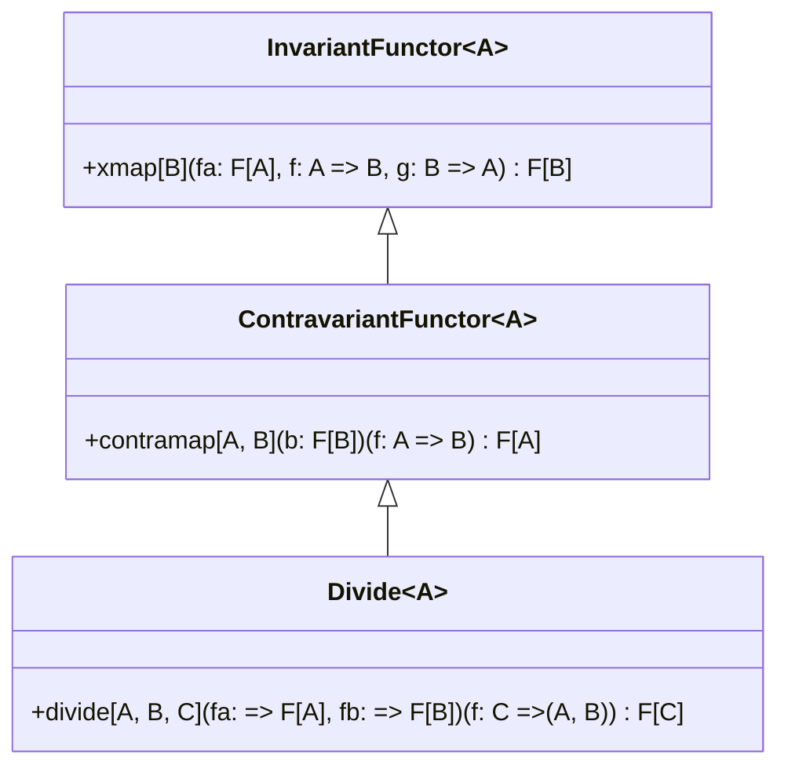

# Divide

???

## Формальное определение

`Divide` - контравариантный аналог [`Apply`](apply.md). 
Он расширяет [контравариантный функтор](contravariant-functor.md) и дополнительно реализует
операцию `divide`: 

`def divide[A, B, C](fa: => F[A], fb: => F[B])(f: C => (A, B)): F[C]`

Законы `Divide`:

- Тождественность (identity): Если определен метод идентификации `id` такой, что: `id(a) == a`,
  тогда `cmap(fa)(id) == fa`.
- Композиция (composition): Если определены два метода `f: A => B` и `g: B => C`,
  тогда `cmap(cmap(fc)(g))(f) == cmap(fc)(g(f(_)))`.
- Композиция (composition): `divide(divide(fa1, fa2)(delta), fa3)(delta) == divide(fa1, divide(fa2, fa3)(delta))(delta)`,
  где `delta: A => (A, A) = a => (a, a)`.

## Код

```dotty
trait Divide[F[_]] extends ContravariantFunctor[F]:
  def divide[A, B, C](fa: => F[A], fb: => F[B])(f: C => (A, B)): F[C]

  def tuple2[A, B](fa: => F[A], fb: => F[B]): F[(A, B)] = divide(fa, fb)(identity)
```

### Унарная функция

```dotty
given functionDivide[R: Monoid]: Divide[[X] =>> Function1[X, R]] with
  override def cmap[A, B](function: B => R)(f: A => B): A => R =
    a => function(f(a))

  override def divide[A, B, C](fa: => A => R, fb: => B => R)(f: C => (A, B)): C => R =
    c => {
      val (a, b) = f(c)
      summon[Monoid[R]].combine(fa(a), fb(b))
    }
```

### Законы

Композиция (composition):

`divide(divide(fa1, fa2)(delta), fa3)(delta) == divide(fa1, divide(fa2, fa3)(delta))(delta), где delta: A => (A, A) = a => (a, a)`

```dotty
... // Законы контравариантного функтора

def checkDivideComposition[F[_], A](
    fa1: F[A],
    fa2: F[A],
    fa3: F[A],
    a: A
)(using div: Divide[F]): ValidatedNel[String, Unit] =
  import div.*
  def delta: A => (A, A) = a => (a, a)

  Either.cond[String, Unit](
    divide(divide(fa1, fa2)(delta), fa3)(delta) ==
      divide(fa1, divide(fa2, fa3)(delta))(delta),
    (),
    "Не соблюдается Композиция Divide: divide(divide(fa1, fa2)(delta), fa3)(delta) == divide(fa1, divide(fa2, fa3)(delta))(delta), где delta: A => (A, A) = a => (a, a)"
  ).toValidatedNel
end checkDivideComposition
```

## Схема



---

**Ссылки:**

- [Scalaz API](https://javadoc.io/static/org.scalaz/scalaz-core_3/7.3.6/scalaz/Divide.html)
