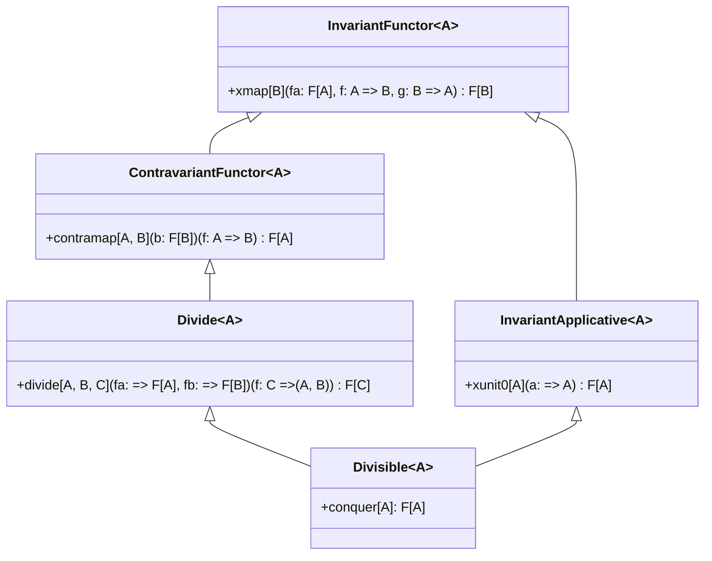

# Divisible

???

## Формальное определение

`Divisible` - контравариантный аналог [`Applicative`](applicative.md). 
Он расширяет [`Divide`](divide.md) и [`InvariantApplicative`](invariant-applicative.md).

Законы `Divisible`:

- Тождественность (identity): Если определен метод идентификации `id` такой, что: `id(a) == a`,
  тогда `cmap(fa)(id) == fa`.
- Композиция (composition): Если определены два метода `f: A => B` и `g: B => C`,
  тогда `cmap(cmap(fc)(g))(f) == cmap(fc)(g(f(_)))`.
- Композиция (composition): `divide(divide(fa1, fa2)(delta), fa3)(delta) == divide(fa1, divide(fa2, fa3)(delta))(delta)`,
  где `delta: A => (A, A) = a => (a, a)`.
- Тождественность справа (right identity): `divide(fa, conquer)(delta) == fa`.
- Тождественность слева (left identity): `divide(conquer, fa)(delta) == fa`.

## Код

```dotty
trait Divisible[F[_]] extends Divide[F], InvariantApplicative[F]:
  def conquer[A]: F[A]

  override def xunit0[A](a: => A): F[A] = conquer

  override def cmap[A, B](fb: F[B])(f: A => B): F[A] =
    divide(conquer[Unit], fb)(c => ((), f(c)))
```

### Унарная функция

```dotty
given functionDivisible[R: Monoid]: Divisible[[X] =>> Function1[X, R]] with
  override def divide[A, B, C](fa: => A => R, fb: => B => R)(f: C => (A, B)): C => R =
    c => {
      val (a, b) = f(c)
      summon[Monoid[R]].combine(fa(a), fb(b))
    }

  override def conquer[A]: A => R = _ => summon[Monoid[R]].empty
```

### Законы

Тождественность справа: `divide(fa, conquer)(delta) == fa`.
Тождественность слева: `divide(conquer, fa)(delta) == fa`.

```dotty
... // Законы Divide

def checkDivisibleRightIdentity[F[_], A](fa: F[A], a: A)(using
    div: Divisible[F]
): ValidatedNel[String, Unit] =
  import div.*
  def delta: A => (A, A) = a => (a, a)

  Either.cond[String, Unit](
    divide(fa, conquer)(delta) == fa,
    (),
    "Не соблюдается Тождественность справа: divide(fa, conquer)(delta) == fa, где delta: A => (A, A) = a => (a, a)"
  ).toValidatedNel

def checkDivisibleLeftIdentity[F[_], A](fa: F[A], a: A)(using
    div: Divisible[F]
): ValidatedNel[String, Unit] =
  import div.*
  def delta: A => (A, A) = a => (a, a)

  Either.cond[String, Unit](
    divide(conquer, fa)(delta) == fa,
    (),
    "Не соблюдается Тождественность слева: divide(conquer, fa)(delta) == fa, где delta: A => (A, A) = a => (a, a)"
  ).toValidatedNel
```

## Схема



---

**Ссылки:**

- [Scalaz API](https://javadoc.io/static/org.scalaz/scalaz-core_3/7.3.6/scalaz/Divisible.html)
